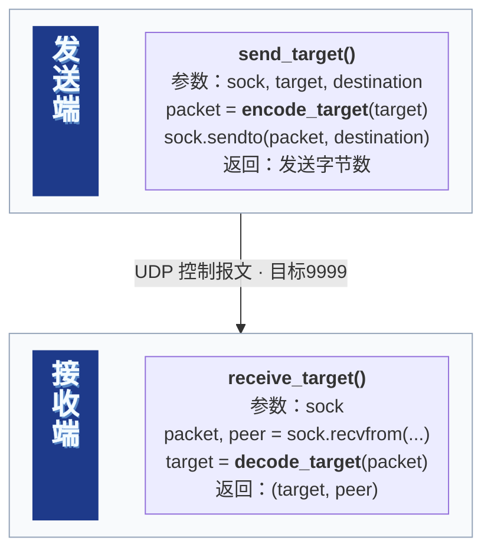
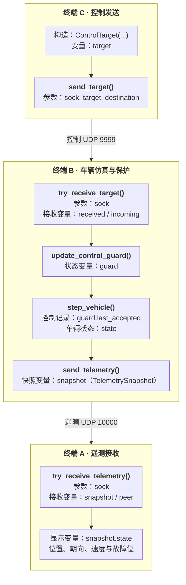
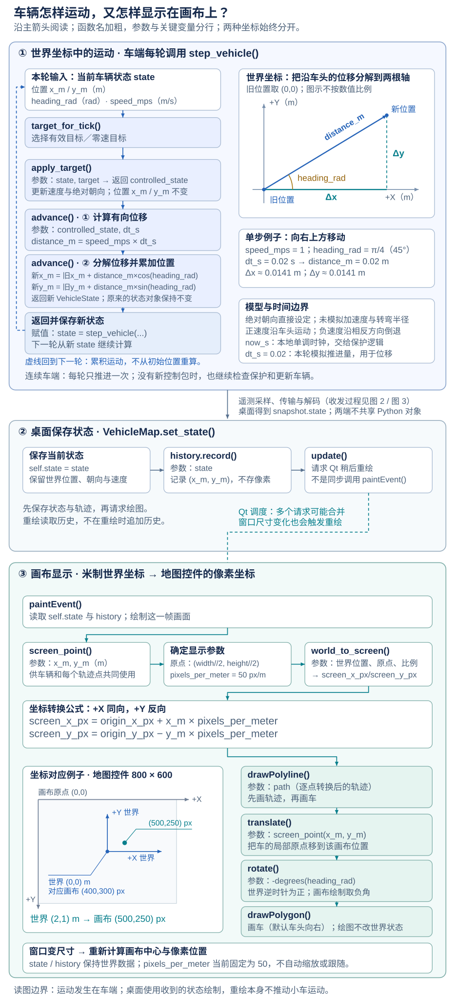
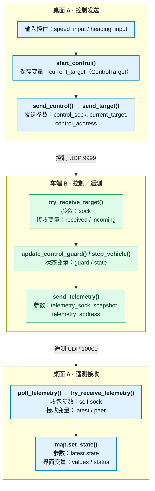
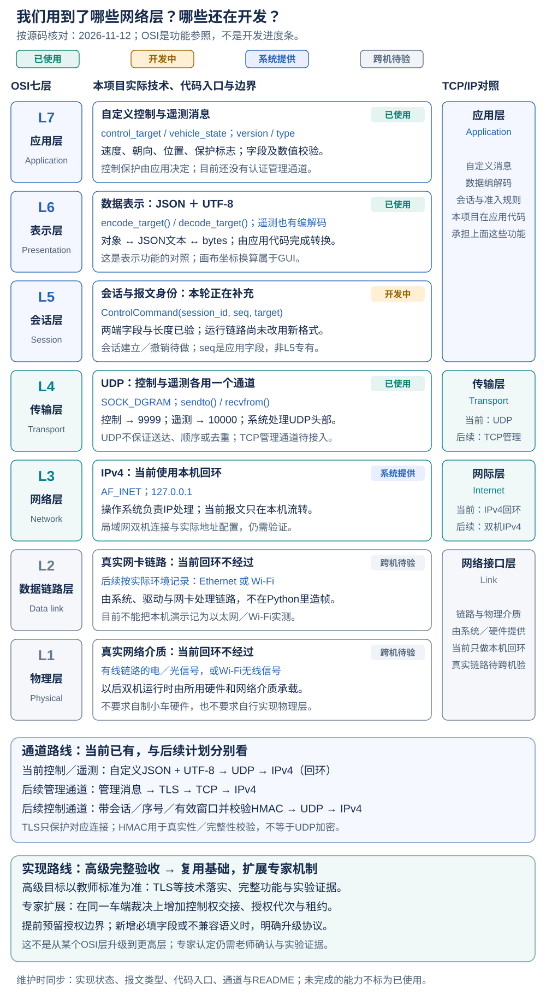

# network-programming-project

虚拟小车网络遥控 · 网络编程小组项目（MUST）。

## 1. 项目概况

### 1.1 当前功能与范围

- **运动模型**：车辆状态、单步推进、固定步长轨迹及分阶段控制。
- **网络与保护**：UDP控制与遥测、报文校验、控制超时停车和故障锁存。
- **桌面控制**：数值输入、正常停车/停发、地图与轨迹、遥测可用/过期提示。

当前是无需硬件的本机原型；控制信封、准入及会话登记/使能/关闭的纯状态操作已完成独立单元验证，尚未接入真实管理与收发；跨机、认证会话和专家机制仍待实现与接入。
最终交付目标为Windows EXE；当前仍按下文的源码方式运行，发布包尚未制作。
本页按开发顺序保留各阶段示例，当前完整桌面操作可直接看[5.1启动](#quick-start)和[5.3数值控制](#desktop-control-acceptance)。
旧示例中的A/B/C是该例自己的终端标签。

### 1.2 阅读导航

| 板块 | 内容 |
| --- | --- |
| [2. 环境准备与项目结构](#environment) | 安装、测试、目录职责与应用入口 |
| [3. 车辆运动与UDP控制](#motion-control) | 离线运动 → 单包UDP控制 → 持续运行与本地保护 |
| [4. 遥测回传](#telemetry) | 三终端运行、状态观察与图2 |
| [5. 桌面控制台](#desktop-console) | 启动与状态 → 地图/轨迹/坐标 → 数值控制与验收 → 实现要点 |
| [6. 网络分层与控制信封](#network-layers) | 各层职责、控制信封与车端准入 |
| [7. 项目配置与文档维护](#project-maintenance) | 包配置、Git协作、目录迁移与导图维护 |

<a id="environment"></a>

## 2. 环境准备与项目结构

### 2.1 运行环境

Windows PowerShell、Python 3.12；运行依赖及版本见[pyproject.toml](pyproject.toml)。
以下命令均在仓库根目录执行，使用虚拟环境中的Python，无需先激活环境。

### 2.2 创建环境与安装依赖

```powershell
py -3.12 -m venv .venv
.\.venv\Scripts\python.exe -m pip install -e .
```

这是可编辑安装：首次配置后，日常修改源码会直接生效，无需每次重新安装。

### 2.3 运行测试

```powershell
.\.venv\Scripts\python.exe -m unittest discover -s tests -t . -v
```

最近本机完整验证为124项测试通过，其中控制编解码40项、控制保护28项、桌面控制8项；下文八步人工验收另行记录，不增加单元测试计数。

### 2.4 项目结构与职责

代码按职责归类；应用入口组合公共模块，测试与教学示例分别存放。

```text
src/rover/
  __init__.py
  core/           公共状态与运动模型
  protocol/       消息格式与编解码
  transport/      网络收发
  vehicle/        车端保护与运行入口
  desktop/        窗口、地图与轨迹
tests/            自动化测试
examples/         各课独立示例
reference_image/  导图与可编辑图源
pyproject.toml    项目安装与构建配置
requirements.txt 第三方依赖清单
README.md        使用说明与原理
.gitignore       Git忽略规则
LICENSE          项目许可证
```

| 模块 | 文件与职责 |
| --- | --- |
| `core` | `vehicle_model.py`保存状态并计算单步运动；`control_target.py`定义/应用运动目标；`simulation.py`用于离线多步轨迹。 |
| `protocol` | `control_codec.py`、`telemetry_codec.py`定义控制/遥测的JSON编解码与字段校验。 |
| `transport` | `udp_transport.py`衔接编解码与Socket收发，区分空闲、坏包和系统错误。 |
| `vehicle` | `control_watchdog.py`选择有效或零速目标；`control_guard.py`管理会话状态、接受记录、首包/后续超时与控制信封准入（新入口和状态操作尚未接入运行）；`vehicle_runtime.py`组合一次受保护步进；`app.py`运行车端循环。 |
| `desktop` | `app.py`组合窗口、按钮、定时器与网络；`desktop_map.py`绘制地图；`map_geometry.py`换算坐标；`trajectory.py`保存世界轨迹。 |
| `tests` | 13个测试模块，最近完整验证124项，覆盖模型、协议、真实UDP、保护、内部会话状态与界面行为。 |
| `examples` | 8个教学示例，可单独观察离线运动、单包/周期控制、超时及命令行遥测。 |
| `reference_image` | 文档图片和生成源；当前应用画面由代码绘制，不依赖这些参考图运行。 |

`core`负责运动规则，车端`vehicle`决定何时应用什么目标；同一模型可用于离线示例和联网运行。
`protocol`负责消息怎样解释，`transport`负责消息怎样收发。目录本身不规定执行顺序，运行顺序由函数调用决定。

#### 2.4.1 两个应用入口

| 模块 | 原文件 | 作用 |
| --- | --- | --- |
| `rover.desktop.app` | `demo_desktop_console.py` | 创建桌面窗口、Socket与定时器，连接用户操作和遥测显示。 |
| `rover.vehicle.app` | `demo_udp_vehicle_loop.py` | 维护车辆/保护状态，循环收包、步进并回传遥测。 |

两个`app.py`用完整模块名区分。它们保留原程序逻辑，不是另写一套程序。
当前双终端完整命令见[5.1](#quick-start)；示例按本页命令使用`-m examples.示例名`。
单独运行测试时，例如`.\.venv\Scripts\python.exe -m unittest -v tests.test_vehicle_model`。
不要直接运行`src/`内的文件。

<a id="motion-control"></a>

## 3. 车辆运动与UDP控制

### 3.1 离线运动与分阶段控制

```powershell
.\.venv\Scripts\python.exe -m examples.demo_simulation
.\.venv\Scripts\python.exe -m examples.demo_control
```

`apply_target()`更新速度与绝对朝向，`advance()`根据步长计算新位置；
`run_steps()`重复推进并保存初始状态及每步结果。
运动公式与世界/画布坐标关系见[5.2.2运动原理图](#vehicle-motion-coordinates)。

### 3.2 单包UDP控制

#### 3.2.1 同机单包UDP收发

本例终端A是接收端，终端B是发送端。先在A运行：

```powershell
.\.venv\Scripts\python.exe -m examples.demo_udp_receiver
```

看到`waiting for UDP`后，在B运行：

```powershell
.\.venv\Scripts\python.exe -m examples.demo_udp_sender
```

接收端应打印来源地址及`ControlTarget(speed_mps=2.0, heading_rad=0.5)`。
接收端绑定`127.0.0.1:9999`，发送端绑定端口`0`，由系统分配临时源端口。
两端打印的来源端口应一致；发送字节数仅表示本机发送结果，不是接收确认。

接收端处理一条消息后退出；再次演示须先重启接收端，等待时可按`Ctrl+C`结束。

<a id="single-udp-flow"></a>

#### 3.2.2 图1：一条控制消息怎样到达接收端

`packet`由`recvfrom()`从Socket接收队列取得，`peer`是来源地址；再由`decode_target()`校验和还原。



对应源码：[发送](examples/demo_udp_sender.py)、[接收](examples/demo_udp_receiver.py)、[UDP收发](src/rover/transport/udp_transport.py)、[控制编解码](src/rover/protocol/control_codec.py)。

#### 3.2.3 UDP目标驱动车辆模型

先在终端A运行：

```powershell
.\.venv\Scripts\python.exe -m examples.demo_udp_vehicle
```

再在终端B运行`-m examples.demo_udp_sender`，完整命令见3.2.1。初始位置由接收端的`VehicleState()`创建；
发送端只提供目标速度和朝向。

接收目标后以`0.02 s`推进50步，即1秒模拟时间，轨迹含初始帧共51个状态：

```text
states=51
start: x=0.0000m y=0.0000m
end: sim_t=1.00s x=1.7552m y=0.9589m
```

这是收到一条消息后的离线计算，1秒模拟时间可以很快算完。

### 3.3 持续控制与车端保护

#### 3.3.1 控制超时与定时运行

```powershell
.\.venv\Scripts\python.exe -m examples.demo_watchdog_loop
```

脚本构造一次`2.0 m/s、0 rad`目标，以`0.02 s`模拟步长运行；
约0.5秒后停车，约1秒后结束，停车后坐标不变。

| 时间变量 | 用途 |
| --- | --- |
| `accepted_at_s` | 最后接受有效控制的时刻，用于判断控制超时 |
| `started_at_s` | 程序启动时刻，用于计算总运行时长 |
| `wall_t` / `sim_t` | 实际经过时间 / 累计模拟时间；两者可能因调度不同 |

#### 3.3.2 持续接收、周期控制与故障锁存

先在终端A启动持续车端：

```powershell
.\.venv\Scripts\python.exe -m rover.vehicle.app
```

在终端B选择一种发送方式。单条目标用于观察接受一次后的超时停车：

```powershell
.\.venv\Scripts\python.exe -m examples.demo_udp_sender
```

周期目标每约0.1秒一条，共20条：

```powershell
.\.venv\Scripts\python.exe -m examples.demo_udp_stream_sender
```

比较两种方式时先重启车端，清除上一轮锁存。观察重点：

1. 首次目标被`accepted`后开始运动；新有效目标刷新接受时间。
2. 距最后接受已达0.5秒时停车并设置`fault_latched=True`；重发普通目标显示`ignored`，不能解除锁存。
3. 无包时返回`None`，坏包抛出`ValueError`并打印`rejected`；保护与仿真仍继续。车端每轮只推进一次。
4. `wall_t`包含首次控制前的等待；日志在本轮推进后打印，因此首条接受记录的坐标可能已非零。

发送日志的`1/20`表示发送进度，不是协议序号。车端用`Ctrl+C`退出。
本页时刻均受系统调度影响，不要求恰好在某个毫秒或固定终点停车。

<a id="telemetry"></a>

## 4. 遥测回传

### 4.1 三终端启动

三个终端按以下顺序启动，先结束旧车端和旧接收器：

| 终端 | 职责 | 命令 |
| --- | --- | --- |
| A | 接收遥测 | `.\.venv\Scripts\python.exe -m examples.demo_udp_telemetry_receiver` |
| B | 车辆仿真 | `.\.venv\Scripts\python.exe -m rover.vehicle.app` |
| C | 周期控制 | `.\.venv\Scripts\python.exe -m examples.demo_udp_stream_sender` |

C向B的`127.0.0.1:9999`发控制；B使用另一个Socket向A的`127.0.0.1:10000`回传实际位置、朝向、速度和故障标志。

### 4.2 观察与核对

- 首次控制前为原点、零速、未锁定；从未接受控制时，等待本身不触发当前锁存。
- C发送期间位置变化；C结束后B超时停车，A继续收到零速、已锁定状态。再次发送仍应被忽略。
- 保持B运行，只重启A，可以再次收到当前状态；若B已退出，只重启A会等待。
- B每次启动创建新的原点状态；显示端重启不清除车端故障。
- 遥测目标周期为`0.05 s`，终端A日志限速，不能用显示行数推算发送频率；遥测发送失败不停止车端保护循环。

无包`None`不代表全零状态；坏报文已被取出并抛出`ValueError`，程序可以继续处理后续报文。
命令行接收器没有过期提示，桌面窗口的过期提示见第5节。

<a id="three-terminal-flow"></a>

### 4.3 图2：三个终端怎样控制并回传状态

按C → B → A阅读；加粗为函数名，参数与变量分行，跨端箭头标明通道和端口。



A看到的`peer`属于车端遥测Socket，与C的控制来源端口不同。
对应源码：[车辆运行环](src/rover/vehicle/app.py)、[保护状态](src/rover/vehicle/control_guard.py)、[遥测编解码](src/rover/protocol/telemetry_codec.py)。

<a id="desktop-console"></a>

## 5. 桌面控制台

<a id="quick-start"></a>

### 5.1 启动与状态显示

桌面A接替上一节的遥测A和发送C，当前完整操作只需A＋B。
先退出旧程序，避免端口冲突及多个控制源覆盖目标。

终端A打开桌面：

```powershell
.\.venv\Scripts\python.exe -m rover.desktop.app
```

终端B在另一个终端运行车端：

```powershell
.\.venv\Scripts\python.exe -m rover.vehicle.app
```

只启动A时显示“等待遥测”，没有车辆；B启动后出现原点车辆并显示“遥测可用”。
约1秒无合法遥测后提示“遥测过期”，保留最后车辆、轨迹和读数；它们此时仅代表最后收到的状态。

`status`表示遥测情况，`fault_latched`来自车端保护，`control_status`表示本地发送情况，三者独立。
当前地址固定为本机回环，跨机配置尚未接入。

### 5.2 地图、轨迹与坐标

#### 5.2.1 地图与运行轨迹

`TrajectoryHistory`保存最多1000个世界坐标位置，只跳过相邻重复；A→B→A仍保留。
每个合法遥测包都保存位置，重绘只读历史；窗口变尺寸后重新换算像素，原始位置不变。

绘制时先画轨迹，再平移和旋转车头，避免整条轨迹跟着车辆转动。
地图目前固定比例，超出视野时车辆会被裁切；平移、缩放和跟随后续完善。

<a id="vehicle-motion-coordinates"></a>

#### 5.2.2 车辆运动与画布坐标

沿图阅读：车端推进世界状态 → 按期限采样并回传遥测 → 桌面逐包保存 → Qt读取缓存并绘制。
`poll_telemetry()`对每个合法包调用`map.set_state(latest.state)`；后者依次保存最新状态、按规则维护世界轨迹、请求重绘。
侧栏只取本轮最后一个合法快照；多个重绘请求可能合并，因此收包、记录轨迹与绘图不是一一对应。[Qt重绘调度说明](https://doc.qt.io/qt-6/qwidget.html#update)

蓝色实线表示调用/执行顺序，灰线表示数据保存/读取，青色虚线表示Qt稍后调度。
世界位置用米、朝向用弧度；画布原点在左上，世界原点映射到地图中心。
`screen_point()`调用`world_to_screen()`执行公式，再将返回像素二元组包装成`QPointF`；轨迹与车辆位置分别复用此换算。
世界+Y向上、画布+Y向下，因此像素Y和绘制角度需转换；重绘只读缓存，不推进车辆或追加轨迹。

[](reference_image/diagrams/04-vehicle-motion.svg)

[可缩放SVG](reference_image/diagrams/04-vehicle-motion.svg) · [高清PNG](reference_image/diagrams/04-vehicle-motion.png)

对应源码：[运动模型](src/rover/core/vehicle_model.py)、[应用目标](src/rover/core/control_target.py)、[运行组合](src/rover/vehicle/vehicle_runtime.py)、[坐标换算](src/rover/desktop/map_geometry.py)、[地图绘制](src/rover/desktop/desktop_map.py)。

<a id="desktop-control-acceptance"></a>

### 5.3 数值控制与八步验收

输入朝向使用度，发送前转为弧度；只编辑输入不会改变已应用目标。

| 操作 | 行为 |
| --- | --- |
| 开始／应用 | 保存当前输入，立即发送并继续周期发送 |
| 正常停车 | 正在发送时改发零速目标，保留已应用朝向；未发送或已停发时不启动发送 |
| 停止发包 | 停止控制发送，遥测接收继续；车端按最后有效控制计时停车 |
| 关闭 | A用窗口“×”，B在终端按Ctrl+C |

2026-11-11用户已完成以下真实A＋B验收：

| 步骤 | 操作与已确认结果 |
| --- | --- |
| 1 | 只有A时等待；B启动后原点车辆、遥测可用、未锁定。 |
| 2 | 设1.0 m/s、45°并应用，车辆向右上移动，朝向显示约0.785 rad。 |
| 3 | 正常停车，速度为0、位置保持；保护未锁定，遥测仍可用。 |
| 4 | 重新设1.0 m/s、0°并应用，车辆恢复向右运动。 |
| 5 | 停止发包，距最后接受控制约0.5秒后停车锁存，遥测仍可用。 |
| 6 | 锁定后重新应用，B打印ignored，位置不变；随后停止发包。 |
| 7 | 结束B，约1秒后A提示遥测过期，车辆、轨迹和最后读数保留。 |
| 8 | 关闭旧A/B后重启，端口正常释放，新车端原点等待，桌面不自动发送。 |

故障锁存后，普通目标及正常停车都不能解除锁存。
重新演示应先退出旧A再重启B，避免旧A的周期目标被新车端接受。
当前A的Ctrl+C可能只打印异常而不退出，请用窗口“×”；正式会话与重连未使能机制后续接入。

<a id="desktop-ui-flow"></a>

#### 5.3.1 图3：桌面数值控制与遥测关系

按A发送 → B计算并回传 → A显示阅读；上下两个A属于同一个桌面进程。



### 5.4 关键实现要点

#### 5.4.1 三种数据

| 数据 | 变量 | 改变时机 |
| --- | --- | --- |
| 输入草稿 | `speed_input / heading_input` | 编辑数值时改变 |
| 已应用目标 | `current_target` | 点击应用，或正在发送时执行正常停车 |
| 实际状态 | `state / latest.state / map.state` | 车端推进后回传，桌面使用收到的状态绘图 |

`sent`只是本机发送字节数，不是车端接收或执行确认。

#### 5.4.2 两个定时器与两个Socket

| 对象 | 配置与职责 |
| --- | --- |
| `self.timer` | 初始化启动，约20ms轮询遥测；每轮最多8次接收尝试 |
| `self.control_timer` | 初始不启动；应用后约100ms发送一次已应用目标 |
| `self.sock` | 监听本机10000端口，接收遥测 |
| `self.control_sock` | 使用临时源端口，向车端9999端口发送控制 |

`start_control()`先保存目标、启动控制定时器，再立即首发，因为`send_control()`会检查定时器是否活动。
收到合法遥测才刷新`last_received_s`；无包或坏包都不延长有效显示时间。

#### 5.4.3 FakeSocket测试

- 替换发生在创建窗口前，因此窗口的网络对象变为`FakeSocket`；Qt控件、信号、目标构造与JSON编码仍真实执行。
- `control("speed_input")`通过`getattr(window, ...)`读取窗口属性；它不在按钮内部寻找或创建输入框。
- `click()`触发真实信号并调用业务函数，`FakeSocket.sendto()`记录报文与地址供断言检查。
- `timeout.emit()`只手动调用一次回调，不证明实际经过100ms；真实UDP由传输测试和双进程联调验证。

对应源码：[桌面窗口](src/rover/desktop/app.py)、[桌面测试](tests/test_desktop_control.py)、[轨迹历史](src/rover/desktop/trajectory.py)、[UDP传输](src/rover/transport/udp_transport.py)。

<a id="network-layers"></a>

## 6. 网络分层与控制信封

### 6.1 图5：各层实际用了什么

OSI七层用于理解职责，TCP/IP用于描述本项目采用的实际通信结构。
本项目在应用代码中承担消息语义、数据表示和会话管理功能；不能把写了`session_id`直接当作独立实现了OSI的L5。[分层与应用内会话功能的说明](https://docs.oracle.com/cd/E19504-01/802-5886/intro-45828/index.html)。
下图对照2026-11-13源码，区分已使用、开发中、系统提供及跨机待验；功能变化时同步修订。

[](reference_image/diagrams/05-network-layers.svg)

[可缩放SVG](reference_image/diagrams/05-network-layers.svg) · [高清PNG](reference_image/diagrams/05-network-layers.png)

当前载荷是**自定义消息 → JSON文本 → UTF-8字节**，再由UDP/IPv4承载。
`sendto(packet, address)`中的IP与端口交给操作系统处理，不是编码器写进JSON的字段。
UDP不保证送达、顺序或去重；`127.0.0.1`只在本机流转，不作为已完成局域网实验的证据。[UDP标准](https://www.rfc-editor.org/rfc/rfc768.html)、[主机回环规定](https://www.rfc-editor.org/rfc/rfc1122.html#section-3.2.1.3)。

### 6.2 已完成的工作怎样归类

| 前面完成的内容 | 在系统中的作用与关键入口 |
| --- | --- |
| 车辆状态、目标与步进 | `VehicleState`、`apply_target()`、`advance()`提供运动计算，本身不是网络协议。 |
| 控制与遥测编解码 | `encode_target()/decode_target()`、`encode_telemetry()/decode_telemetry()`定义应用消息并转换数据表示。 |
| UDP收发与非阻塞接收 | `send_target()`、`try_receive_target()`及遥测对应函数使用系统Socket；无包、坏包与系统错误分别处理。 |
| 超时停车与故障锁存 | `AcceptedTarget`、`update_control_guard()`、`step_vehicle()`执行本地保护，不代表已完成认证会话。 |
| 内部会话状态操作 | `open_control_session()`、`enable_control_session()`、`close_control_session()`维护登记、使能和关闭后的状态，属于应用内状态规则，尚未连接真实管理通道。 |
| 桌面显示与周期控制 | `start_control()`、`send_control()`、`poll_telemetry()`组合两条UDP方向；`world_to_screen()`是GUI坐标换算。 |

### 6.3 控制信封与车端准入

`ControlCommand(session_id, seq, target)`复用现有`control_codec.py`，把会话标识、报文序号与运动目标组合起来。

#### 6.3.1 报文格式与编解码

最近通过的控制编解码基线为40项（旧格式19项、新格式21项），涵盖合法编解码、倒车往返、两端元数据/运动值校验、两端1200字节边界、解析前拒绝超限、严格版本类型及新旧格式互拒；完整项目回归已通过。

新解码器先检查原始`bytes`长度，再进行UTF-8解码和JSON解析：超限已违反约定，无需再创建字符串与对象。限制按字节而非字符或字典字段数计算；先解析再检查仍能判定长度，但解析开销已经发生。超限且同时无法解析时，优先报告长度错误。

当前新格式的JSON载荷示例：

```json
{
  "version": 1,
  "type": "control_command",
  "session_id": "session-a",
  "seq": 12,
  "speed_mps": 2.0,
  "heading_rad": 0.5
}
```

格式要求：版本为整数1，类型为`control_command`；会话标识为非空且非纯空白字符串；序号为非负整数，布尔值不作为整数接受；运动值须为可表示成有限float的int/float。整条UTF-8载荷最多1200字节。

- `session_id`区分哪次控制会话，不是密码或源端口；内部登记、使能和关闭操作见6.3.3。
- `seq`对同一会话中的新报文递增，即使目标值相同。它为后续重复/乱序判断提供依据，不要求保存或执行每一条；序号较大也不等于报文足够新鲜；比较须结合已确认有效的所属会话，不能把不同会话的序号混用。

<a id="control-admission"></a>

#### 6.3.2 车端准入与超时保护

`control_guard.py`新增`update_command_guard()`，对解码后的`ControlCommand`判断是否接受；它不收包，也不推进车辆位置。

| 车端状态字段 | 含义 |
| --- | --- |
| `session_id` | 车端当前登记的会话；由内部状态操作或测试构造，真实管理流程尚未接入。 |
| `enabled` | 是否明确允许控制，默认`False`；已使能也可以接受合法零速目标，不表示必须运动。 |
| `enabled_at_s` | 本次使能的车端单调时刻；首条有效命令被接受前的超时起点，重复使能不刷新。 |
| `last_seq` | 最后实际接受的序号；`None`表示尚无历史，`0`是有效序号。 |
| `last_accepted` | 当前可执行的目标与本地接受时刻；`None`表示当前没有有效执行记录。 |
| `fault_latched` | 故障是否锁存；普通新命令不能解除锁存，单独打开使能位也不能绕过。 |

新入口按以下顺序处理：

1. 调用`update_control_guard(guard, now_s=now_s)`复用保护检查，省略`incoming`，不提前接受命令。已有锁存直接返回；否则先选计时起点：已有`last_accepted`时用`accepted_at_s`，否则已使能时用`enabled_at_s`；未使能且没有接受记录时正常等待，不计时。
2. 已使能却没有任何计时起点，或`now_s - 起点 >= 0.5 s`时，先锁存故障、撤销使能并清空`last_accepted`，保留会话、序号及使能起点，然后返回；同一轮到达的新命令也不能刷新到期记录。
3. 保护通过后，检查有无新命令、是否使能、会话是否匹配、序号是否比本会话最后接受的大。允许跳号，拒绝重复或倒退；使能只是准入条件之一。
4. 全部通过后才创建`AcceptedTarget`，用`replace()`同时保存目标、`accepted_at_s`与`last_seq`。首包之后改用接受时刻计时；被拒绝的命令不刷新记录。

`enabled_at_s`和`accepted_at_s`保存发生事件时的车端单调时刻，`now_s`是每次调用传入的当前检查时刻，不是状态字段；运行时须使用同一单调时钟。`0.0`是合法时刻，应以`is None`判断有无起点；首次检查已越过期限也会锁存。

`incoming=None`只表示本轮没有新命令，未超时时旧目标仍有效；`last_accepted=None`表示当前没有可执行记录，可能仍在等待首包。车辆执行层的`target_for_tick()`此时选择零速目标。若已使能、没有接受记录且`enabled_at_s=None`，则属于上面的缺失起点情况。

#### 6.3.3 会话登记、使能与关闭

以下是供可信管理上下文调用的内部纯状态接口，不收发报文，也不完成认证；`session_id`匹配只表示与当前登记一致。

| 操作 | 条件与状态转换 | 重复或不匹配时 |
| --- | --- | --- |
| `open_control_session(guard, session_id)` | 登记会话ID，保留其余状态；从初始或已关闭状态打开时仍未使能，不生成目标，也不解除故障。 | 同ID重复调用状态值不变；已有其他ID时抛出`ValueError`，不能覆盖。 |
| `enable_control_session(guard, now_s)` | 必须已有会话且未锁存故障；设置`enabled=True`和`enabled_at_s=now_s`，不创建接受记录，尚无目标时开始等待首包。 | 缺少会话或已有故障时抛出`ValueError`；重复使能保留原起点和控制记录。 |
| `close_control_session(guard, session_id)` | 清空会话、目标、序号和使能起点，撤销使能，保留`fault_latched`。 | 当前登记为其他ID时抛出`ValueError`；已关闭时重复调用，关闭后的状态值不变。 |

因此，关闭A再打开B后，B必须重新使能才能接受自己的`seq=0`；A的旧包在关闭后、B未使能及已使能时都不能恢复控制。

状态为不可变数据；`replace()`返回新状态，调用方须采用并继续传递返回值，例如`guard = close_control_session(guard, session_id="session-a")`。测试保留`before`用于比较原状态未变；它是旧快照，不是另一个待关闭的资源。

控制保护模块28项测试按职责独立组织：旧目标入口3项、控制信封准入8项、内部会话状态17项。覆盖序号0及跳号、未使能/错会话/重复乱序拒绝、无包未到期、故障优先、登记/使能/关闭的拒绝与幂等、首包到期、接受后切换计时起点、缺失起点，以及关闭A后重新使能B的完整状态链路。
对应源码：[准入与保护](src/rover/vehicle/control_guard.py)、[保护测试](tests/test_control_guard.py)、[有效目标选择](src/rover/vehicle/control_watchdog.py)。

#### 6.3.4 当前接入范围与后续升级

新格式、严格准入及内部会话状态操作尚未接入真实管理与UDP收发链路。实际运行仍使用原`control_target`和`vehicle_state`消息；车端`app.py`仍调用`try_receive_target()`与旧入口`update_control_guard()`。两个接受入口是迁移过渡，后续切换正式收发时统一严格准入入口，继续复用公共保护逻辑。

当前完成的是内部会话生命周期与首包/后续超时的纯状态基础；真实管理侧的会话建立/撤销、显式使能流程、身份认证、车端有效窗口、HMAC及TCP/TLS管理通道仍待实现与接入，正式故障复位也尚未实现。

- 先按教师高级标准完成基础版本：以TLS握手/证书校验等对应高级参考的技术能力为依据，结合跨机闭环、保护及实验验证。专家阶段复用基础，扩展控制权交接、授权代次与租约；不是从OSI某层升级到另一层。

新增不兼容的必填字段或授权语义时，应明确调整消息类型或协议版本，并让校验与HMAC覆盖新内容。
TLS只保护对应的TCP管理连接，不自动保护UDP；HMAC校验真实性/完整性，不提供加密保密性。
具体实现按已约定计划推进，图中的后续项不作为已实现功能；目标是达到教师认可的高级/专家标准；A01—A10仅是实现与验证的拆解，不能代替评分标准或保证定档。

<a id="project-maintenance"></a>

## 7. 项目配置与文档维护

### 7.1 项目安装配置

#### 7.1.1 为什么现在增加pyproject.toml

早期所有脚本在根目录，直接运行脚本时Python可以找到同目录的其他模块，因此当时没有项目安装配置。
本次采用`src/rover`包布局，通过[pyproject.toml](pyproject.toml)声明源码位置、依赖和构建方式，统一两端的导入与启动。
这项配置服务于当前包布局，并非所有Python脚本都必须有它。[Python包布局说明](https://packaging.python.org/en/latest/discussions/src-layout-vs-flat-layout/)

| 配置 | 本项目含义 |
| --- | --- |
| `[build-system]` | 使用`setuptools.build_meta`构建，构建工具要求`setuptools>=64`。 |
| `[project]`的`name`、`version` | 安装名称`dsnet-rover`，当前项目版本`0.1.0`；版本号不表示完成百分比。 |
| `description`、`readme` | 简介及用于项目说明的README文件。 |
| `requires-python` | 声明Python最低版本3.12；目前实际验证环境为3.12。 |
| `dependencies` | 运行依赖为`PySide6==6.12.0`，与构建工具依赖分开。 |
| `[tool.setuptools.packages.find]` | 从`src`收集`rover`及全部子包；测试、示例和参考图不作为应用包收集。 |

`dsnet-rover`是安装名称，`rover`是代码导入名称，`src`是源码存放区。
例如`from rover.core.vehicle_model import VehicleState`，导入名称不包含`src`。

#### 7.1.2 可编辑安装与依赖清单

2.2中的`pip install -e .`表示将当前项目以可编辑方式安装到所用Python环境，同时处理项目声明的依赖。
修改现有源码后，下次运行直接使用修改；调整依赖或安装配置后，应重新执行安装命令。
`-m rover.desktop.app`会按包路径找到模块，以主程序方式执行并进入其`main()`。[pip本地安装说明](https://pip.pypa.io/en/stable/topics/local-project-installs/)

[requirements.txt](requirements.txt)继续保留第三方依赖清单；两处目前均固定PySide6 6.12.0，修改依赖时须同步。
只执行`pip install -r requirements.txt`会安装第三方库，不能替代本项目的包安装。
当前可编辑安装及wheel构建均依赖Python环境，最终独立Windows EXE仍需单独制作。

#### 7.1.3 空的__init__.py为什么也要提交

`rover`及五个子包、`tests`、`examples`各有一个空`__init__.py`，共8个。
它们明确本项目采用的普通Python包边界，支持完整包导入、测试定位和示例模块启动。
这些是源码文件，应提交；不需要往里面填`main()`，窗口和Socket仍由应用入口创建。

### 7.2 Git协作与目录迁移

| 提交到仓库 | 用途 |
| --- | --- |
| `src/rover/`，含全部`__init__.py` | 应用源码与包结构 |
| `tests/`、`examples/` | 验证与教学复现 |
| `pyproject.toml`、`requirements.txt` | 项目安装配置与依赖版本 |
| `.gitignore`、`README.md`、`LICENSE` | 忽略规则、说明与许可证 |
| `reference_image/`中的所需图片/图源 | README配图及后续修改依据 |

本机环境、缓存和构建产物按`.gitignore`排除；队友从源码与配置重新生成自己的环境。
个人本地环境笔记按`.gitignore`排除；本页只保留组员复现所需信息。

迁移作为原仓库的新提交处理：先核对文件移动、修改、图片改名/删除，再在功能分支暂存并审查、提交、推送，按PR流程合入`main`。
旧路径会退出新版本，新路径进入新版本；仓库地址和历史提交保留，不用重新创建仓库。
队友拉取迁移后的版本后，先按2.2在自己的虚拟环境执行可编辑安装，再使用新的模块入口启动。
暂存时需要同时覆盖新路径与旧路径删除记录；`git add -A -- <已核对的路径>`可记录对应新增、修改和删除。[Git暂存说明](https://git-scm.com/docs/git-add)

<a id="diagram-maintenance"></a>

### 7.3 导图维护

#### 7.3.1 Mermaid图

图1—图3保留为正文中的可编辑Mermaid代码块。
函数名加粗，参数/变量分行；节点ID只负责连线，不必与Python变量同名。
改名或移动图时同步检查正文引用，避免箭头标签挤到边框。

#### 7.3.2 SVG导图与生成源

图4的[运动与坐标生成源](reference_image/diagrams/render_vehicle_motion.py)、图5的[网络分层生成源](reference_image/diagrams/render_network_layers.py)包含可修改的文字、变量名及布局。
使用项目已有PySide6，在仓库根目录运行：

```powershell
.\.venv\Scripts\python.exe reference_image/diagrams/render_vehicle_motion.py
.\.venv\Scripts\python.exe reference_image/diagrams/render_network_layers.py
```

两个命令各自更新对应的SVG与高清PNG，输出到生成源所在目录。图5复用同目录图4生成源的绘图工具，须一并保留；运行图5命令不会重绘图4。README使用相对链接，图的位置和资源目录均可调整。

新增协议能力时，同步修订图5的核对日期、各层状态、报文类型和通道说明；以实际接入与验证结果标记进展。安全机制不硬塞到单个OSI层，未做的跨机实验也不写成已完成。

功能或文件职责变化时，先更新可复用的已有模块与说明，职责确实不同时再新增。同步修订受影响的函数/变量名、调用关系、README运行命令和图源，必要时重新导出SVG/PNG；过时内容合并或删改，保留已验证的历史示例时明确其适用阶段。
