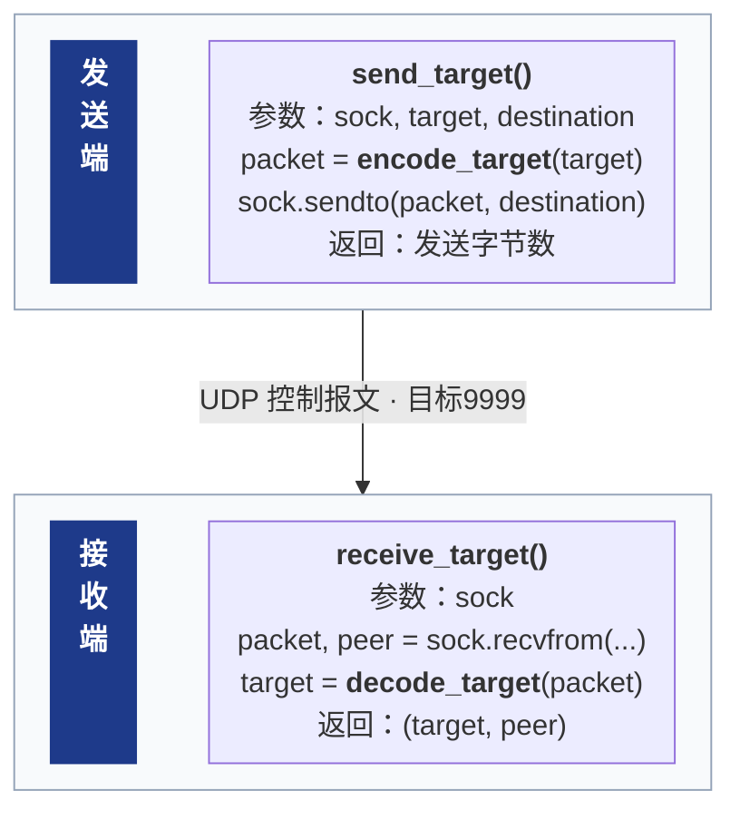
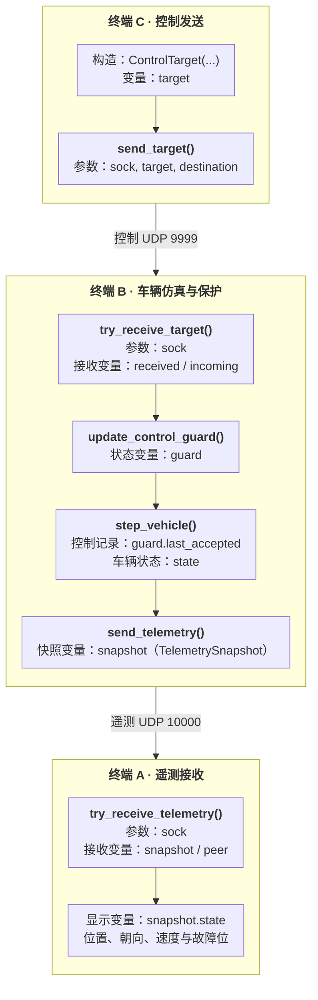
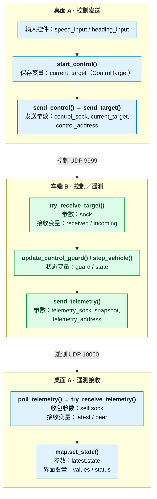

# network-programming-project
Group project for Network Programming (MUST).

## 当前可运行内容

- 离线车辆运动与分阶段控制演示。
- 控制目标的 JSON 编解码与输入校验。
- 同一台电脑上，两个独立进程通过 UDP 传递控制目标。
- 本地控制超时保护与按真实时间节奏运行的车辆演示。
- 同机持续 UDP 车辆演示：非阻塞接收、超时停车、故障锁存后忽略普通控制。
- 实际车辆状态与故障标志的 JSON 编解码、UDP 传输及独立接收端显示。
- PySide6桌面遥测观察台：地图位置与朝向、有界运行轨迹、状态读数，以及等待/可用/过期提示。
- 桌面数值控制输入与“开始／应用”、正常停车、停止发包及发送异常隔离；桌面控制8项自动测试及真实A+B双进程验收通过。

## 阅读导航

- [单包UDP收发与图1](#single-udp-flow)
- [三终端控制、遥测与图2](#three-terminal-flow)
- [桌面数值控制与图3](#desktop-ui-flow)

三张导图分别放在对应的正文旁，图源保留为可编辑的Mermaid代码块。

## 运行环境

Windows PowerShell、Python 3.12。终端演示和核心模型使用 Python 标准库；
桌面界面开发使用 PySide6，版本记录在 `requirements.txt`。

以下命令均在仓库根目录执行。

## 创建环境与运行测试

首次使用时创建虚拟环境：

```powershell
py -3.12 -m venv .venv
```

安装桌面界面依赖：

```powershell
.\.venv\Scripts\python.exe -m pip install -r requirements.txt
```

运行测试：

```powershell
.\.venv\Scripts\python.exe -m unittest -v
```

当前共 78 项测试，通过时显示 `OK`。运行演示另按下文进行多终端验收。

## 离线演示

```powershell
.\.venv\Scripts\python.exe demo_simulation.py
.\.venv\Scripts\python.exe demo_control.py
```

## 同机 UDP 收发演示

打开两个终端，分别进入仓库根目录。

终端 A 先启动接收端：

```powershell
.\.venv\Scripts\python.exe demo_udp_receiver.py
```

看到 `waiting for UDP` 后保持运行，在终端 B 启动发送端：

```powershell
.\.venv\Scripts\python.exe demo_udp_sender.py
```

发送端会打印发送字节数、来源地址和目标地址。接收端应打印来源地址，以及：

```text
ControlTarget(speed_mps=2.0, heading_rad=0.5)
```

接收端绑定 `127.0.0.1:9999`；发送端绑定端口 `0`，
由操作系统分配临时源端口。两端打印的来源端口应一致。

`127.0.0.1` 用于同一台电脑内通信。接收端收到一条消息后退出；
再次演示时，先重新启动接收端。等待期间可按 `Ctrl+C` 结束。

<a id="single-udp-flow"></a>

### 图 1：一条控制消息怎样到达接收端

左侧深色竖条顶格标明发送端／接收端；右侧集中列出函数、参数与关键变量。每端只保留一个内容框，减少外框留白。



- 从上到下只看一条主线：目标对象 → 编码字节 → UDP 发送与接收 → 还原目标对象。
- 发送端绑定临时来源端口；接收端先绑定 `address = ("127.0.0.1", 9999)` 并等待。`destination` 对应该接收地址。
- `packet` 是 UTF-8 JSON 载荷字节；`peer` 是 Socket 返回的来源地址，不是 JSON 里的字段。
- 此图对应单包演示的阻塞接收。`sent` 是本机发送字节数，不是接收确认；当前演示没有回包。

对应源码：[发送演示](demo_udp_sender.py)、[接收演示](demo_udp_receiver.py)、
[收发函数](udp_transport.py)、[控制编解码](control_codec.py)。

## UDP 控制目标驱动车辆模型

两个终端均进入仓库根目录。

终端 A 启动车辆演示接收端：

```powershell
.\.venv\Scripts\python.exe demo_udp_vehicle.py
```

看到等待提示后，终端 B 运行发送端：

```powershell
.\.venv\Scripts\python.exe demo_udp_sender.py
```

初始车辆状态由接收端通过 `VehicleState()` 创建，位置位于原点。
发送端提供目标速度与绝对朝向。

应用目标后，以 `0.02` 秒为步长推进 50 步，共 1 秒模拟时间；
轨迹包含初始时刻，共 51 个状态。

发送速度 `2.0 m/s`、朝向 `0.5 rad` 时，关键输出为：

```text
states=51
start: x=0.0000m y=0.0000m
end: sim_t=1.00s x=1.7552m y=0.9589m
```

这是收到一条消息后的离线模拟，1 秒模拟时间可以很快计算完成。

## 控制超时与定时运行演示

在一个终端中运行：

```powershell
.\.venv\Scripts\python.exe demo_watchdog_loop.py
```

脚本在启动时构造一次速度为 `2.0 m/s`、朝向为 `0 rad` 的已接受目标，
随后以 `0.02 s` 固定模拟步长循环更新车辆，并使用单调时钟计时与等待。
控制记录不再更新时，第一次检查到距接受时刻已达 `0.5 s` 就返回停车目标；
约 `1 s` 后结束演示。输出包括速度变化及最终位置。

- `accepted_at_s` 记录最后一次接受有效控制的时刻，决定控制是否超时。
- `started_at_s` 记录演示启动时刻，决定是否达到总演示时长。
- `wall_t` 是实际经过时间，`sim_t` 是累计模拟时间；调度会使两者不同。

验收时观察速度从 `2.0` 变为 `0.0`，且停车记录与最终记录的 `x` 相同。
具体停车时刻、模拟总时长和终点位置以实际输出为准，不要求恰好为 `0.500 s`、
`1.000 s` 或 `1.000 m`。调度延迟可能推迟超时检查，此演示不提供硬实时保证。

本脚本使用本地构造的控制目标验证运行节奏与超时行为；实际 UDP 收发见下方演示。

## 持续 UDP 车辆与故障锁存演示

两个终端均进入仓库根目录。终端 A 启动持续接收端：

```powershell
.\.venv\Scripts\python.exe demo_udp_vehicle_loop.py
```

看到等待提示后，终端 B 运行原单包发送器：

```powershell
.\.venv\Scripts\python.exe demo_udp_sender.py
```

首次目标被 `accepted`，车辆开始运动。停止发送后，接收端首次检查到距最后一次接受
有效控制已达 `0.5 s` 时停车，打印 `fault_latched=True`。
此时在 B 再运行一次发送器，应显示 `ignored`，速度仍为零，坐标与停车记录相同。

接收端每轮最多尝试接收一个报文，无数据立即继续；无效报文打印 `rejected`，
仍会执行本轮保护和运动更新。每步模拟推进 `0.02 s`，循环使用单调时钟安排等待。

`wall_t` 从接收端启动时累计，包含首次发送前的等待；坐标是在本轮推进后打印，
因此首次接受目标的日志已包含一次模拟位移。日志时间有舍入及调度误差，不表示硬实时保证。

按 `Ctrl+C` 结束接收端。本阶段故障后通过人工重启接收端重新演示，
普通控制包不能解除锁存。当前仅为本机教学原型，显式使能、身份认证、
会话与序号和新鲜度窗口将在后续实现。遥测回传见下方三终端演示。

## 周期发送与控制时效刷新

先重启上述持续接收端，清除上一轮的故障锁存；然后在另一个终端运行：

```powershell
.\.venv\Scripts\python.exe demo_udp_stream_sender.py
```

发送器使用同一个 Socket，每隔约 `0.1 s` 发送一次相同控制目标，共20次，
首末发送约相隔 `1.9 s`。控制台的 `1/20` 等数字只表示发送进度，不是报文协议序号。

每次目标被接受都会更新接受时间，因此持续发送期间，车辆应保持运动超过
首次接受后的 `0.5 s`；发送结束后，接收端按最后一次接受时间计算超时并停车锁存。
验收时比较接收端首条、末条接受记录及停车记录，不能仅凭发送字节数认定已送达。

## 三终端控制与遥测回传

控制发送器将目标发往车端 `127.0.0.1:9999`；车端使用另一个 UDP Socket，
将实际状态发往遥测接收端 `127.0.0.1:10000`。三个程序均在同一台电脑运行。
遥测包含位置、绝对朝向、实际速度和 `fault_latched`，来自车端本轮更新后的状态。

三个终端均进入仓库根目录。先结束旧车辆程序，按以下顺序启动。

终端 A，启动遥测接收端：

```powershell
.\.venv\Scripts\python.exe demo_udp_telemetry_receiver.py
```

终端 B，启动持续车辆程序：

```powershell
.\.venv\Scripts\python.exe demo_udp_vehicle_loop.py
```

终端 C，发送 20 条周期控制：

```powershell
.\.venv\Scripts\python.exe demo_udp_stream_sender.py
```

按以下步骤验收，并保留 A、B 对应同一次车辆运行的日志：

1. 发送控制前，A 应显示原点、零速度和 `fault_latched=False`。
   从未接受控制时，启动等待本身不会触发当前故障锁存。
2. 周期发送期间，B 显示 `accepted`，A 显示位置变化、速度 `2.0 m/s`、
   朝向 `0.5 rad` 和 `fault_latched=False`。
3. 停止发送后，B 按最后一次有效控制接受时间检查超时并停车；
   A 随后显示零速度、`fault_latched=True`，后续坐标保持不变。
   最终坐标随实际循环调度变化，不固定要求某个数值。
4. 保持 B 运行，再在 C 运行一次周期发送器；B 应显示 `ignored`，
   A 仍显示锁定停车，不能因普通新控制自动恢复。
5. 保持 B 运行，只在 A 按 `Ctrl+C` 退出并重新运行接收端；
   A 应再次收到当前车辆状态。重启显示端不清除车端故障。

若 B 的车辆程序已经退出，只重启 A 时会停留在等待提示：此时没有车端继续发送，
A 不会自行生成车辆状态，需要重新启动 B。当前虚拟车进程每次启动都会创建新的原点状态，
与仅重启 A 并保留车端状态不同。若 A 一直运行而 B 退出，旧日志只是最后一次收到的状态；
当前终端演示尚无遥测过期提示，后续控制台阶段补充。

车端仍按 `0.02 s` 固定模拟步长推进；遥测目标发送周期为 `0.05 s`（20 Hz），
每轮最多尝试一次，落后时跳过积压。实际发送节奏受系统调度影响，不提供硬实时保证。
遥测发送异常只在发送支路记录，错误日志最多每秒一次，后续车辆保护循环继续执行。

A 的普通状态日志最多约每秒四行，收到故障标志变化时立即显示；
因此显示行数不能用来测量实际遥测发送频率。A 打印的来源地址属于车端专用遥测 Socket，
与 C 的控制发送端口不同；程序重启后临时来源端口可能变化。

暂时没有可读遥测时，接收接口返回 `None`，不会伪造全零状态；
无效报文抛出 `ValueError`，该报文已经从接收队列取走，接收程序可继续处理后续报文。

<a id="three-terminal-flow"></a>

### 图 2：三个终端怎样控制小车并回传状态

按从上到下的 C → B → A 阅读。加粗的是函数名，参数与变量分行列出；跨端箭头只标通信方式和目标端口。



- C 提供期望目标；B 更新实际 `state` 后，将它与 `guard.fault_latched` 组合成 `snapshot`；A 只显示收到的状态。
- 控制发送的 `destination` 对应 B 的 `address`（9999）；遥测发送的 `telemetry_address` 对应 A 的接收地址（10000）。完整调用参数见下方源码链接。
- `incoming` 是本轮收到的目标或 `None`。B 在收包前、收包后都检查保护，图中合并展示；超时锁存后，普通新目标仍会被忽略。
- 暂无报文返回 `None`，坏报文抛出 `ValueError`。B 仍继续保护、仿真及按期遥测；A 暂无数据时等待，不伪造全零状态。
- B 用独立的 `telemetry_sock` 发遥测，因此 A 的 `peer` 是车端遥测来源地址，与 B 收到控制时的 `peer` 不同。

对应源码：[周期控制发送](demo_udp_stream_sender.py)、[车辆运行环](demo_udp_vehicle_loop.py)、
[遥测接收显示](demo_udp_telemetry_receiver.py)、[保护状态](control_guard.py)、[遥测快照与编解码](telemetry_codec.py)。

## 桌面遥测观察台

以下保留已验收的观察模式：A使用桌面窗口，B运行车端，C发送控制。
当前分支已加入桌面数值输入与按钮；使用桌面按钮时由A接替C，不同时运行旧C发送器。
三个控制按钮与发送异常隔离已通过8项自动测试；2026-11-11用户已完成双进程人工验收，步骤与结果见下方，原理见[图3](#desktop-ui-flow)。
先关闭旧的命令行遥测接收器或其他观察台，避免同时占用10000端口；
重新演示时也要先结束旧车端，清除上一次故障锁存。

终端A启动窗口：

```powershell
.\.venv\Scripts\python.exe demo_desktop_console.py
```

随后终端B运行`demo_udp_vehicle_loop.py`，终端C运行`demo_udp_stream_sender.py`。
二者完整命令见上方三终端演示。窗口展示车端通过UDP回传的状态，不自行推进车辆模型。

2026-11-09用户在本机完成以下六项人工验收，并提供等待、原点、锁定和过期截图：

1. 只启动窗口：显示“等待遥测”，没有车辆，读数为占位符。
2. 启动B：原点出现车辆，显示“遥测可用”。
3. C周期发送：车辆向右上方移动，位置、朝向、速度读数更新。
4. C结束：车端超时停车，“保护”显示“已锁定”，遥测仍可用。
5. 结束B：约1.0秒未收到合法遥测后显示“遥测过期”，保留最后位置和读数。
6. 窗口可正常拖动、调整大小和关闭。

界面等待/可用/过期来自本地接收情况，保护锁存来自车端回传的`fault_latched`，
两者独立。过期时读数只代表最近一次收到的状态，不能证明车辆此刻仍在该位置或具有该速度。
`telemetry_timeout_s=1.0`只决定界面何时提示过期，与车端0.5秒控制超时保护不同；
当前合法报文表示通过格式和字段校验，认证、会话及网络新鲜度机制仍待后续接入。

`QTimer`目标每20毫秒调用`poll_telemetry()`；每次最多进行8次接收尝试，
有合法状态时更新地图，无新包时仍检查接收间隔。坏包不刷新`last_received_s`。
定时器和实际显示频率受调度影响；这组人工验收不代替自动测试、跨机或性能验收。

地图逻辑在[desktop_map.py](desktop_map.py)，收包与显示状态在
[demo_desktop_console.py](demo_desktop_console.py)，坐标转换在
[map_geometry.py](map_geometry.py)。地图已显示最近状态和运行轨迹；当前分支已接入数值输入、按钮首发与已应用目标的周期发送，正常停车与停止发包操作已实现，并通过本机双进程人工验收。

### 运行轨迹

[trajectory.py](trajectory.py)中的`TrajectoryHistory`最多保存1000个世界坐标位置点。
相邻位置相同则跳过，但A→B→A这样的返回会保留；达到容量后追加新点会移除最旧点。
轨迹是收到的位置采样连线，不保证UDP没有丢包或乱序。

控制台在每个合法遥测包到达时更新地图与历史，右侧数字使用该轮最后一个合法包。
无数据或坏包不追加位置。绘制时才用`screen_point()`转换坐标，且先画轨迹、
再平移和旋转绘图坐标系画小车；`QPainter`变换不会修改`VehicleState`中的世界坐标。
重绘只读历史，因为一次重绘可能对应多次收包，也可能只是窗口缩放。

2026-11-10用户本机确认：移动留线、停车后轨迹不扩展、调整窗口大小后车辆与轨迹对应、
停止车端后遥测过期且保留车辆和轨迹。
完整70项测试及两界面文件语法检查通过；这四项人工验收不增加单元测试计数。

<a id="desktop-control-acceptance"></a>

### 桌面按钮控制：双进程验收（2026-11-11已通过）

本模式只运行桌面A和车端B。先结束旧桌面窗口、旧车端、旧命令行遥测接收器及旧C发送器，避免端口占用或多个控制源覆盖目标。

A在仓库根目录启动：

```powershell
.\.venv\Scripts\python.exe demo_desktop_console.py
```

B在另一个终端、同一仓库根目录启动：

```powershell
.\.venv\Scripts\python.exe demo_udp_vehicle_loop.py
```

| 步骤 | 用户已确认的实际结果 |
| --- | --- |
| 1 | A等待；启动B后原点车辆、遥测可用、未锁定。 |
| 2 | 1.0 m/s、45°控制后向右上移动，显示0.785 rad。 |
| 3 | 正常停车后速度0、位置保持，未锁定且遥测仍可用。 |
| 4 | 重新设置1.0 m/s、0°并应用后恢复向右运动。 |
| 5 | 停止发包后车端停车锁存，遥测仍可用。 |
| 6 | 锁定后重发仍不移动，B打印ignored；位置维持约(12.521, 5.501)m。 |
| 7 | 关闭B后A提示遥测过期，保留车辆状态和轨迹。 |
| 8 | 用窗口×关闭A后，A/B均可重新启动，新车端原点等待，桌面不自动发送。 |

0.5秒与1秒都从各自最后一次有效接收计算，实际显示允许少量调度延迟；不要求固定终点坐标。
重新演示前先退出旧A，再重新启动B，避免旧A的周期控制被新车端立即接受。
当前尚未接入会话与重连未使能机制，本次重启只检查资源释放和初始等待。
用户已提供八张截图和关闭/重启确认；这8步人工验收独立于8项桌面控制单元测试，不增加完整78项测试的计数。
桌面A当前请用窗口“×”关闭；Ctrl+C可能只打印KeyboardInterrupt而保留窗口，应用内退出按钮后续再加。
地图目前采用固定比例，超出画布的车辆会被裁切；读数与遥测仍正常。平移、缩放或自动跟随后续完善。

<a id="desktop-ui-flow"></a>

### 图 3：桌面数值控制与遥测关系

这里是桌面按钮控制模式：由A接替旧C发送器，只运行桌面A与车端B。
按从上到下的 **A控制发送 → B接收并回传 → A遥测显示** 阅读。
三个框表示收发职责，实际只有桌面A和车端B两个进程；顶部、底部属于同一个桌面窗口。
框内加粗的是函数名，普通行用“参数／变量”注明含义；跨端箭头只标通信方式与目标端口。



- `current_target`是桌面已应用的期望目标；`state`是车端仿真状态；`latest.state`是桌面最近收到的车端状态。
- 桌面用`control_sock`向`control_address`（车端9999端口）发送控制；用`self.sock`在`listen_address`（本机10000端口）接收遥测。
- `control_timer`约100ms调用`send_control()`，`timer`约20ms调用`poll_telemetry()`；接收轮询独立运行，不必先点击发送。使用桌面控制时，不同时运行旧C发送器。

<details>
<summary>展开：变量、定时器、轨迹与测试细节</summary>

#### 先分清三种数据

| 数据 | 对应变量 | 什么时候改变 |
| --- | --- | --- |
| 正在编辑的输入值 | `speed_input.value()`、`heading_input.value()` | 编辑数值时改变；朝向输入单位为度 |
| 最近一次已应用的目标 | `current_target`，类型为`ControlTarget` | 点击“开始／应用”时从输入重建；正常停车时替换为零速目标；周期发送读取它 |
| 最近收到的车端仿真状态 | `latest.state`，随后保存为`map.state` | 合法遥测到达时改变；地图和实际读数使用它，不使用输入框推算 |

编辑输入只修改草稿；点击应用会将草稿保存为`current_target`。正常停车也会替换它：速度为0，保留已应用朝向。
发送目标也不会直接移动地图上的车辆：车端先计算，桌面再通过遥测得知结果。

#### 两个定时器、两个Socket各管什么

| 对象 | 配置与启用时机 | 职责 |
| --- | --- | --- |
| `self.timer` | 初始化时`start(20)` | 调用`poll_telemetry()`；每轮最多8次接收尝试，无包也检查显示是否过期 |
| `self.control_timer` | 初始化只`setInterval(100)`；点击应用后`start()` | 后续`timeout`调用`send_control()`，约100ms一包；不是另一个线程 |
| `self.sock` | 监听`listen_address = ("127.0.0.1", 10000)` | 接收遥测，来源地址记为`peer` |
| `self.control_sock` | 绑定`("127.0.0.1", 0)`临时源端口 | 向`control_address = ("127.0.0.1", 9999)`发送控制 |

`start_control()`先保存目标，再启动控制定时器，最后主动调用一次`send_control()`立即首发。
这个顺序是因为`send_control()`会检查`isActive()`；未启动时直接返回，
不是为了把发送耗时算进计时。定时器配置间隔也不保证严格实时。

#### 遥测、轨迹与重绘的边界

- `latest`是本轮快照`TelemetrySnapshot`，`latest.state`才是其中的`VehicleState`。每个合法包更新`last_received_s`并调用`map.set_state()`；循环结束后，右侧`values`使用本轮最后一个合法包。
- `status`显示等待/可用/过期；`control_status`显示本地发送情况，二者独立。`fault_latched`来自车端遥测。`sent`只表示本机发送字节数，不是车端收到或执行确认。
- 无报文返回`None`，坏报文抛出`ValueError`；两者都不刷新合法遥测时效、不追加轨迹。约1秒无合法遥测时保留最后位置并提示过期；这与车端0.5秒控制超时停车是两个机制。车端从未接受控制时保持初始等待，控制超时从最后一次接受目标计算。
- `history.record(state)`保存世界坐标，最多1000点，只跳过相邻重复；A→B→A仍保留。`update()`请求稍后重绘，多次请求可能合并，窗口缩放也会重绘，所以不能在`paintEvent()`里才记录轨迹。
- 绘制时由`screen_point() → world_to_screen()`转换当前像素坐标；先画轨迹，再平移、旋转画车辆。绘图变换不改写世界状态，GUI也不推进车辆模型。`closeEvent()`负责停止两个定时器并关闭两个Socket。

#### 测试中的FakeSocket

[test_desktop_control.py](test_desktop_control.py)先执行`socket_patch.start()`，再创建`DesktopConsole()`。
因此窗口创建两个Socket时，都会得到独立的`FakeSocket`实例；它们共享测试的`sent`记录列表。

测试里的`control("speed_input")`调用`getattr(window, "speed_input", None)`，
读取窗口属性，不是在`QPushButton`内部查找，也不会替窗口创建控件。
`speed_input`和`heading_input`指向`QDoubleSpinBox`，`start_button`指向`QPushButton`。

`start_button.click()`仍通过真实Qt信号调用`start_control()`，
目标构造、度转弧度、JSON编码仍执行；只有最后的网络收发被替换。
`FakeSocket.sendto()`记录`(packet, address)`，测试的`message()`再读取记录检查JSON。测试中的`self.sent`是记录列表；业务`send_control()`中的局部变量`sent`是字节数，二者不同。
`timeout.emit()`是手动触发一次发送回调，没有等待或证明真实经过100ms。
真实UDP收发仍由已有传输测试与后续A+B联调验证。

当前用户本地桌面控制8项和完整78项测试通过，覆盖开始/应用、零速停车、主动停发、发送异常隔离及未发送时不自动启动。
正常停车与停止发包已通过本地自动测试及真实桌面A+B人工验收；认证、会话、跨机和专家机制仍按后续计划实现。


</details>

对应源码：[桌面窗口与控制](demo_desktop_console.py)、[UDP收发](udp_transport.py)、
[控制目标](control_target.py)、[控制编解码](control_codec.py)、[车辆运行环](demo_udp_vehicle_loop.py)、
[地图绘制](desktop_map.py)、[坐标转换](map_geometry.py)、[轨迹缓存](trajectory.py)。

## 导图维护

- 函数名用`<b>函数名()</b>`加粗；参数、变量和构造类型分行写，避免把对象名误当成函数名。
- 直接编辑对应正文中的Mermaid代码块即可改名或移动整张图；节点ID只负责连线，不必与Python变量名相同。
- `rankSpacing`控制框内纵向间距；跨端使用更长的连线保留通信文字空间。调整时不要把跨端留白一起压缩。
- 图1左侧深色竖条只标明端名称，`~~~`是不可见的布局连接，不表示数据发送。
- 源码链接使用仓库相对路径，图不绑定本机盘符或PNG目录。
- 后续导图以图2、图3为基准：按收发职责分区，函数名加粗，参数与变量分行，跨端箭头只标通信方式和端口。
