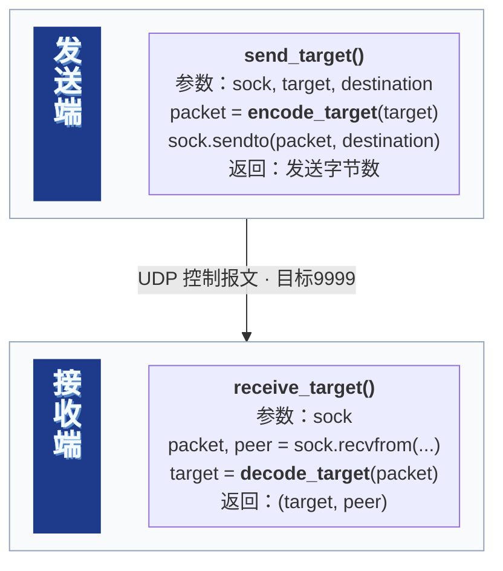
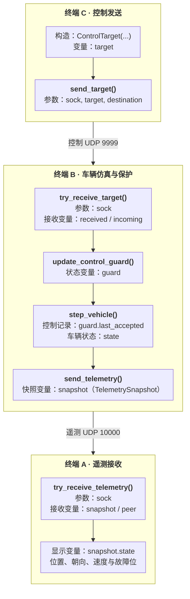
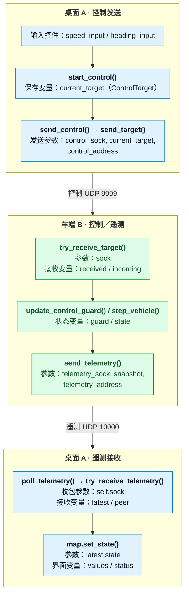
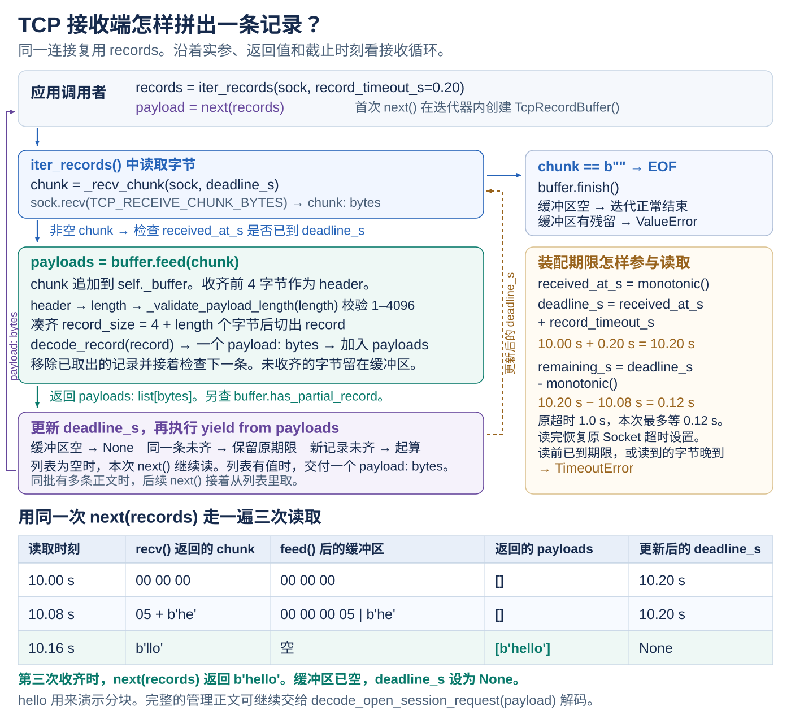
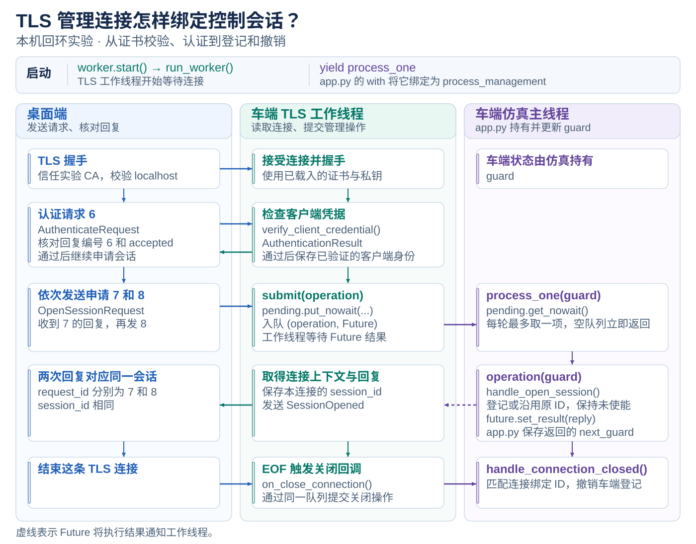

# network-programming-project

虚拟小车网络遥控 · 网络编程小组项目（MUST）。

## 项目总览

### 功能与交付

- **运动模型**：车辆状态、单步推进、固定步长轨迹及分阶段控制。
- **网络与保护**：UDP控制与遥测、TLS认证管理、HMAC与有效窗口准入、控制超时停车、急停和故障锁存。
- **桌面控制**：数值输入、正常停车/停发、地图与轨迹、遥测可用/过期提示。

当前原型可在本机以源码方式运行，无需实体小车。最终交付目标为Windows EXE，发布包待制作。

### 模块职责速查

| 模块与能力 | 在系统中的作用与关键入口 |
| --- | --- |
| 车辆状态、目标与步进 | `VehicleState`、`apply_target()`、`advance()`提供运动计算，本身不是网络协议。 |
| 控制与遥测编解码 | `encode_target()/decode_target()`、`encode_telemetry()/decode_telemetry()`定义应用消息并转换数据表示。 |
| UDP收发与非阻塞接收 | `send_target()`、`try_receive_target()`及遥测对应函数使用系统Socket；无包、坏包与系统错误分别处理。 |
| 超时停车与故障锁存 | `AcceptedTarget`、`update_control_guard()`、`step_vehicle()`执行本地保护，不代表已完成认证会话。 |
| 会话状态与管理接入 | `open_control_session()`、`enable_control_session()`、`close_control_session()`维护登记、使能与关闭状态；TLS 实验入口已连接仿真主循环，UDP 控制通过 HMAC 和会话准入检查。 |
| 桌面显示与周期控制 | `start_control()`、`send_control()`、`poll_telemetry()`组合两条UDP方向；`world_to_screen()`是GUI坐标换算。 |

### 开发路线与验收范围

开发顺序为 **完整会话流程与ID约定 → 内存串联 → 管理消息与TCP分帧 → 本机TCP传输 → TLS、身份与会话绑定 → 新UDP控制及HMAC、有效窗口、急停与恢复 → 桌面整合 → 双机高级验收**。内存串联阶段复用现有会话状态逻辑。

认证会话、HMAC、有效窗口控制与急停已完成本机实验闭环；正式复位、安全链路桌面整合、跨机与专家机制继续推进。

- 项目范围包括观察端、故障注入、重复实验与原始数据，以及专家阶段的控制权交接、授权代次、租约和机制对照。
- 第二台机器预检及最小EXE打包提前安排。配置、资源、证书、日志、跨机验证、报告、PPT与录像随版本更新。
- 高级阶段验证TLS握手、证书校验、跨机闭环与保护。专家阶段在此基础上扩展控制权交接、授权代次与租约。

图中按实现和验证状态标记进展。A01—A10用于拆解组内实现与验证，最终评定依据教师评分标准。

### 章节导航

本页按开发顺序保留各阶段示例，当前完整桌面操作可直接看[4.1启动](#quick-start)和[4.3数值控制](#desktop-control-acceptance)。
旧示例中的A/B/C是该例自己的终端标签。

| 板块 | 内容 |
| --- | --- |
| [1. 环境准备与项目结构](#environment) | 安装、测试、目录职责与应用入口 |
| [2. 车辆运动与UDP控制](#motion-control) | 离线运动 → 单包UDP控制 → 持续运行与本地保护 |
| [3. 遥测回传](#telemetry) | 三终端运行、状态观察与图2 |
| [4. 桌面控制台](#desktop-console) | 启动与状态 → 地图/轨迹/坐标 → 数值控制与验收 → 实现要点 |
| [5. 网络分层、控制信封与管理传输](#network-layers) | 分层职责、车端准入、会话状态、管理JSON与TCP |
| [6. 项目配置与文档维护](#project-maintenance) | 包配置、Git协作、目录迁移与导图维护 |

<a id="environment"></a>

## 1. 环境准备与项目结构

### 1.1 运行环境

Windows PowerShell、Python 3.12；运行依赖及版本见[pyproject.toml](pyproject.toml)。
以下命令均在仓库根目录执行，使用虚拟环境中的Python，无需先激活环境。

<a id="environment-setup"></a>

### 1.2 创建环境与安装依赖

```powershell
py -3.12 -m venv .venv
.\.venv\Scripts\python.exe -m pip install -e .
```

这是可编辑安装：首次配置后，日常修改源码会直接生效，无需每次重新安装。

### 1.3 运行测试

```powershell
.\.venv\Scripts\python.exe -m unittest discover -s tests -t . -v
```

最近实际回归：2026-11-20，30个测试模块、288项通过，用户终端用时0.335秒；急停新增12项独立回归用时0.003秒。真实TLS、HMAC、短期窗口、自动管理编号、续窗、超时停车与急停已完成双终端验收，人工验收不增加单元测试计数。此前管理客户端基线为29个模块、276项（0.307秒），窗口控制基线为28个模块、269项（0.311秒），相应实测记录分别保留。

历史基线：2026-11-19助手完整回归21个测试模块、214项通过，包括控制编解码40项、认证控制编解码9项、HMAC计算与核对6项、管理消息编解码26项、会话密钥8项、UDP控制收发15项、TCP应用记录15项、TCP传输7项、控制保护28项、桌面控制8项。Qt使用离屏模式，Socket使用本机回环；原始记录保留供对照。

### 1.4 项目结构与职责

代码按职责归类；应用入口组合公共模块，测试与教学示例分别存放。

```text
src/rover/
  __init__.py
  core/           公共状态与运动模型
  protocol/       消息格式与编解码
  transport/      网络收发
  vehicle/        车端保护与运行入口
  desktop/        窗口、地图与轨迹
tests/            自动化测试
examples/         各课独立示例
reference_image/  导图与可编辑图源
pyproject.toml    项目安装与构建配置
requirements.txt 第三方依赖清单
README.md        使用说明与原理
.gitignore       Git忽略规则
LICENSE          项目许可证
```

| 模块 | 文件与职责 |
| --- | --- |
| `core` | `vehicle_model.py`保存状态并计算单步运动；`control_target.py`定义/应用运动目标；`simulation.py`用于离线多步轨迹。 |
| `protocol` | `control_codec.py`、`telemetry_codec.py`与`management_codec.py`定义控制、遥测和管理消息的JSON编解码与字段校验；`control_auth.py`计算和核对HMAC认证码。 |
| `transport` | `udp_transport.py`衔接编解码与Socket收发，区分空闲、坏包和系统错误；`tcp_records.py`编解码TCP应用记录并从分次到达的字节中提取完整正文；`tcp_transport.py`负责本机TCP收发、EOF及读取期限。 |
| `vehicle` | `control_watchdog.py`选择有效或零速目标；`control_guard.py`管理会话、密钥、使能、接受记录及超时；`management_session.py`处理身份和会话归属，`management_connection.py`处理管理消息流；`vehicle_runtime.py`组合受保护步进，`app.py`运行车端循环。 |
| `desktop` | `app.py`组合窗口、按钮、定时器与网络；`desktop_map.py`绘制地图；`map_geometry.py`换算坐标；`trajectory.py`保存世界轨迹；`management_client.py`封装TLS管理请求、自动编号及回复配对，目前由实验脚本调用。 |
| `tests` | 最近实际完整回归覆盖30个测试模块、288项测试，涵盖模型、控制/遥测/管理消息、管理客户端、HMAC、会话密钥、短期窗口、急停、真实UDP、本机TCP、TCP应用记录、保护、会话状态与界面行为。 |
| `examples` | 8个教学示例，可单独观察离线运动、单包/周期控制、超时及命令行遥测。 |
| `reference_image` | 文档图片和生成源；当前应用画面由代码绘制，不依赖这些参考图运行。 |

`core`负责运动规则，车端`vehicle`决定何时应用什么目标；同一模型可用于离线示例和联网运行。
`protocol`负责消息怎样解释，`transport`负责消息怎样收发。目录本身不规定执行顺序，运行顺序由函数调用决定。

#### 1.4.1 两个应用入口

| 模块 | 原文件 | 作用 |
| --- | --- | --- |
| `rover.desktop.app` | `demo_desktop_console.py` | 创建桌面窗口、Socket与定时器，连接用户操作和遥测显示。 |
| `rover.vehicle.app` | `demo_udp_vehicle_loop.py` | 维护车辆/保护状态，循环收包、步进并回传遥测。 |

两个`app.py`用完整模块名区分。它们保留原程序逻辑，不是另写一套程序。
当前双终端完整命令见[4.1](#quick-start)；示例按本页命令使用`-m examples.示例名`。
单独运行测试时，例如`.\.venv\Scripts\python.exe -m unittest -v tests.test_vehicle_model`。
不要直接运行`src/`内的文件。

<a id="motion-control"></a>

## 2. 车辆运动与UDP控制

### 2.1 离线运动与分阶段控制

```powershell
.\.venv\Scripts\python.exe -m examples.demo_simulation
.\.venv\Scripts\python.exe -m examples.demo_control
```

`apply_target()`更新速度与绝对朝向，`advance()`根据步长计算新位置；
`run_steps()`重复推进并保存初始状态及每步结果。
运动公式与世界/画布坐标关系见[4.2.2运动原理图](#vehicle-motion-coordinates)。

### 2.2 单包UDP控制

<a id="single-udp-demo"></a>

#### 2.2.1 同机单包UDP收发

本例终端A是接收端，终端B是发送端。先在A运行：

```powershell
.\.venv\Scripts\python.exe -m examples.demo_udp_receiver
```

看到`waiting for UDP`后，在B运行：

```powershell
.\.venv\Scripts\python.exe -m examples.demo_udp_sender
```

接收端应打印来源地址及`ControlTarget(speed_mps=2.0, heading_rad=0.5)`。
接收端绑定`127.0.0.1:9999`，发送端绑定端口`0`，由系统分配临时源端口。
两端打印的来源端口应一致；发送字节数仅表示本机发送结果，不是接收确认。

接收端处理一条消息后退出；再次演示须先重启接收端，等待时可按`Ctrl+C`结束。

<a id="single-udp-flow"></a>

#### 2.2.2 图1：一条控制消息怎样到达接收端

`packet`由`recvfrom()`从Socket接收队列取得，`peer`是来源地址；再由`decode_target()`校验和还原。



对应源码：[发送](examples/demo_udp_sender.py)、[接收](examples/demo_udp_receiver.py)、[UDP收发](src/rover/transport/udp_transport.py)、[控制编解码](src/rover/protocol/control_codec.py)。

#### 2.2.3 UDP目标驱动车辆模型

先在终端A运行：

```powershell
.\.venv\Scripts\python.exe -m examples.demo_udp_vehicle
```

再在终端B运行`-m examples.demo_udp_sender`，完整命令见[2.2.1 同机单包UDP收发](#single-udp-demo)。初始位置由接收端的`VehicleState()`创建；
发送端只提供目标速度和朝向。

接收目标后以`0.02 s`推进50步，即1秒模拟时间，轨迹含初始帧共51个状态：

```text
states=51
start: x=0.0000m y=0.0000m
end: sim_t=1.00s x=1.7552m y=0.9589m
```

这是收到一条消息后的离线计算，1秒模拟时间可以很快算完。

### 2.3 持续控制与车端保护

#### 2.3.1 控制超时与定时运行

```powershell
.\.venv\Scripts\python.exe -m examples.demo_watchdog_loop
```

脚本构造一次`2.0 m/s、0 rad`目标，以`0.02 s`模拟步长运行；
约0.5秒后停车，约1秒后结束，停车后坐标不变。

| 时间变量 | 用途 |
| --- | --- |
| `accepted_at_s` | 最后接受有效控制的时刻，用于判断控制超时 |
| `started_at_s` | 程序启动时刻，用于计算总运行时长 |
| `wall_t` / `sim_t` | 实际经过时间 / 累计模拟时间；两者可能因调度不同 |

#### 2.3.2 持续接收、周期控制与故障锁存

先在终端A启动持续车端：

```powershell
.\.venv\Scripts\python.exe -m rover.vehicle.app
```

在终端B选择一种发送方式。单条目标用于观察接受一次后的超时停车：

```powershell
.\.venv\Scripts\python.exe -m examples.demo_udp_sender
```

周期目标每约0.1秒一条，共20条：

```powershell
.\.venv\Scripts\python.exe -m examples.demo_udp_stream_sender
```

比较两种方式时先重启车端，清除上一轮锁存。观察重点：

1. 首次目标被`accepted`后开始运动；新有效目标刷新接受时间。
2. 距最后接受已达0.5秒时停车并设置`fault_latched=True`；重发普通目标显示`ignored`，不能解除锁存。
3. 无包时返回`None`，坏包抛出`ValueError`并打印`rejected`；保护与仿真仍继续。车端每轮只推进一次。
4. `wall_t`包含首次控制前的等待；日志在本轮推进后打印，因此首条接受记录的坐标可能已非零。

发送日志的`1/20`表示发送进度，不是协议序号。车端用`Ctrl+C`退出。
本页时刻均受系统调度影响，不要求恰好在某个毫秒或固定终点停车。

<a id="telemetry"></a>

## 3. 遥测回传

### 3.1 三终端启动

三个终端按以下顺序启动，先结束旧车端和旧接收器：

| 终端 | 职责 | 命令 |
| --- | --- | --- |
| A | 接收遥测 | `.\.venv\Scripts\python.exe -m examples.demo_udp_telemetry_receiver` |
| B | 车辆仿真 | `.\.venv\Scripts\python.exe -m rover.vehicle.app` |
| C | 周期控制 | `.\.venv\Scripts\python.exe -m examples.demo_udp_stream_sender` |

C向B的`127.0.0.1:9999`发控制；B使用另一个Socket向A的`127.0.0.1:10000`回传实际位置、朝向、速度和故障标志。

### 3.2 观察与核对

- 首次控制前为原点、零速、未锁定；从未接受控制时，等待本身不触发当前锁存。
- C发送期间位置变化；C结束后B超时停车，A继续收到零速、已锁定状态。再次发送仍应被忽略。
- 保持B运行，只重启A，可以再次收到当前状态；若B已退出，只重启A会等待。
- B每次启动创建新的原点状态；显示端重启不清除车端故障。
- 遥测目标周期为`0.05 s`，终端A日志限速，不能用显示行数推算发送频率；遥测发送失败不停止车端保护循环。

无包`None`不代表全零状态；坏报文已被取出并抛出`ValueError`，程序可以继续处理后续报文。
命令行接收器没有过期提示，桌面窗口的过期提示见第5节。

<a id="three-terminal-flow"></a>

### 3.3 图2：三个终端怎样控制并回传状态

按C → B → A阅读；加粗为函数名，参数与变量分行，跨端箭头标明通道和端口。



A看到的`peer`属于车端遥测Socket，与C的控制来源端口不同。
对应源码：[车辆运行环](src/rover/vehicle/app.py)、[保护状态](src/rover/vehicle/control_guard.py)、[遥测编解码](src/rover/protocol/telemetry_codec.py)。

<a id="desktop-console"></a>

## 4. 桌面控制台

<a id="quick-start"></a>

### 4.1 启动与状态显示

桌面A接替上一节的遥测A和发送C，当前完整操作只需A＋B。
先退出旧程序，避免端口冲突及多个控制源覆盖目标。

终端A打开桌面：

```powershell
.\.venv\Scripts\python.exe -m rover.desktop.app
```

终端B在另一个终端运行车端：

```powershell
.\.venv\Scripts\python.exe -m rover.vehicle.app
```

只启动A时显示“等待遥测”，没有车辆；B启动后出现原点车辆并显示“遥测可用”。
约1秒无合法遥测后提示“遥测过期”，保留最后车辆、轨迹和读数；它们此时仅代表最后收到的状态。

`status`表示遥测情况，`fault_latched`来自车端保护，`control_status`表示本地发送情况，三者独立。
当前地址固定为本机回环，跨机配置尚未接入。

### 4.2 地图、轨迹与坐标

#### 4.2.1 地图与运行轨迹

`TrajectoryHistory`保存最多1000个世界坐标位置，只跳过相邻重复；A→B→A仍保留。
每个合法遥测包都保存位置，重绘只读历史；窗口变尺寸后重新换算像素，原始位置不变。

绘制时先画轨迹，再平移和旋转车头，避免整条轨迹跟着车辆转动。
地图目前固定比例，超出视野时车辆会被裁切；平移、缩放和跟随后续完善。

<a id="vehicle-motion-coordinates"></a>

#### 4.2.2 车辆运动与画布坐标

沿图阅读：车端推进世界状态 → 按期限采样并回传遥测 → 桌面逐包保存 → Qt读取缓存并绘制。
`poll_telemetry()`对每个合法包调用`map.set_state(latest.state)`；后者依次保存最新状态、按规则维护世界轨迹、请求重绘。
侧栏只取本轮最后一个合法快照；多个重绘请求可能合并，因此收包、记录轨迹与绘图不是一一对应。[Qt重绘调度说明](https://doc.qt.io/qt-6/qwidget.html#update)

蓝色实线表示调用/执行顺序，灰线表示数据保存/读取，青色虚线表示Qt稍后调度。
世界位置用米、朝向用弧度；画布原点在左上，世界原点映射到地图中心。
`screen_point()`调用`world_to_screen()`执行公式，再将返回像素二元组包装成`QPointF`；轨迹与车辆位置分别复用此换算。
世界+Y向上、画布+Y向下，因此像素Y和绘制角度需转换；重绘只读缓存，不推进车辆或追加轨迹。

[](reference_image/diagrams/04-vehicle-motion.svg)

[可缩放SVG](reference_image/diagrams/04-vehicle-motion.svg) · [高清PNG](reference_image/diagrams/04-vehicle-motion.png)

对应源码：[运动模型](src/rover/core/vehicle_model.py)、[应用目标](src/rover/core/control_target.py)、[运行组合](src/rover/vehicle/vehicle_runtime.py)、[坐标换算](src/rover/desktop/map_geometry.py)、[地图绘制](src/rover/desktop/desktop_map.py)。

<a id="desktop-control-acceptance"></a>

### 4.3 数值控制与八步验收

输入朝向使用度，发送前转为弧度；只编辑输入不会改变已应用目标。

| 操作 | 行为 |
| --- | --- |
| 开始／应用 | 保存当前输入，立即发送并继续周期发送 |
| 正常停车 | 正在发送时改发零速目标，保留已应用朝向；未发送或已停发时不启动发送 |
| 停止发包 | 停止控制发送，遥测接收继续；车端按最后有效控制计时停车 |
| 关闭 | A用窗口“×”，B在终端按Ctrl+C |

2026-11-11用户已完成以下真实A＋B验收：

| 步骤 | 操作与已确认结果 |
| --- | --- |
| 1 | 只有A时等待；B启动后原点车辆、遥测可用、未锁定。 |
| 2 | 设1.0 m/s、45°并应用，车辆向右上移动，朝向显示约0.785 rad。 |
| 3 | 正常停车，速度为0、位置保持；保护未锁定，遥测仍可用。 |
| 4 | 重新设1.0 m/s、0°并应用，车辆恢复向右运动。 |
| 5 | 停止发包，距最后接受控制约0.5秒后停车锁存，遥测仍可用。 |
| 6 | 锁定后重新应用，B打印ignored，位置不变；随后停止发包。 |
| 7 | 结束B，约1秒后A提示遥测过期，车辆、轨迹和最后读数保留。 |
| 8 | 关闭旧A/B后重启，端口正常释放，新车端原点等待，桌面不自动发送。 |

故障锁存后，普通目标及正常停车都不能解除锁存。
重新演示应先退出旧A再重启B，避免旧A的周期目标被新车端接受。
当前A的Ctrl+C可能只打印异常而不退出，请用窗口“×”；正式会话与重连未使能机制后续接入。

<a id="desktop-ui-flow"></a>

#### 4.3.1 图3：桌面数值控制与遥测关系

按A发送 → B计算并回传 → A显示阅读；上下两个A属于同一个桌面进程。



### 4.4 关键实现要点

#### 4.4.1 三种数据

| 数据 | 变量 | 改变时机 |
| --- | --- | --- |
| 输入草稿 | `speed_input / heading_input` | 编辑数值时改变 |
| 已应用目标 | `current_target` | 点击应用，或正在发送时执行正常停车 |
| 实际状态 | `state / latest.state / map.state` | 车端推进后回传，桌面使用收到的状态绘图 |

`sent`只是本机发送字节数，不是车端接收或执行确认。

#### 4.4.2 两个定时器与两个Socket

| 对象 | 配置与职责 |
| --- | --- |
| `self.timer` | 初始化启动，约20ms轮询遥测；每轮最多8次接收尝试 |
| `self.control_timer` | 初始不启动；应用后约100ms发送一次已应用目标 |
| `self.sock` | 监听本机10000端口，接收遥测 |
| `self.control_sock` | 使用临时源端口，向车端9999端口发送控制 |

`start_control()`先保存目标、启动控制定时器，再立即首发，因为`send_control()`会检查定时器是否活动。
收到合法遥测才刷新`last_received_s`；无包或坏包都不延长有效显示时间。

#### 4.4.3 FakeSocket测试

- 替换发生在创建窗口前，因此窗口的网络对象变为`FakeSocket`；Qt控件、信号、目标构造与JSON编码仍真实执行。
- `control("speed_input")`通过`getattr(window, ...)`读取窗口属性；它不在按钮内部寻找或创建输入框。
- `click()`触发真实信号并调用业务函数，`FakeSocket.sendto()`记录报文与地址供断言检查。
- `timeout.emit()`只手动调用一次回调，不证明实际经过100ms；真实UDP由传输测试和双进程联调验证。

对应源码：[桌面窗口](src/rover/desktop/app.py)、[桌面测试](tests/test_desktop_control.py)、[轨迹历史](src/rover/desktop/trajectory.py)、[UDP传输](src/rover/transport/udp_transport.py)。

<a id="network-layers"></a>

## 5. 网络分层、控制信封与管理传输

### 5.1 分层职责

#### 5.1.1 图5：各层实际用了什么

OSI七层用于理解职责，TCP/IP用于描述本项目采用的实际通信结构。
高级与专家属于项目验收阶段，分层图用于对照不同网络功能的职责。
本项目在应用代码中承担消息语义、数据表示和会话管理功能；不能把写了`session_id`直接当作独立实现了OSI的L5。[分层与应用内会话功能的说明](https://docs.oracle.com/cd/E19504-01/802-5886/intro-45828/index.html)。
下图对照2026-11-16源码，区分已使用、开发中、系统提供及跨机待验；功能变化时同步修订。

[](reference_image/diagrams/05-network-layers.svg)

[可缩放SVG](reference_image/diagrams/05-network-layers.svg) · [高清PNG](reference_image/diagrams/05-network-layers.png)

### 5.2 控制信封与车端准入

`ControlCommand(session_id, seq, target)`复用现有`control_codec.py`，把会话标识、报文序号与运动目标组合起来。

#### 5.2.1 报文格式与编解码

最近通过的控制编解码基线为40项（旧格式19项、新格式21项），涵盖合法编解码、倒车往返、两端元数据/运动值校验、两端1200字节边界、解析前拒绝超限、严格版本类型及新旧格式互拒；完整项目回归已通过。

新解码器先检查原始`bytes`长度，再进行UTF-8解码和JSON解析：超限已违反约定，无需再创建字符串与对象。限制按字节而非字符或字典字段数计算；先解析再检查仍能判定长度，但解析开销已经发生。超限且同时无法解析时，优先报告长度错误。

当前新格式的JSON载荷示例：

```json
{
  "version": 1,
  "type": "control_command",
  "session_id": "session-a",
  "seq": 12,
  "speed_mps": 2.0,
  "heading_rad": 0.5
}
```

格式要求：版本为整数1，类型为`control_command`；会话标识为非空且非纯空白字符串；序号为非负整数，布尔值不作为整数接受；运动值须为可表示成有限float的int/float。整条UTF-8载荷最多1200字节。

- `session_id`区分哪次控制会话，不是密码或源端口；内部登记、使能和关闭操作见[会话登记、使能与关闭](#control-session-lifecycle)。
- `seq`对同一会话中的新报文递增，即使目标值相同。它为后续重复/乱序判断提供依据，不要求保存或执行每一条；序号较大也不等于报文足够新鲜；比较须结合已确认有效的所属会话，不能把不同会话的序号混用。

<a id="control-admission"></a>

#### 5.2.2 车端准入与超时保护

`control_guard.py`新增`update_command_guard()`，对解码后的`ControlCommand`判断是否接受；它不收包，也不推进车辆位置。

| 车端状态字段 | 含义 |
| --- | --- |
| `session_id` | 车端当前登记的会话；由内部状态操作或测试构造，真实管理流程尚未接入。 |
| `enabled` | 是否明确允许控制，默认`False`；已使能也可以接受合法零速目标，不表示必须运动。 |
| `enabled_at_s` | 本次使能的车端单调时刻；首条有效命令被接受前的超时起点，重复使能不刷新。 |
| `last_seq` | 最后实际接受的序号；`None`表示尚无历史，`0`是有效序号。 |
| `last_accepted` | 当前可执行的目标与本地接受时刻；`None`表示当前没有有效执行记录。 |
| `fault_latched` | 故障是否锁存；普通新命令不能解除锁存，单独打开使能位也不能绕过。 |

新入口按以下顺序处理：

1. 调用`update_control_guard(guard, now_s=now_s)`复用保护检查，省略`incoming`，不提前接受命令。已有锁存直接返回；否则先选计时起点：已有`last_accepted`时用`accepted_at_s`，否则已使能时用`enabled_at_s`；未使能且没有接受记录时正常等待，不计时。
2. 已使能却没有任何计时起点，或`now_s - 起点 >= 0.5 s`时，先锁存故障、撤销使能并清空`last_accepted`，保留会话、序号及使能起点，然后返回；同一轮到达的新命令也不能刷新到期记录。
3. 保护通过后，检查有无新命令、是否使能、会话是否匹配、序号是否比本会话最后接受的大。允许跳号，拒绝重复或倒退；使能只是准入条件之一。
4. 全部通过后才创建`AcceptedTarget`，用`replace()`同时保存目标、`accepted_at_s`与`last_seq`。首包之后改用接受时刻计时；被拒绝的命令不刷新记录。

`enabled_at_s`和`accepted_at_s`保存发生事件时的车端单调时刻，`now_s`是每次调用传入的当前检查时刻，不是状态字段；运行时须使用同一单调时钟。`0.0`是合法时刻，应以`is None`判断有无起点；首次检查已越过期限也会锁存。

`incoming=None`只表示本轮没有新命令，未超时时旧目标仍有效；`last_accepted=None`表示当前没有可执行记录，可能仍在等待首包。车辆执行层的`target_for_tick()`此时选择零速目标。若已使能、没有接受记录且`enabled_at_s=None`，则属于上面的缺失起点情况。

<a id="control-session-lifecycle"></a>

#### 5.2.3 会话登记、使能与关闭

以下是供可信管理上下文调用的内部纯状态接口，不收发报文，也不完成认证；`session_id`匹配只表示与当前登记一致。
`open_control_session()`只登记调用方提供的ID，不负责生成或传输。当前测试使用`session-a/b`等固定样例；自动生成、管理回复及桌面保存仍待正式管理链路接入。


| 操作 | 条件与状态转换 | 重复或不匹配时 |
| --- | --- | --- |
| `open_control_session(guard, session_id)` | 登记会话ID，保留其余状态；从初始或已关闭状态打开时仍未使能，不生成目标，也不解除故障。 | 同ID重复调用状态值不变；已有其他ID时抛出`ValueError`，不能覆盖。 |
| `enable_control_session(guard, now_s)` | 必须已有会话且未锁存故障；设置`enabled=True`和`enabled_at_s=now_s`，不创建接受记录，尚无目标时开始等待首包。 | 缺少会话或已有故障时抛出`ValueError`；重复使能保留原起点和控制记录。 |
| `close_control_session(guard, session_id)` | 清空会话、目标、序号和使能起点，撤销使能，保留`fault_latched`。 | 当前登记为其他ID时抛出`ValueError`；已关闭时重复调用，关闭后的状态值不变。 |

因此，关闭A再打开B后，B必须重新使能才能接受自己的`seq=0`；A的旧包在关闭后、B未使能及已使能时都不能恢复控制。

状态为不可变数据；`replace()`返回新状态，调用方须采用并继续传递返回值，例如`guard = close_control_session(guard, session_id="session-a")`。测试保留`before`用于比较原状态未变；它是旧快照，不是另一个待关闭的资源。

控制保护模块28项测试按职责独立组织：旧目标入口3项、控制信封准入8项、内部会话状态17项。覆盖序号0及跳号、未使能/错会话/重复乱序拒绝、无包未到期、故障优先、登记/使能/关闭的拒绝与幂等、首包到期、接受后切换计时起点、缺失起点，以及关闭A后重新使能B的完整状态链路。
对应源码：[准入与保护](src/rover/vehicle/control_guard.py)、[保护测试](tests/test_control_guard.py)、[有效目标选择](src/rover/vehicle/control_watchdog.py)。

#### 5.2.4 运行模式与报文准入

车端根据运行模式选择相应的报文接收与处理入口。

| 运行模式 | `incoming` 的内容 | 处理函数 |
| --- | --- | --- |
| 默认 UDP | `ControlTarget`，速度和朝向 | `update_control_guard()`接受目标，并处理超时锁存。 |
| TLS 管理模式 | `ControlCommand`，会话 ID、序号和目标 | `update_command_guard()`检查使能、会话归属及序号，再接受目标。 |

`update_command_guard()`内部先调用`update_control_guard()`做公共超时检查，随后做会话和序号审查。只有通过的报文才更新接受时间与`last_seq`。

本机双终端已实测 TLS 认证、申请会话、使能后发送 UDP 的`seq=0～9`，遥测确认速度达到 1.0 m/s。最后一条指令在 4.125 s 被接受，4.625 s 停车并锁存故障，间隔 0.500 s。再次使能被拒绝，连接断开后会话登记清空。

### 5.3 管理消息与本机TCP

<a id="management-message-codec"></a>

#### 5.3.1 管理请求与回复编解码

`management_codec.py`已完成`open_session`请求和`session_opened`成功回复的JSON编解码，17项模块测试通过，覆盖消息头、必填字段、ID格式、编解码两端4096字节正文上限，以及畸形输入拒绝和后续独立调用。大小限制按完整JSON正文的UTF-8字节计算，不含应用记录的4字节长度头；解码时先检查长度，再解析正文。这些函数已用于本机TCP管理演示，负责数据格式。正式会话生成、登记及认证由后续管理逻辑完成。

当前两种管理消息的职责如下，`version`均为严格整数`1`：

| 消息 | 数据与职责 | 编解码入口 |
| --- | --- | --- |
| `open_session` | `OpenSessionRequest(request_id)`申请建立会话，此时尚无`session_id`。 | `encode_open_session_request()` / `decode_open_session_request()` |
| `session_opened` | `SessionOpened(request_id, session_id)`携带成功回复；回复应回显对应申请的编号，实际匹配由后续管理逻辑完成。 | `encode_session_opened()` / `decode_session_opened()` |

`request_id`必须为非负整数，允许`0`，拒绝布尔值；`session_id`必须为非空白字符串，编解码保留原值。`_encode_management_message()`、`_decode_management_message()`共用JSON与大小处理，两个ID校验函数共用字段规则。对应源码：[管理消息](src/rover/protocol/management_codec.py)、[管理消息测试](tests/test_management_codec.py)。

<a id="encapsulation-and-framing"></a>

#### 5.3.2 图6：上层定义消息，下层负责承载

老师课堂中的HTTP → TCP → IPv4 → Ethernet示意，展示了逐层封装：下层将来自上层的字节放入自己的Data/Payload，再添加本层需要的信息。图6用本项目的管理JSON替代HTTP；各层有自己的头部，应用消息、TCP段、IP包和链路帧之间没有固定的一一对应关系。

[](reference_image/diagrams/06-encapsulation.svg)

[可缩放SVG](reference_image/diagrams/06-encapsulation.svg) · [高清PNG](reference_image/diagrams/06-encapsulation.png) · [文字与布局生成源](reference_image/diagrams/render_encapsulation.py)

TCP与UDP都自带传输层协议头，由系统协议栈处理。现有控制与遥测的载荷路径是**自定义消息 → JSON文本 → UTF-8字节 → UDP/IPv4**；`sendto(packet, address)`中的IP与端口交给操作系统处理，不是编码器写进JSON的字段。本项目一条JSON对应一份UDP数据报，接收容量足够时`recvfrom()`保留该数据报的边界，因此不额外添加应用消息长度前缀。UDP不保证送达、顺序或去重。[UDP标准](https://www.rfc-editor.org/rfc/rfc768.html)

TCP向应用提供有序字节流，一次读取可能只有半条消息，也可能包含多条消息。本机TCP管理演示采用**4字节无符号大端正文长度N + N字节正文**；`N = len(payload)`只计算JSON正文的UTF-8字节，不含前缀自身4字节，正文上限沿用4096字节。接收方须先累计满4字节读出N，再累计正文；长度头本身也可能分次到达。

`encode_open_session_request(request)`生成JSON正文`payload`。`encode_record(payload)`添加4字节长度头`header`，返回应用记录`record`，头部字节数由`RECORD_HEADER_BYTES`给出。`send_record()`调用`sendall()`写入已连接的TCP Socket。应用记录由Python代码组织，TCP协议由操作系统处理。链路层继续使用Ethernet frame这个名称。接收端逐条还原正文的过程见[图7](#tcp-record-receive)。

图中的以太网头和FCS由系统、驱动与网卡处理；`127.0.0.1`回环不经过真实以太网，不作为已完成局域网实验的证据。[主机回环规定](https://www.rfc-editor.org/rfc/rfc1122.html#section-3.2.1.3)

课程衔接：CS370/SE370第一讲第15、17、20页（PDU与封装），第二讲第56—57页（以太网framing），第五讲第9页及第33页（TCP/UDP首部；UDP所在PDF页序为32）。TCP字节流不保留应用消息边界的例子见课程教材第6.5.2节、印刷第560页、图6-35。

<a id="tcp-record-receive"></a>

#### 5.3.3 图7：TCP接收端怎样拼出一条记录

[](reference_image/diagrams/07-tcp-record-receive.svg)

[可缩放SVG](reference_image/diagrams/07-tcp-record-receive.svg) · [高清PNG](reference_image/diagrams/07-tcp-record-receive.png) · [生成源](reference_image/diagrams/render_tcp_record_receive.py)

图7沿用图6里的`hello`字节示例。从调用方传入的`sock`和`record_timeout_s`读起，沿箭头查看每个返回值。`_recv_chunk(sock, deadline_s)`返回`chunk`，同一个`TcpRecordBuffer`再用`feed(chunk)`切出完整的`record`。`decode_record(record)`返回一条`payload`，`feed()`返回本批的`payloads`列表。`yield from payloads`把正文逐条交给连续的`next()`调用。实际管理正文由调用方交给相应的JSON解码器，例如`decode_open_session_request(payload)`。

设置`record_timeout_s`后，装配期限从读到当前记录的首批字节时起算。每次继续读，`_recv_chunk()`取剩余期限与原Socket超时中较短的值，读取结束后恢复原设置。收到Socket EOF后，`iter_records()`调用`finish()`检查头部或正文是否截断。

单条记录编解码的9项测试覆盖多字节长度、1/4096字节合法边界、短头部、零长度或超限声明以及正文长度不符。加上缓冲行为后，TCP应用记录15项通过，TCP传输7项通过。双终端已在`127.0.0.1:19176`实测管理请求与回复共用一条TCP连接，回显`request_id=7`、返回固定演示ID `demo-session`，然后正常到达EOF。[TCP应用记录](src/rover/transport/tcp_records.py) · [TCP传输](src/rover/transport/tcp_transport.py) · [记录测试](tests/test_tcp_records.py) · [传输测试](tests/test_tcp_transport.py)

<a id="tls-certificates"></a>

### 5.4 TLS握手与证书校验

#### 5.4.1 证书文件与常见缩写

车端使用`server.pem`（服务器证书）和`server.key`（服务器私钥）参与握手。桌面端用`ca.pem`验证车端证书的签发链，并核对证书中的服务名称`localhost`。

| 术语 | 全称与在本章的用途 |
| --- | --- |
| TLS / SSL | TLS 是 **Transport Layer Security**（传输层安全协议）。SSL 是 **Secure Sockets Layer**（安全套接字层），是 TLS 的前身。本机演示协商到了 TLS 1.3。 |
| PEM | **Privacy-Enhanced Mail**（隐私增强邮件）。名称源自早期邮件标准。在本实验中，`ca.pem`和`server.pem`采用文本编码，以`BEGIN CERTIFICATE`和`END CERTIFICATE`标记 Base64 证书内容的边界。 |
| CA / `ca.pem` | **Certificate Authority**（证书颁发机构，RFC 5280 写作 **Certification Authority**）。`ca.pem`保存实验根 CA 的公共证书，作为桌面端校验证书链的信任起点。 |
| OpenSSL | 广泛使用的开源密码学工具包，提供 SSL/TLS 库和命令行工具。本章用它生成、签发、查看和验证证书。 |
| CSR | **Certificate Signing Request**（证书签名请求）。`server.csr`携带服务器的公钥和名称等信息，用于向 CA 申请签发服务器证书。 |
| CN / SAN | CN 是 **Common Name**（通用名称），如输出里的`subject=CN=localhost`。SAN 是 **Subject Alternative Name**（主题备用名称），本机校验所用的`DNS:localhost`列在这里。DNS 是 **Domain Name System**（域名系统），这里的`DNS:`表示名称类型。 |

参考：[TLS 1.3](https://www.rfc-editor.org/rfc/rfc8446.html) · [OpenSSL 工具包](https://openssl-library.org/) · [PEM 文本编码](https://www.rfc-editor.org/rfc/rfc7468.html#section-1) · [X.509 证书与 SAN](https://www.rfc-editor.org/rfc/rfc5280.html#section-4.2.1.6) · [证书签名请求](https://www.rfc-editor.org/rfc/rfc2986.html#section-1)

#### 5.4.2 本机证书校验

X.509 是这里使用的证书标准。用`openssl x509`查看证书时，`subject`表示证书属于谁，`issuer`表示谁签发了证书。`ca.pem`的主题和签发者都是`Local TLS Lab CA`，并带有`CA:TRUE`。`server.pem`的签发者是该 CA，证书的 SAN 包含`DNS:localhost`。

| `openssl verify`校验条件 | 实测结果 |
| --- | --- |
| 加载`ca.pem`，核对`localhost` | `server.pem: OK` |
| 加载同一张`ca.pem`，核对`wrong.localhost` | `hostname mismatch` |
| 信任集合为空，核对`localhost` | `unable to get local issuer certificate` |

这三次使用同一张服务器证书，分别检验证书校验成功、名称不匹配和找不到可信签发链的结果。[OpenSSL 证书验证命令](https://docs.openssl.org/3.5/man1/openssl-verify/)

#### 5.4.3 本机TCP连接与TLS握手

两端先用`accept()`和`create_connection()`得到普通的TCP Socket。随后`SSLContext.wrap_socket()`按各自的配置把该连接交给TLS处理。默认在握手成功后返回`SSLSocket`，随后通过它读写的应用数据由TLS加密传输。[Python `SSLContext.wrap_socket()` 文档](https://docs.python.org/3.12/library/ssl.html#ssl.SSLContext.wrap_socket)

双终端在`127.0.0.1:19177`实测，同一张服务器证书和同一个`ca.pem`下，预期名称为`localhost`时协商到`TLSv1.3`。改成`wrong.localhost`后，桌面端仍打印`TCP connected`，随后在握手中报`Hostname mismatch`，车端也收到握手错误。

#### 5.4.4 通过TLS收发管理消息

握手成功后，双终端把`SSLSocket`交给已有的`send_record()`和`iter_records()`。实测桌面发出`OpenSessionRequest(request_id=7)`，车端解码后在同一连接回复`SessionOpened(request_id=7, session_id='demo-session')`。`demo-session`是固定演示值。客户端凭据、授权和真实会话绑定由后续管理逻辑处理。

#### 5.4.5 在TLS连接上核对客户端凭据

车端根据桌面端提交的`client_id`查询本地配置，再通过`verify_client_credential()`比较提交的凭据与该客户端的配置值。函数调用`hmac.compare_digest()`进行比较。HMAC 是 **Hash-based Message Authentication Code**（基于哈希的消息认证码），这里使用的是该模块的比较函数，真正的 HMAC 报文校验留到 UDP 控制章节。

本机回环练习使用同一张服务器证书、同一个`localhost`和客户端 ID。两次均协商到 TLS 1.3，车端对正确凭据回复`authenticated`，对错误凭据回复`rejected`。练习用一条临时 JSON 记录传递凭据，回送验证结果后结束连接。控制会话的分配与连接绑定属于后续接入步骤。

#### 5.4.6 认证通过后在同一连接申请会话

车端验证凭据后，在当前连接的处理代码里保留通过验证的`client_id`。桌面端收到`authenticated`后才发送`open_session`。双方沿用同一个`SSLSocket`以及各自已有的`iter_records()`迭代器，继续收发后续记录。车端也独立检查认证结果，只有通过验证才读取会话申请。

本机回环验证中，正确凭据使车端收到来自`desktop-a`的`OpenSessionRequest(request_id=7)`，桌面端收到对应的`SessionOpened(request_id=7, session_id='demo-session')`。错误凭据仍完成 TLS 握手，收到`rejected`后结束操作。`demo-session`是固定演示值，实际会话分配与状态登记属于后续接入步骤。

#### 5.4.7 生成、登记与关闭控制会话

UUID 全称为 **Universally Unique Identifier**（通用唯一标识符）。实验中，车端在认证通过且读到会话申请后调用`uuid4().hex`，生成由 32 个小写十六进制字符组成的会话 ID。[Python 3.12 UUID 文档](https://docs.python.org/3.12/library/uuid.html#uuid.uuid4)

车端先用`open_control_session()`把 ID 登记到实验的`ControlGuardState`，再把同一个 ID 放进`SessionOpened`回复。登记时保持`enabled=False`，桌面收到的`request_id`用于匹配回复。车端在该连接的处理流程中保留登记的 ID，读取到连接结束或处理异常时通过`finally`调用`close_control_session()`撤销登记。

本机回环验证中，两次独立的成功申请各自生成了不同的 ID，每次的车端登记和桌面回复一致。错误凭据被拒绝后没有创建会话。实验使用脚本自己的内存状态，接入正式车端循环及多连接管理仍待完成。

#### 5.4.8 连接上下文与重复申请

车端认证通过后创建`AuthenticatedConnection`，其中`client_id`是已验证的身份，`session_id`初始为`None`。每次读取到`open_session`，车端用`handle_open_session()`返回的`guard`和`connection`继续处理下一条记录。首次申请把新 ID 同时写入两份状态。同一条连接再次申请时，原会话与控制状态继续有效，回复回显本次的`request_id`。

连接结束时，`finally`用`handle_connection_closed()`撤销当前连接仍持有的会话，处理完就丢弃该连接上下文。本机回环实验中，同一条 TLS 连接上的请求 7 和 8 得到相同的会话 ID，车端全程未使能，连接结束后登记清空。错误凭据在进入这段连接处理前被拒绝。

#### 5.4.9 认证请求与回复的对应关系

双终端实验改用管理消息编解码器传递认证。桌面端发送`AuthenticateRequest`，其中包含`request_id`、`client_id`和凭据。车端解码后核对凭据，并用`AuthenticationResult`回显请求编号和布尔型`accepted`。桌面端先核对回复编号，再根据认证结果决定是否在同一条 TLS 连接上发送`open_session`。

本机回环验证中，正确凭据收到编号 6 的`accepted=True`，随后请求 7 和 8 拿到同一个会话 ID。错误凭据收到编号 6 的`accepted=False`。回复编号不匹配时，桌面端在发起会话申请前终止流程。

#### 5.4.10 连接处理函数与状态回调

双终端实验把已完成握手的`SSLSocket`和两个回调交给`serve_management_connection()`。连接处理函数读取认证与会话申请，发送回复，并在认证通过后的连接处理结束时调用关闭回调。

实验车端的`main()`持有`guard`。申请回调用`handle_open_session()`得到新的车端状态、连接上下文和回复，保存车端状态后，把连接上下文和回复交还给连接处理函数。关闭回调用`handle_connection_closed()`撤销仍属于该连接的会话，并保存返回的车端状态。两个回调都用`nonlocal guard`更新`main()`中的绑定。

本机回环验证中，正确凭据通过回调为请求 7 和 8 返回同一个会话 ID，连接结束后登记清空。错误凭据收到`accepted=False`，此时未调用会话申请或关闭回调。

#### 5.4.11 管理线程与仿真循环之间传递请求

独立实验用`Queue`（线程安全队列）传递连接上下文、申请和一个`Future`（待完成的结果）。模拟网络线程把三者放入队列后等待结果。仿真每轮最多调用一次`get_nowait()`取请求。队列为空时立即继续；有请求时由仿真更新`guard`，再用`Future.set_result()`把连接上下文和回复交回网络线程。

实验先运行一次空队列的仿真，再提交请求 7。下一轮由仿真登记会话，网络线程得到同一个会话 ID，登记时保持未使能。实验调度用的`Event.wait()`放在仿真单轮函数外。

#### 5.4.12 图8：TLS 管理会话如何进入车端仿真

本机联调通过实验启动脚本进入`app.py`，由 TLS 工作线程收发管理消息，由仿真主线程更新`guard`。同一车端进程已实测顺序处理两条 TLS 连接。每条连接的请求 7 和 8 共用会话 ID，桌面端退出后登记清空，后一次连接取得新 ID。



[PNG 大图](reference_image/diagrams/08-tls-management.png) · [图源](reference_image/diagrams/render_tls_management.py)

#### 5.4.13 会话使能与首包超时验收

桌面端通过认证并取得会话 ID 后，在同一条 TLS 连接发送`enable_session`。车端仿真线程核对会话归属及故障状态，回复`session_enable_result`。同一会话重复使能会沿用首次使能时间。

本机实测错误会话 ID 的请求 8 被拒绝，合法请求 9 与重复请求 10 均成功。实验没有发送首条控制报文，随后遥测报告`speed=0.0m/s fault_latched=True`，再次使能的请求 11 被拒绝，连接结束后车端撤销登记。车端启动脚本与验收客户端默认使用实验脚本同级的`certs`目录，联调已验证可省略证书路径参数。

### 5.5 当前接入范围与协议升级

控制信封、准入及会话登记、使能和关闭的内部状态操作已完成独立单元验证。

TLS 认证、会话申请、使能和撤销已通过实验入口在本机接入车端仿真。默认 UDP 模式已复验收包、达到 2.0 m/s 和超时停车锁存。TLS 管理模式已接入会话密钥分发、HMAC UDP `ControlCommand`与严格准入，完成坏包拒绝、运动、停发超时锁存及断开撤销的本机闭环。TLS 实验启动和客户端脚本当前位于仓库外的`项目准备/TLS实验`，正式入口整合仍待完成。原桌面控制台使用`control_target`和`vehicle_state`消息，安全控制链路的界面接入属于后续步骤。

后续需为新 UDP 控制链路接入车端有效窗口、急停和故障复位，并完成桌面整合及跨机验收。

普通TCP教学仅验证传输；新链路的正式会话控制须完成对应身份、权限与会话校验。管理I/O不得阻塞车端更新和超时检查。

新增不兼容的必填字段或授权语义时，应明确调整消息类型或协议版本，并让校验与HMAC覆盖新内容。
TLS只保护对应的TCP管理连接，不自动保护UDP；HMAC校验真实性/完整性，不提供加密保密性。

### 5.6 HMAC 校验

HMAC 全称为 **Hash-based Message Authentication Code**（基于哈希的消息认证码）。本阶段采用 HMAC-SHA256，其中 SHA-256 是 **Secure Hash Algorithm**（安全散列算法）的 256 位版本。收发双方用共享密钥和相同的报文字节计算认证码，接收方核对认证码后再做控制准入。[Python HMAC 文档](https://docs.python.org/3.12/library/hmac.html)

认证码计算与核对已通过 6 项单元测试，覆盖 RFC 4231 标准样本、正文或密钥改动、错误认证码、格式错误和空密钥。空密钥属于本地配置错误，抛出 `ValueError`；收到的认证码格式错误或不匹配时，核对函数返回 `False`。[RFC 4231 测试样本 1](https://www.rfc-editor.org/rfc/rfc4231.html#section-4.2)

认证版控制报文使用 `type=authenticated_control_command`，在完整控制字段之外增加 `mac`。计算时先去掉 `mac`，按固定字段排序和紧凑 JSON 格式生成字节；接收方按相同规则重新计算。因此 JSON 的空格和字段顺序可以不同，版本、消息类型、会话、序号及运动目标的内容必须通过认证。这是本项目的编码约定。新增 9 项认证版编解码测试，与已有控制编解码相关回归合计 55 项通过，包含字段篡改、错误密钥、缺失或无效 MAC 以及完整报文大小检查。

| 名称 | 作用 |
| --- | --- |
| `session_id` | 标识控制会话，供车端核对归属。 |
| `control_key` | 会话共享密钥，作为 HMAC 的计算输入，通过 TLS 管理连接分发。 |
| `mac` | 随 UDP 控制报文携带的认证码，由报文字段和共享密钥计算得到。 |

会话密钥的生成、回复编解码、重复申请复用与关闭清除已通过 8 项新测试，与管理编解码、会话、保护和连接相关回归合计 72 项通过。认证UDP收发新增6项测试，相关回归38项通过。

2026-11-19 用户真实双终端验收通过：客户端在 TLS 内取得32字节会话密钥；车端拒绝3份坏MAC报文后，接受合法`seq=0～9`。最后一次接受在6.593 s，7.093 s停车并锁存故障，显示间隔0.500 s；请求11再次使能为False，连接关闭后会话清空。UDP目前没有逐条指令的确认回执，拒绝原因记录在车端日志，遥测反馈实际车辆状态。

**证书、登录凭据与密钥的分工**

当前实验中，车端加载 `server.pem/server.key`，桌面端通过 `ca.pem` 和预期主机名验证车端证书。车端随后用应用层的 `client_id/credential` 验证桌面身份。桌面端当前没有配置客户端证书。[Python TLS 配置](https://docs.python.org/3.12/library/ssl.html#ssl.create_default_context)

| 对象 | 谁持有、用于什么 |
| --- | --- |
| CA 证书 `ca.pem` 与 CA 私钥 `ca.key` | 桌面端信任 CA 证书来校验签发链；CA 私钥用于签发证书，不参与日常应用连接。 |
| 车端证书 `server.pem` 与私钥 `server.key` | 证书包含车端公钥和身份信息；车端保管私钥，在握手中证明自己持有对应私钥。 |
| TLS 内部流量密钥 | TLS 握手协商并派生，由 `ssl` 库管理，用于保护当前 TLS 管理连接中的数据。 |
| 应用登录凭据 `credential` | 桌面端提交，车端与本地配置比较，判断客户端身份。 |
| 会话共享密钥 `control_key` | 车端为新会话生成，两端保存相同值，用于 UDP 控制报文的 HMAC 计算和核对。 |

证书认证使用公钥与私钥这对非对称密钥；TLS 业务数据使用协商出的对称流量密钥保护。应用生成的 `control_key` 则服务于独立的 UDP 通道。[TLS 1.3 协议](https://www.rfc-editor.org/rfc/rfc8446.html#section-2)

**共享密钥与通道之间的关系**

“共享”表示授权的桌面端与车端各自保存同一份秘密值。新会话中，车端生成 32 字节的 `control_key` 并保存在 `guard`，通过已建立的 TLS 连接在会话回复中发送其十六进制表示。桌面端用 `bytes.fromhex()`恢复成相同的 32 字节值。32 字节表示为 64 个十六进制字符，转换前后密钥值不变。

接线后的发送方用 `HMAC(control_key, 控制字段)`得到 `mac`，随 UDP 发送控制字段和 `mac`；接收方用本地保存的同一密钥重新计算并核对。HMAC 提供报文认证与完整性校验，UDP 的控制字段仍可读取；会话、序号和后续有效窗口分别承担归属、重复/倒退拒绝和过期检查。[HMAC 定义](https://www.rfc-editor.org/rfc/rfc2104.html#section-1)

TLS 只保护经过该 TLS Socket 的字节流。同一对设备之间另建的 UDP Socket 不会自动继承它的保护。TLS 管理连接在这里承担安全分发会话密钥的职责，HMAC 再把这份会话授权延伸到逐条 UDP 控制报文。`session_id` 是会话标识，`request_id` 是请求与回复的关联号，`seq` 是指令序号，三者都不承担密钥的作用。

按通道看，保护关系分为两步：

```text
TLS 管理通道：安全地把 K 分发给桌面端
                         ↓
UDP 控制通道：使用 K 和 payload 计算、核对 HMAC
```

UDP 控制指令本身未经过 TLS 加密，控制字段仍然可读。会话、使能、序号和有效窗口负责控制准入。

### 5.7 车端短期有效窗口

有效窗口用于限制已认证指令的可接受期限。HMAC 正确、序号较新，只能分别证明持钥方与相对顺序；一份在网络中滞留的高序号报文仍需要期限检查。

沿原计划由车端签发窗口、桌面在控制报文中回传 `window_id`，车端用自己的单调时钟判断。两台机器不相减各自的单调时钟值。当前细化先取0.25秒为可调整的默认窗口长度，原0.5秒控制看门狗继续独立运行。

第一步只验证 `control_window.py` 的单窗口规则：`ControlWindow` 保存窗口ID、签发时刻与截止时刻；`issue_control_window()`计算固定截止时刻，`is_control_window_valid()`核对ID及 `issued_at_s <= now_s < expires_at_s`。恰好到期即拒绝，检查不会延长期限。签发参数错误抛出 `ValueError`，缺窗口、错ID或无效检查时间返回 `False`。本单元的固定测试ID随后由车端管理逻辑自动生成并通过TLS分发。

用户已实测窗口规则6项与原控制保护28项合计34项通过。`issue_control_window()`创建固定有效期记录，`is_control_window_valid()`只检查并返回布尔值；续期需要另外签发新窗口。

| 机制 | 判断的问题 |
| --- | --- |
| HMAC | 报文是否由持钥方产生，认证字段是否被改动。 |
| 会话与使能 | 当前连接/会话是否拥有控制资格，是否明确允许控制。 |
| `seq` | 是否比本会话最后接受的序号更新。 |
| 有效窗口 | 报文回传的窗口在车端检查时是否仍有效。 |
| 0.5秒看门狗 | 距离使能或上次接受有效指令是否已经超时，需要停车锁存。 |

窗口到期只阻止新到指令，已有目标仍由看门狗约束；被拒绝的指令不得刷新接受时间或序号。窗口ID后续会作为安全报文的必填认证字段，明确升级消息类型或版本后接入管理、收发和准入。此节是下一单元的接口与规则说明，尚不表示实际UDP链路已执行窗口校验。

已新增窗口版 `encode_windowed_command()/decode_windowed_command()`，报文采用 `version=2`、`type=authenticated_control_command`，`window_id`为必填认证字段。MAC覆盖版本、类型、会话、序号、窗口ID与运动字段；版本1、2各自入口拒绝另一版本。为保留版本1的历史用例，`ControlCommand.window_id`先使用默认`None`，窗口版编码器仍严格要求非空窗口ID。用户已实测新增11项测试的RED（24处FAIL），补齐后相关100项回归通过。

已增加 `ControlGuardState.control_window` 与 `update_windowed_command_guard()`：先检查看门狗，再核对窗口，最后复用会话、使能和序号准入。过期、缺失或错误窗口不更新目标、接受时间及序号；新会话重置窗口，关闭时清除窗口并保留故障。用户已实测新增10项测试的RED（8处FAIL），补齐后相关70项回归通过。TLS签发/续期及主循环切换到版本2仍待接线。

会话先创建、再签发窗口，是建立流程的依赖；每条指令的检查顺序则由保护和状态更新规则决定。会话与窗口的只读检查可以调整先后。当前窗口放在 `update_command_guard()` 之前，是因为后者在准入通过时会返回已经更新目标、接受时间及序号的新状态；先通过窗口门槛，能直接避免采用过期指令的接受状态。必须保证每轮超时保护不被提前返回跳过，且到期锁存优先于接受新包，全部准入条件通过后才保存新的接受记录。

#### 5.7.1 窗口申请、签发与续期

窗口管理消息继续使用管理协议版本1；UDP窗口控制报文使用版本2，两者分别演进。桌面端在已认证的TLS连接上申请窗口，车端依据该连接绑定的会话决定是否签发。

| 消息 | 字段与作用 |
| --- | --- |
| `issue_control_window` | `request_id`关联本次申请与回复，`session_id`指定申请窗口的会话。 |
| `control_window_result` | `request_id`对应原申请；`granted`表示是否获准签发。成功时返回`window_id`与`lifetime_s`，拒绝时这两项均为JSON `null`。 |

签发处理先检查控制看门狗，再核对故障、会话密钥及连接和请求的会话归属。允许在使能前准备窗口，签发成功不代表控制已使能。车端生成新的UUID窗口ID并保存固定截止时刻；续窗替换当前窗口，旧窗口ID随即失效。签发不刷新`last_accepted`、`last_seq`或`enabled_at_s`，因此管理请求不能充当有效控制指令来延缓停车。

`lifetime_s`是车端签发时的总有效时长，传输期间会消耗其中一部分；桌面收到回复后不会重新获得完整时长。真正截止时刻保存在车端，由车端单调时钟判断。

用户已完成窗口消息编解码与签发处理，2026年11月20日实测新增12项测试的RED（47处FAIL），补齐后相关100项回归通过。TLS消息分派、主循环队列以及实际UDP版本2切换仍待接线，当前实测链路尚不能据此视为已经执行窗口控制。

用户已完成TLS窗口请求分派与主线程队列接线，实测新增7项的RED（6处ERROR，接口尚未接入），补齐后相关107项通过（0.028秒）。双终端实测：会话`3afd2e2da7a24618821d550e73e36d24`，错误会话申请12被拒绝；申请13、14分别获得`340bbcfc8558491ba0cffcf60648e3cc`和`f498b41edbb74ceab7e468db060849da`，时长均0.25秒；退出后车端显示会话为None。

该TLS实验仅发送窗口申请，没有发送使能请求；107项自动回归仍包含已有使能测试。`IssueControlWindowRequest/ControlWindowResult`与`EnableSessionRequest/SessionEnableResult`同时保留，分别负责窗口签发和控制使能。获得窗口不修改`guard.enabled`；实际控制需要各项准入条件同时成立。

#### 5.7.2 窗口版UDP与主循环接线（已实测）

新增窗口版UDP收发入口，管理模式主循环改用版本2解码和`update_windowed_command_guard()`，普通UDP演示继续使用`ControlTarget`与`update_control_guard()`。版本1历史入口供旧测试和示例使用，版本2管理模式拒绝降级报文。

候选片段预检：新增9项测试RED为10处FAIL、0ERROR，补齐后全量269项通过。测试直接运行`app.py`单轮行为，验证合法窗口可运动，缺失/错误/到期窗口不能驱动车辆，管理模式拒绝版本1，同时保留普通UDP演示。

较早的本机端到端候选预检包含实际TLS监听器、主循环、UDP和遥测：使能成功及重复使能成功，错MAC/错窗口/旧窗口不占用高序号，合法`seq=0～9`全部接受，每两条指令续窗；末条接受时刻0.890秒，停车锁存时刻1.390秒，遥测确认速度由1.0变为0.0，再次使能被拒绝，断开后会话清除。该组历史结果来自内存候选模块及临时回环端口，与下述用户实际接线验收分别记录。

用户随后完成手动接线，实测新增9项GREEN（0.012秒）、全量269项通过（0.311秒）。真实双终端会话为`3af6d30a9eca46e3827d4d586b3e7cd6`：错MAC被rejected，错/旧窗口高序号101、102被ignored，合法seq0到9全部接受；末条接受时刻5.563秒，停车锁存6.063秒，相差0.500秒。遥测确认运动及故障停车，使能申请9、10成功，故障后申请30被拒绝，关闭后会话清除。

两个接收函数是独立入口，旧入口保留版本1测试与示例；管理模式改用`try_receive_windowed_control_command()`，由`decode_windowed_command()`完成版本2及HMAC校验并还原窗口ID，未调用旧接收函数。窗口是否仍有效由保护函数判断。`update_windowed_command_guard()`则在看门狗与窗口检查通过后调用`update_command_guard()`，复用会话、使能和序号准入。

实验中的`request_id`只关联管理申请和回复，数值不决定执行先后；当前实现不要求递增。脚本沿用使能请求8、9、10，并在其间插入窗口申请12，因此实际发送顺序是8、12、9、10、13。12是请求编号，真正的窗口ID是UUID字符串。控制指令另有`seq`；每两条控制指令续窗一次，在seq2、4、6、8前用`20 + seq`分配窗口申请编号22、24、26、28，分别供seq2～3、4～5、6～7、8～9使用。未发起的编号没有对应回复，不代表消息丢失。

### 5.8 管理客户端与自动请求编号

`ManagementClient`包装一条已经完成证书校验的TLS连接，提供`authenticate()`、`open_session()`、`enable_session()`和`issue_control_window()`。四种请求共用从1开始的递增编号，并复用同一条记录接收流；每次回复必须匹配原请求的类型和编号。该编号规则属于客户端策略，管理协议仍接受合法的非负请求编号。

每个新客户端连接独立从1开始，编号不跨连接共享。编码成功后才消耗编号，非法本地输入未发包时可以修正后继续。合法的使能拒绝、窗口拒绝允许后续请求；认证拒绝、传输失败、EOF、超时或回复格式/编号错误后停止复用该客户端。Socket由外层`with`关闭，客户端不隐式重连或恢复控制。

这些方法会同步等待回复，当前用于实验脚本，桌面接入时由网络线程调用。窗口控制实验随后只需调用方法，管理请求编号预期连续为1到12；UDP控制序号仍独立为0到9。

较早的候选预检：新增7项RED为11处FAIL、0ERROR，补齐后全量276项通过；真实本机TLS/UDP实验确认管理编号1到12、合法控制seq0到9、故障停车和断开清理。该组属于内存候选预检，与下述用户实际接线验收分别记录。

用户已完成接入：RED为7项、11处FAIL；全量276项通过（0.307秒）。实际TLS会话为`8dd8e6f58030409492c803809b15ff88`，管理编号1到12连续，合法控制seq0到9全部接受；末条接受6.203秒，停车锁存6.703秒，间隔0.500秒。使能、重复使能、拒绝坏包、续窗、故障后拒绝使能与断开清理均保持正常。窗口检查点已由用户提交为`390ecb5`，管理客户端另行提交。

#### 5.8.1 对象、编解码函数参数与异常

`client = ManagementClient(tls)`创建一个对象并执行`__init__()`，方法中的`self`指向该对象。对象保存原TLS socket、单一记录迭代器、下次请求编号和可用状态；没有复制网络连接。调用`client.enable_session(session_id)`时，对象内部使用这些已保存的成员，因此调用者不必反复传入TLS、records和request_id。

`_exchange(request, encode, decode)`中的后两个名字是普通函数参数。使能方法传入`encode_enable_session_request`与`decode_session_enable_result`，本次`encode(request)`就调用前者，`decode(payload)`调用后者。传函数名时不加括号，具体调用发生在`_exchange()`内；其他公开方法显式传入自己的编解码函数。

`payload = next(self._records, None)`中的None是迭代器结束时的默认值，并非Socket直接返回的正文。对端结束字节流后，recv得到空bytes，`iter_records()`检查没有半条残留便return，next于是返回None。正在等待本次管理回复时遇到这种EOF，客户端主动抛出`ConnectionError`；暂时没有数据会等待或超时，半条记录遇EOF则先报`ValueError`。`ConnectionError`属于`OSError`，因此会进入异常分支并禁止继续复用客户端。

`assert seen_motion, "movement telemetry was not observed"`仅在条件为假时抛出带该信息的`AssertionError`；条件为真时继续执行，不打印逗号后的文字。收到运动遥测后`seen_motion`为True，后续停车检查正常运行。

### 5.9 TLS会话急停

急停请求沿现有TLS管理连接与主线程队列处理。新增`EmergencyStopRequest(request_id, session_id)`和`EmergencyStopResult(request_id, accepted)`；`accepted`表示当前会话拥有者的急停请求已被接受。只允许当前绑定连接操作当前会话，缺失/错误/旧会话绑定被拒绝；未使能时也可急停，重复急停保持成功与锁存状态。

急停处理清除`last_accepted`、使能状态、使能计时和控制窗口，设置`fault_latched=True`；保留会话ID、密钥和最后接受序号，管理通道继续存在。主线程处理急停后，该轮车辆步进使用零速目标，不等待原0.5秒看门狗到期。正确签名和更高序号都不能解除锁存，重新连接也不能自动恢复。正式复位规则在后续单元明确实现。

候选片段的新增12项RED为35处FAIL、0ERROR，补齐后全量288项通过（0.272秒）。较早的本机TLS/UDP预检中，末条运动记录0.312秒、零速锁存0.406秒，间隔0.094秒；该组历史结果来自内存候选模块与临时回环端口。

用户已完成实际接线：RED为12项、35处FAIL（0.008秒），新增12项GREEN（0.003秒），全量288项通过（0.335秒）。真实会话`4a2bd23534414410838c38d72b6262dd`中，合法seq0到3全部接受，错误会话急停请求7被拒绝，拥有者急停请求8成功。车端末条运动记录5.859秒，零速锁存5.922秒，间隔0.063秒，早于0.5秒看门狗期限。之后签名正确的seq100到102全部ignored，车辆位置保持0.2000米；重复急停9成功，使能10与续窗11被拒绝，关闭后会话清除。单元测试另验证断开/重连不清故障。

演示计时口径：上述0.063秒是同一车端日志中“末条运动记录到零速锁存”的间隔，不是“点击或发送急停到停车”的完整端到端响应时间，也不是性能分布统计。PPT可据此展示本次主动急停在看门狗到期前生效，并将故障后的迟到包拒绝作为独立证据。

<a id="project-maintenance"></a>

## 6. 项目配置与文档维护

### 6.1 项目安装配置

#### 6.1.1 为什么现在增加pyproject.toml

早期所有脚本在根目录，直接运行脚本时Python可以找到同目录的其他模块，因此当时没有项目安装配置。
本次采用`src/rover`包布局，通过[pyproject.toml](pyproject.toml)声明源码位置、依赖和构建方式，统一两端的导入与启动。
这项配置服务于当前包布局，并非所有Python脚本都必须有它。[Python包布局说明](https://packaging.python.org/en/latest/discussions/src-layout-vs-flat-layout/)

| 配置 | 本项目含义 |
| --- | --- |
| `[build-system]` | 使用`setuptools.build_meta`构建，构建工具要求`setuptools>=64`。 |
| `[project]`的`name`、`version` | 安装名称`dsnet-rover`，当前项目版本`0.1.0`；版本号不表示完成百分比。 |
| `description`、`readme` | 简介及用于项目说明的README文件。 |
| `requires-python` | 声明Python最低版本3.12；目前实际验证环境为3.12。 |
| `dependencies` | 运行依赖为`PySide6==6.12.0`，与构建工具依赖分开。 |
| `[tool.setuptools.packages.find]` | 从`src`收集`rover`及全部子包；测试、示例和参考图不作为应用包收集。 |

`dsnet-rover`是安装名称，`rover`是代码导入名称，`src`是源码存放区。
例如`from rover.core.vehicle_model import VehicleState`，导入名称不包含`src`。

#### 6.1.2 可编辑安装与依赖清单

[1.2 创建环境与安装依赖](#environment-setup)中的`pip install -e .`表示将当前项目以可编辑方式安装到所用Python环境，同时处理项目声明的依赖。
修改现有源码后，下次运行直接使用修改；调整依赖或安装配置后，应重新执行安装命令。
`-m rover.desktop.app`会按包路径找到模块，以主程序方式执行并进入其`main()`。[pip本地安装说明](https://pip.pypa.io/en/stable/topics/local-project-installs/)

[requirements.txt](requirements.txt)继续保留第三方依赖清单；两处目前均固定PySide6 6.12.0，修改依赖时须同步。
只执行`pip install -r requirements.txt`会安装第三方库，不能替代本项目的包安装。
当前可编辑安装及wheel构建均依赖Python环境，最终独立Windows EXE仍需单独制作。

#### 6.1.3 空的__init__.py为什么也要提交

`rover`及五个子包、`tests`、`examples`各有一个空`__init__.py`，共8个。
它们明确本项目采用的普通Python包边界，支持完整包导入、测试定位和示例模块启动。
这些是源码文件，应提交；不需要往里面填`main()`，窗口和Socket仍由应用入口创建。

### 6.2 Git协作与目录迁移

| 提交到仓库 | 用途 |
| --- | --- |
| `src/rover/`，含全部`__init__.py` | 应用源码与包结构 |
| `tests/`、`examples/` | 验证与教学复现 |
| `pyproject.toml`、`requirements.txt` | 项目安装配置与依赖版本 |
| `.gitignore`、`README.md`、`LICENSE` | 忽略规则、说明与许可证 |
| `reference_image/`中的所需图片/图源 | README配图及后续修改依据 |

本机环境、缓存和构建产物按`.gitignore`排除；队友从源码与配置重新生成自己的环境。
个人本地环境笔记按`.gitignore`排除；本页只保留组员复现所需信息。

迁移作为原仓库的新提交处理：先核对文件移动、修改、图片改名/删除，再在功能分支暂存并审查、提交、推送，按PR流程合入`main`。
旧路径会退出新版本，新路径进入新版本；仓库地址和历史提交保留，不用重新创建仓库。
队友拉取迁移后的版本后，先按[1.2 创建环境与安装依赖](#environment-setup)在自己的虚拟环境执行可编辑安装，再使用新的模块入口启动。
暂存时需要同时覆盖新路径与旧路径删除记录；`git add -A -- <已核对的路径>`可记录对应新增、修改和删除。[Git暂存说明](https://git-scm.com/docs/git-add)

<a id="diagram-maintenance"></a>

### 6.3 导图维护

#### 6.3.1 Mermaid图

图1—图3保留为正文中的可编辑Mermaid代码块。
函数名加粗，参数/变量分行；节点ID只负责连线，不必与Python变量同名。
改名或移动图时同步检查正文引用，避免箭头标签挤到边框。

#### 6.3.2 SVG导图与生成源

图4的[运动与坐标生成源](reference_image/diagrams/render_vehicle_motion.py)、图5的[网络分层生成源](reference_image/diagrams/render_network_layers.py)、图6的[封装与边界生成源](reference_image/diagrams/render_encapsulation.py)、图7的[TCP接收生成源](reference_image/diagrams/render_tcp_record_receive.py)和图8的[TLS 管理会话生成源](reference_image/diagrams/render_tls_management.py)包含可修改的文字、变量名及布局。图6的`LABELS`、`FIELDS`和布局常量集中保存函数名、字段文字、位置与尺寸。
使用项目已有PySide6，在仓库根目录运行：

```powershell
.\.venv\Scripts\python.exe reference_image/diagrams/render_vehicle_motion.py
.\.venv\Scripts\python.exe reference_image/diagrams/render_network_layers.py
.\.venv\Scripts\python.exe reference_image/diagrams/render_encapsulation.py
.\.venv\Scripts\python.exe reference_image/diagrams/render_tcp_record_receive.py
.\.venv\Scripts\python.exe reference_image/diagrams/render_tls_management.py
```

每个命令各自更新对应的SVG与高清PNG，输出到生成源所在目录。图5、图6和图7复用同目录图4生成源的绘图工具，须一并保留。README使用相对链接，图的位置和资源目录均可调整。

新增协议能力时，同步修订图5的核对日期、各层状态、报文类型和通道说明；以实际接入与验证结果标记进展。安全机制不硬塞到单个OSI层，未做的跨机实验也不写成已完成。

技术变更记在对应章节。项目总览随功能范围、开发路线或验收目标的变化独立修订。

功能或文件职责变化时，先更新可复用的已有模块与说明，职责确实不同时再新增。同步修订受影响的函数/变量名、调用关系、README运行命令和图源，必要时重新导出SVG/PNG；过时内容合并或删改，保留已验证的历史示例时明确其适用阶段。
