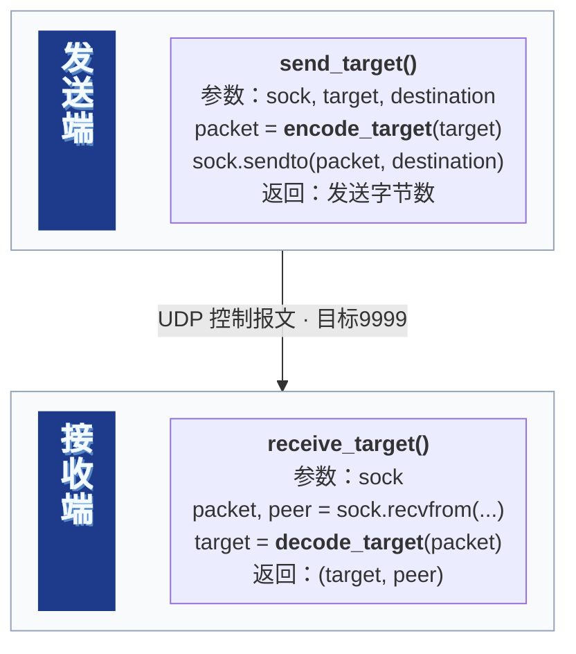
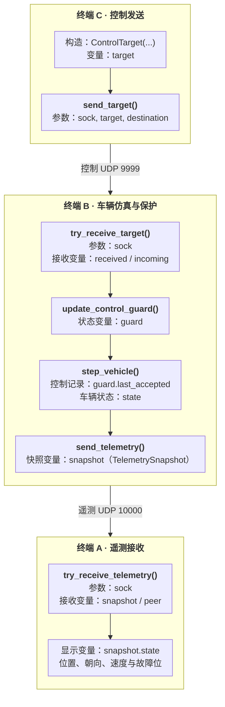
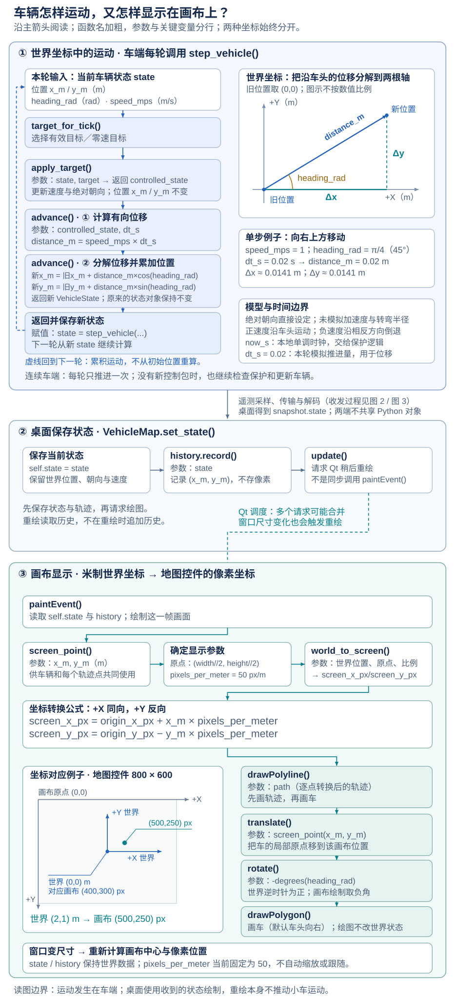
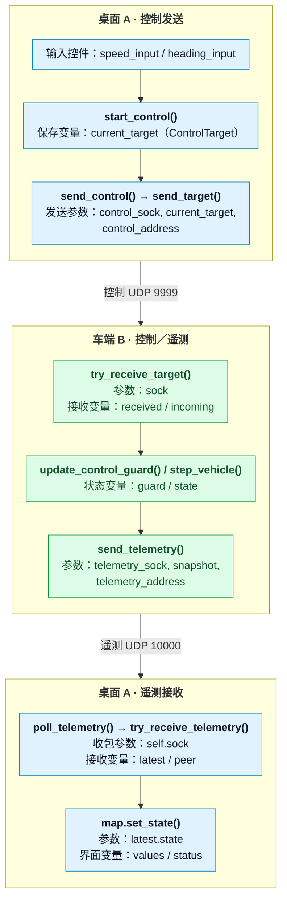
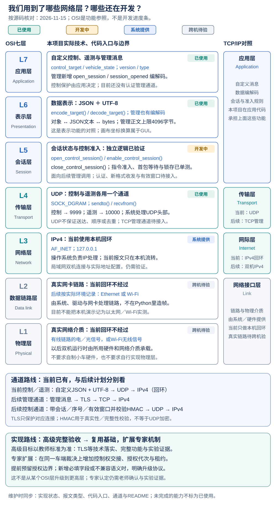
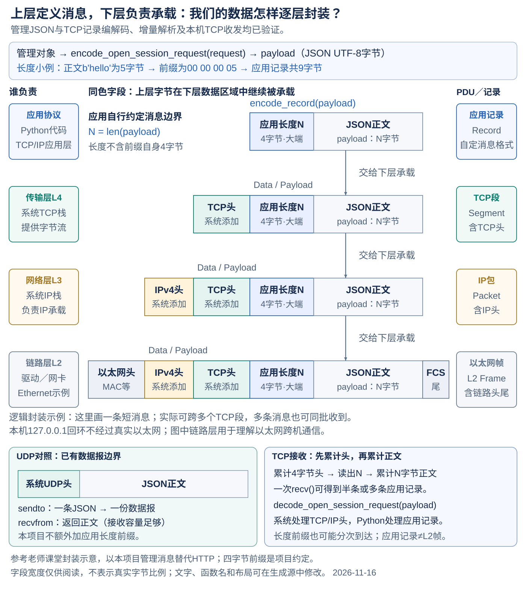
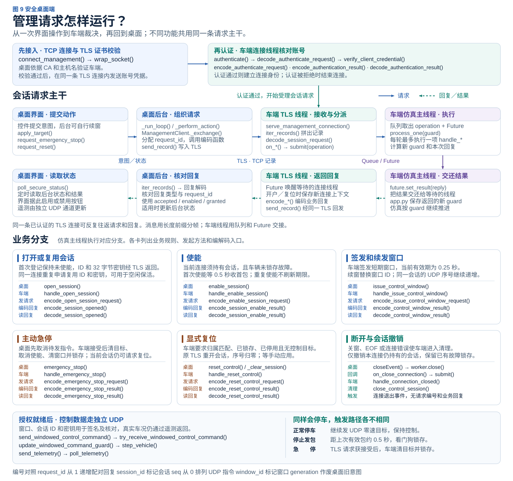
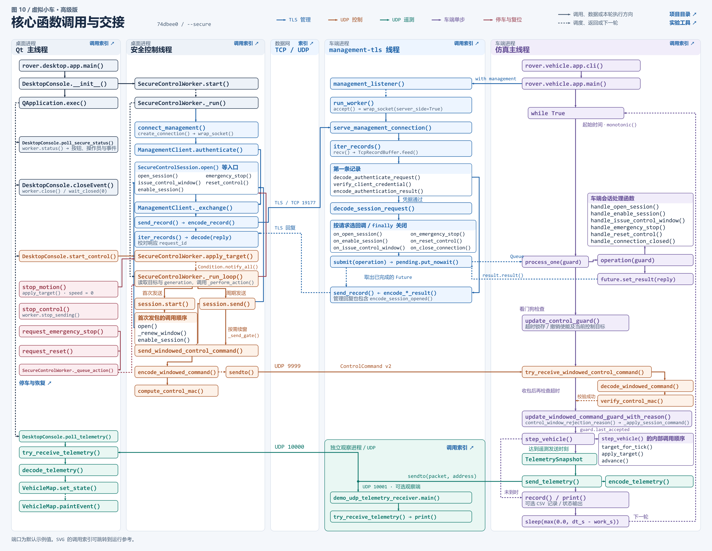

# network-programming-project

虚拟小车网络遥控 · 网络编程小组项目（MUST）。

[协议待办](#protocol-checklist) · [体验待办](#experience-checklist) · [团队开发规范](docs/development-standards.md)

## 项目总览

### 功能与交付

- **运动模型**：车辆状态、单步推进、固定步长轨迹及分阶段控制。
- **网络与保护**：UDP控制与遥测、TLS认证管理、HMAC与有效窗口准入、控制超时停车、急停和故障锁存。
- **桌面控制**：数值输入、正常停车/停发、地图与轨迹、遥测可用/过期提示。

当前原型可在本机以源码方式运行，无需实体小车。最终交付目标为Windows EXE，发布包待制作。

### 模块职责速查

| 模块与能力 | 在系统中的作用与关键入口 |
| --- | --- |
| 车辆状态、目标与步进 | `VehicleState`、`apply_target()`、`advance()`提供运动计算，本身不是网络协议。 |
| 控制与遥测编解码 | `encode_target()/decode_target()`、`encode_telemetry()/decode_telemetry()`定义应用消息并转换数据表示。 |
| UDP收发与非阻塞接收 | `send_target()`、`try_receive_target()`及遥测对应函数使用系统Socket；无包、坏包与系统错误分别处理。 |
| 超时停车与故障锁存 | `AcceptedTarget`、`update_control_guard()`、`step_vehicle()`执行本地保护，不代表已完成认证会话。 |
| 会话状态与管理接入 | `open_control_session()`、`enable_control_session()`、`close_control_session()`维护登记、使能与关闭状态；TLS 实验入口已连接仿真主循环，UDP 控制通过 HMAC 和会话准入检查。 |
| 桌面显示与周期控制 | `start_control()`、`send_control()`、`poll_telemetry()`组合两条UDP方向；`world_to_screen()`是GUI坐标换算。 |

### 开发路线与验收范围

开发顺序为 **完整会话流程与ID约定 → 内存串联 → 管理消息与TCP分帧 → 本机TCP传输 → TLS、身份与会话绑定 → 新UDP控制及HMAC、有效窗口、急停与恢复 → 桌面整合 → 双机高级验收**。内存串联阶段复用现有会话状态逻辑。

安全桌面控制、急停与复位已完成本机验收。TLS 管理、UDP 控制和遥测已在 Windows 宿主机与 Ubuntu 虚拟机之间完成[虚拟局域网联调](#vmware-lan-acceptance)。两台物理电脑的局域网验收和专家机制待推进。

- 项目范围包括观察端、故障注入、重复实验与原始数据，以及专家阶段的控制权交接、授权代次、租约和机制对照。
- 第二台机器预检及最小EXE打包提前安排。配置、资源、证书、日志、跨机验证、报告、PPT与录像随版本更新。
- 高级阶段验证TLS握手、证书校验、跨机闭环与保护。专家阶段在此基础上扩展控制权交接、授权代次与租约。

图中按实现和验证状态标记进展。A01—A10用于拆解组内实现与验证，最终评定依据教师评分标准。实验数据和待补项见[高级版验收记录](#advanced-acceptance-status)。

[详细开发路线](docs/development-roadmap.md) · [AI 与贡献者入口](AGENTS.md) · [图 10 核心函数运行结构](#advanced-runtime-map) · [展开模块与函数关系](docs/runtime-reference.md) · [新增验收记录](docs/verification.md)

### 后续待办

对应任务交付、达到验收条件并留下证据后，在 PR 中把本页对应条目标记为完成。数据和待补项见[高级版验收记录](#advanced-acceptance-status)。

<a id="protocol-checklist"></a>

#### 协议路线 · 高级向专家推进

物理双机和真实断网由组员在有设备时补测。专家路线先推进可在本机验证的任务，现场验收结果单独记录。 [协议任务依赖与验收](docs/development-roadmap.md#protocol-delivery)

- [ ] A01 完成两台物理电脑的局域网联调，验证 TLS 认证、UDP 控制、车端运动和遥测回传。 [双机验收要求](docs/development-roadmap.md#advanced-protocol-acceptance)
- [ ] A08/A09 保持车端运行，实际断网并验证停车。网络恢复后确认车辆保持静止，再重建会话，若已锁存则显式复位，再次使能并明确应用目标后验证重新运动。 [断网与恢复验收](docs/development-roadmap.md#advanced-protocol-acceptance)

- [x] P1 定义控制权状态机、管理消息与拒绝结果。 [接口草案与本机实测](docs/expert-control-authority.md#41-单终端动手测试)
- [x] P2 支持两条 TLS 管理连接同时在线，保持车端串行裁决。 [双 TLS 本机联调](docs/expert-control-authority.md#5-p2-双-tls-本机联调)
- [ ] P3 实现独占控制权和零速显式交接。 [正式车端本机交接预检](docs/expert-control-authority.md#6-p3-零速交接)
- [ ] P4 将授权代次接入 UDP 准入，验证旧授权失效。
- [ ] P5 实现租约续期、到期撤销与停车。
- [ ] P6 发布控制权状态，接入双端操作与反馈。
- [ ] P7 完成机制对照、双端实测和回归留证。

<a id="experience-checklist"></a>

#### 体验路线 · 桌面 GUI 优先

先改善现有桌面操作，再逐步加入操纵、物理和三维显示。 [体验实施顺序与验收](docs/development-roadmap.md#experience-delivery)

- [ ] U1 优化桌面 GUI 布局、控制操作、状态提示和地图使用。 [界面和控件验收](#desktop-ui-acceptance)
- [ ] U2 增加图形化连接配置，常规操作可免命令行。
- [ ] U3 跑通二维启动与只读观察，验证最小 Windows EXE。
- [ ] U4 接入方向摇杆、油门与刹车，定义回中、失焦和断开行为。
- [ ] U5 在二维车端验证加速、滑行、制动与转向模型。
- [ ] U6 建立真实三维坐标与遥测，验证高度变化和兼容性。
- [ ] U7 接入三维场景和车体，保留二维视图。
- [ ] U8 完成驾驶反馈、场景验收和发布包复验。

### 章节导航

本页按开发顺序保留各阶段示例，当前完整桌面操作可直接看[4.1启动](#quick-start)和[4.3数值控制](#desktop-control-acceptance)。
旧示例中的A/B/C是该例自己的终端标签。

| 板块 | 内容 |
| --- | --- |
| [1. 环境准备与项目结构](#environment) | 安装、测试、目录职责与应用入口 |
| [2. 车辆运动与UDP控制](#motion-control) | 离线运动 → 单包UDP控制 → 持续运行与本地保护 |
| [3. 遥测回传](#telemetry) | 三终端运行、状态观察与图2 |
| [4. 桌面控制台](#desktop-console) | 启动与状态 → 地图/轨迹/坐标 → 数值控制与验收 → 实现要点 |
| [5. 协议分层、TCP 分帧与 TLS 会话](#network-layers) | 控制信封 → 管理编解码与分帧 → TLS 与线程交接 |
| [6. 安全控制、管理动作与保护恢复](#secure-control-evolution) | HMAC、有效窗口 → 管理请求、急停 → 复位与运行时 |
| [7. 正式入口、桌面整合与跨系统联调](#secure-desktop-integration) | 正式启动 → 安全桌面 → VMware 与只读观察 |
| [8. 网络故障实验与高级验收](#fault-experiment-sequence) | 断流、丢包、延迟、乱序与重复 → 诊断 → 计时与证据 |
| [9. 项目配置与文档维护](#project-maintenance) | 包配置、Git协作、目录迁移、导图维护与TDD开发方式 |

<a id="environment"></a>

## 1. 环境准备与项目结构

### 1.1 运行环境

Windows PowerShell、Python 3.12；运行依赖及版本见[pyproject.toml](pyproject.toml)。
以下命令均在仓库根目录执行，使用虚拟环境中的Python，无需先激活环境。

<a id="environment-setup"></a>

### 1.2 创建环境与安装依赖

```powershell
py -3.12 -m venv .venv
.\.venv\Scripts\python.exe -m pip install -e .
```

这是可编辑安装：首次配置后，日常修改源码会直接生效，无需每次重新安装。

### 1.3 运行测试

```powershell
.\.venv\Scripts\python.exe -m unittest discover -s tests -t . -v
```

观察端版本 `1d0ec91` 全量回归 345 项通过（1.130 秒），车端专项 16 项通过（0.133 秒）。局域网配置版本 `ead59ba` 全量回归 342 项通过（1.184 秒），桌面接口专项 17 项通过（0.084 秒）。上一个安全桌面基线的 36 个测试模块共 339 项通过（1.114 秒）。桌面急停与复位接线经历21项中的4项预期失败，补全后专项21项通过（0.232秒），并完成本机联调。基础安全桌面提交2100a51的基线为335项，后台提交c784bb1为330项（1.115秒），桌面安全发包为324项（1.300秒），桌面安全连接入口为316项（1.243秒）。正式车端PR #21已合并为5314264，合并后310项通过（0.970秒）。此前管理运行时301项、正式复位298项、急停288项、管理客户端276项及窗口控制269项的实测记录分别保留。开发方式及RED/GREEN实例见[9.4 测试驱动开发与阶段验收](#development-method)。

历史基线：2026-11-19助手完整回归21个测试模块、214项通过，包括控制编解码40项、认证控制编解码9项、HMAC计算与核对6项、管理消息编解码26项、会话密钥8项、UDP控制收发15项、TCP应用记录15项、TCP传输7项、控制保护28项、桌面控制8项。Qt使用离屏模式，Socket使用本机回环；原始记录保留供对照。

### 1.4 项目结构与职责

代码按职责归类；应用入口组合公共模块，测试与教学示例分别存放。

```text
src/rover/
  __init__.py
  core/           公共状态与运动模型
  protocol/       消息格式与编解码
  transport/      网络收发
  vehicle/        车端保护与运行入口
  desktop/        窗口、地图与轨迹
tests/            自动化测试
examples/         各课独立示例
reference_image/  导图与可编辑图源
pyproject.toml    项目安装与构建配置
requirements.txt 第三方依赖清单
README.md        使用说明与原理
.gitignore       Git忽略规则
LICENSE          项目许可证
```

| 模块 | 文件与职责 |
| --- | --- |
| `core` | `vehicle_model.py`保存状态并计算单步运动；`control_target.py`定义/应用运动目标；`simulation.py`用于离线多步轨迹。 |
| `protocol` | `control_codec.py`、`telemetry_codec.py`与`management_codec.py`定义控制、遥测和管理消息的JSON编解码与字段校验；`control_auth.py`计算和核对HMAC认证码。 |
| `transport` | `udp_transport.py`衔接编解码与Socket收发，区分空闲、坏包和系统错误；`tcp_records.py`编解码TCP应用记录并从分次到达的字节中提取完整正文；`tcp_transport.py`负责本机TCP收发、EOF及读取期限。 |
| `vehicle` | `control_watchdog.py`选择有效或零速目标；`control_guard.py`管理会话、密钥、使能、接受记录及超时；`management_session.py`处理身份和会话归属，`management_connection.py`处理管理消息流，`management_runtime.py`负责TLS监听、网络线程与主线程队列交接；`vehicle_runtime.py`组合受保护步进，`app.py`运行车端循环。 |
| `desktop` | `app.py`组合窗口、按钮、定时器与网络；`desktop_map.py`绘制地图；`map_geometry.py`换算坐标；`trajectory.py`保存世界轨迹；`management_client.py`封装TLS管理请求、自动编号及回复配对；`secure_connection.py`统一证书校验、账号认证和连接清理；`secure_control.py`组织桌面会话、窗口与签名发包；`control_worker.py`负责后台连接、周期发送、保活和状态更新。 |
| `tests` | 最近全量回归 351 项，覆盖模型、控制/遥测/管理消息、管理客户端、安全连接入口、桌面安全发包与后台线程、HMAC、会话密钥、短期窗口、急停、正式复位、管理运行时线程交接、启动与网络地址配置、遥测双发、控制断流和车端计时、真实UDP、本机TCP、TCP应用记录、保护、会话状态与两种桌面启动路径和界面行为。 |
| `examples` | 教学示例，可单独观察离线运动、单包与周期控制、超时、命令行遥测和安全管理连接。 |
| `reference_image` | 文档图片和生成源；当前应用画面由代码绘制，不依赖这些参考图运行。 |

`core`负责运动规则，车端`vehicle`决定何时应用什么目标；同一模型可用于离线示例和联网运行。
`protocol`负责消息怎样解释，`transport`负责消息怎样收发。目录本身不规定执行顺序，运行顺序由函数调用决定。

#### 1.4.1 两个应用入口

| 模块 | 原文件 | 作用 |
| --- | --- | --- |
| `rover.desktop.app` | `demo_desktop_console.py` | 创建桌面窗口、Socket与定时器，连接用户操作和遥测显示。 |
| `rover.vehicle.app` | `demo_udp_vehicle_loop.py` | 维护车辆/保护状态，循环收包、步进并回传遥测。 |

两个`app.py`用完整模块名区分。它们保留原程序逻辑，不是另写一套程序。
当前双终端完整命令见[4.1](#quick-start)；示例按本页命令使用`-m examples.示例名`。
单独运行测试时，例如`.\.venv\Scripts\python.exe -m unittest -v tests.test_vehicle_model`。
不要直接运行`src/`内的文件。

<a id="motion-control"></a>

## 2. 车辆运动与UDP控制

### 2.1 离线运动与分阶段控制

```powershell
.\.venv\Scripts\python.exe -m examples.demo_simulation
.\.venv\Scripts\python.exe -m examples.demo_control
```

`apply_target()`更新速度与绝对朝向，`advance()`根据步长计算新位置；
`run_steps()`重复推进并保存初始状态及每步结果。
运动公式与世界/画布坐标关系见[4.2.2运动原理图](#vehicle-motion-coordinates)。

### 2.2 单包UDP控制

<a id="single-udp-demo"></a>

#### 2.2.1 同机单包UDP收发

本例终端A是接收端，终端B是发送端。先在A运行：

```powershell
.\.venv\Scripts\python.exe -m examples.demo_udp_receiver
```

看到`waiting for UDP`后，在B运行：

```powershell
.\.venv\Scripts\python.exe -m examples.demo_udp_sender
```

接收端应打印来源地址及`ControlTarget(speed_mps=2.0, heading_rad=0.5)`。
接收端绑定`127.0.0.1:9999`，发送端绑定端口`0`，由系统分配临时源端口。
两端打印的来源端口应一致；发送字节数仅表示本机发送结果，不是接收确认。

接收端处理一条消息后退出；再次演示须先重启接收端，等待时可按`Ctrl+C`结束。

<a id="single-udp-flow"></a>

#### 2.2.2 图1：一条控制消息怎样到达接收端

`packet`由`recvfrom()`从Socket接收队列取得，`peer`是来源地址；再由`decode_target()`校验和还原。



对应源码：[发送](examples/demo_udp_sender.py)、[接收](examples/demo_udp_receiver.py)、[UDP收发](src/rover/transport/udp_transport.py)、[控制编解码](src/rover/protocol/control_codec.py)。

#### 2.2.3 UDP目标驱动车辆模型

先在终端A运行：

```powershell
.\.venv\Scripts\python.exe -m examples.demo_udp_vehicle
```

再在终端B运行`-m examples.demo_udp_sender`，完整命令见[2.2.1 同机单包UDP收发](#single-udp-demo)。初始位置由接收端的`VehicleState()`创建；
发送端只提供目标速度和朝向。

接收目标后以`0.02 s`推进50步，即1秒模拟时间，轨迹含初始帧共51个状态：

```text
states=51
start: x=0.0000m y=0.0000m
end: sim_t=1.00s x=1.7552m y=0.9589m
```

这是收到一条消息后的离线计算，1秒模拟时间可以很快算完。

### 2.3 持续控制与车端保护

#### 2.3.1 控制超时与定时运行

```powershell
.\.venv\Scripts\python.exe -m examples.demo_watchdog_loop
```

脚本构造一次`2.0 m/s、0 rad`目标，以`0.02 s`模拟步长运行；
约0.5秒后停车，约1秒后结束，停车后坐标不变。

| 时间变量 | 用途 |
| --- | --- |
| `accepted_at_s` | 最后接受有效控制的时刻，用于判断控制超时 |
| `started_at_s` | 程序启动时刻，用于计算总运行时长 |
| `wall_t` / `sim_t` | 实际经过时间 / 累计模拟时间；两者可能因调度不同 |

#### 2.3.2 持续接收、周期控制与故障锁存

先在终端A启动持续车端：

```powershell
.\.venv\Scripts\python.exe -m rover.vehicle.app
```

在终端B选择一种发送方式。单条目标用于观察接受一次后的超时停车：

```powershell
.\.venv\Scripts\python.exe -m examples.demo_udp_sender
```

周期目标每约0.1秒一条，共20条：

```powershell
.\.venv\Scripts\python.exe -m examples.demo_udp_stream_sender
```

比较两种方式时先重启车端，清除上一轮锁存。观察重点：

1. 首次目标被`accepted`后开始运动；新有效目标刷新接受时间。
2. 距最后接受已达0.5秒时停车并设置`fault_latched=True`；重发普通目标显示`ignored`，不能解除锁存。
3. 无包时返回`None`，坏包抛出`ValueError`并打印`rejected`；保护与仿真仍继续。车端每轮只推进一次。
4. `wall_t`包含首次控制前的等待；日志在本轮推进后打印，因此首条接受记录的坐标可能已非零。

发送日志的`1/20`表示发送进度，不是协议序号。车端用`Ctrl+C`退出。
本页时刻均受系统调度影响，不要求恰好在某个毫秒或固定终点停车。

<a id="telemetry"></a>

## 3. 遥测回传

### 3.1 三终端启动

三个终端按以下顺序启动，先结束旧车端和旧接收器：

| 终端 | 职责 | 命令 |
| --- | --- | --- |
| A | 接收遥测 | `.\.venv\Scripts\python.exe -m examples.demo_udp_telemetry_receiver` |
| B | 车辆仿真 | `.\.venv\Scripts\python.exe -m rover.vehicle.app` |
| C | 周期控制 | `.\.venv\Scripts\python.exe -m examples.demo_udp_stream_sender` |

C向B的`127.0.0.1:9999`发控制；B使用另一个Socket向A的`127.0.0.1:10000`回传实际位置、朝向、速度和故障标志。

### 3.2 观察与核对

- 首次控制前为原点、零速、未锁定；从未接受控制时，等待本身不触发当前锁存。
- C发送期间位置变化；C结束后B超时停车，A继续收到零速、已锁定状态。再次发送仍应被忽略。
- 保持B运行，只重启A，可以再次收到当前状态；若B已退出，只重启A会等待。
- B每次启动创建新的原点状态；显示端重启不清除车端故障。
- 遥测目标周期为`0.05 s`，终端A日志限速，不能用显示行数推算发送频率；遥测发送失败不停止车端保护循环。

无包`None`不代表全零状态；坏报文已被取出并抛出`ValueError`，程序可以继续处理后续报文。
命令行接收器没有过期提示，桌面窗口的过期提示见[4.1 启动与状态显示](#quick-start)。

<a id="three-terminal-flow"></a>

### 3.3 图2：三个终端怎样控制并回传状态

按C → B → A阅读；加粗为函数名，参数与变量分行，跨端箭头标明通道和端口。



A看到的`peer`属于车端遥测Socket，与C的控制来源端口不同。
对应源码：[车辆运行环](src/rover/vehicle/app.py)、[保护状态](src/rover/vehicle/control_guard.py)、[遥测编解码](src/rover/protocol/telemetry_codec.py)。

<a id="desktop-console"></a>

## 4. 桌面控制台

<a id="quick-start"></a>

### 4.1 启动与状态显示

桌面A接替上一节的遥测A和发送C，当前完整操作只需A＋B。
先退出旧程序，避免端口冲突及多个控制源覆盖目标。

终端A打开桌面：

```powershell
.\.venv\Scripts\python.exe -m rover.desktop.app
```

终端B在另一个终端运行车端：

```powershell
.\.venv\Scripts\python.exe -m rover.vehicle.app
```

只启动A时显示“等待遥测”，没有车辆；B启动后出现原点车辆并显示“遥测可用”。
约1秒无合法遥测后提示“遥测过期”，保留最后车辆、轨迹和读数；它们此时仅代表最后收到的状态。

`status`表示遥测情况，`fault_latched`来自车端保护，`control_status`表示本地发送情况，三者独立。
本节的默认教学模式使用本机回环地址。安全模式的地址配置见[7.3.1 虚拟局域网联调](#vmware-lan-acceptance)。

### 4.2 地图、轨迹与坐标

#### 4.2.1 地图与运行轨迹

`TrajectoryHistory`保存最多1000个世界坐标位置，只跳过相邻重复；A→B→A仍保留。
合法遥测包逐个传给地图，历史仍按世界坐标保存。窗口尺寸或视野改变时根据当前比例和偏移换算像素。

绘制时先画轨迹，再平移和旋转车头，避免整条轨迹跟着车辆转动。
拖拽地图平移，滚轮以光标为中心缩放。工具栏也可缩放、定位车辆和清除轨迹。清除后以最后上报的位置作为新轨迹的起点。

<a id="vehicle-motion-coordinates"></a>

#### 4.2.2 车辆运动与画布坐标

沿图阅读：车端推进世界状态 → 按期限采样并回传遥测 → 桌面逐包保存 → Qt读取缓存并绘制。
`poll_telemetry()`对每个合法包调用`map.set_state(latest.state)`；后者依次保存最新状态、按规则维护世界轨迹、请求重绘。
侧栏只取本轮最后一个合法快照；多个重绘请求可能合并，因此收包、记录轨迹与绘图不是一一对应。[Qt重绘调度说明](https://doc.qt.io/qt-6/qwidget.html#update)

蓝色实线表示调用/执行顺序，灰线表示数据保存/读取，青色虚线表示Qt稍后调度。
世界位置用米，朝向用弧度。画布原点在左上，世界原点在默认视野中映射到地图中心。
`screen_point()`调用`world_to_screen()`执行公式，再将返回像素二元组包装成`QPointF`；轨迹与车辆位置分别复用此换算。
世界+Y向上、画布+Y向下，因此像素Y和绘制角度需转换；重绘只读缓存，不推进车辆或追加轨迹。

[](reference_image/diagrams/04-vehicle-motion.svg)

[可缩放SVG](reference_image/diagrams/04-vehicle-motion.svg) · [高清PNG](reference_image/diagrams/04-vehicle-motion.png)

对应源码：[运动模型](src/rover/core/vehicle_model.py)、[应用目标](src/rover/core/control_target.py)、[运行组合](src/rover/vehicle/vehicle_runtime.py)、[坐标换算](src/rover/desktop/map_geometry.py)、[地图绘制](src/rover/desktop/desktop_map.py)。

<a id="desktop-control-acceptance"></a>

### 4.3 数值控制与八步验收

输入朝向使用度，发送前转为弧度；只编辑输入不会改变已应用目标。

| 操作 | 行为 |
| --- | --- |
| 开始／应用 | 保存当前输入，立即发送并继续周期发送 |
| 正常停车 | 正在发送时改发零速目标，保留已应用朝向；未发送或已停发时不启动发送 |
| 停止发包 | 停止控制发送，遥测接收继续；车端按最后有效控制计时停车 |
| 关闭 | A用窗口“×”，B在终端按Ctrl+C |

2026-11-11用户已完成以下真实A＋B验收：

| 步骤 | 操作与已确认结果 |
| --- | --- |
| 1 | 只有A时等待；B启动后原点车辆、遥测可用、未锁定。 |
| 2 | 设1.0 m/s、45°并应用，车辆向右上移动，朝向显示约0.785 rad。 |
| 3 | 正常停车，速度为0、位置保持；保护未锁定，遥测仍可用。 |
| 4 | 重新设1.0 m/s、0°并应用，车辆恢复向右运动。 |
| 5 | 停止发包，距最后接受控制约0.5秒后停车锁存，遥测仍可用。 |
| 6 | 锁定后重新应用，B打印ignored，位置不变；随后停止发包。 |
| 7 | 结束B，约1秒后A提示遥测过期，车辆、轨迹和最后读数保留。 |
| 8 | 关闭旧A/B后重启，端口正常释放，新车端原点等待，桌面不自动发送。 |

故障锁存后，普通目标及正常停车都不能解除锁存。
重新演示应先退出旧A再重启B，避免旧A的周期目标被新车端接受。
当前A的Ctrl+C可能只打印异常而不退出，请用窗口“×”；正式会话与重连未使能机制后续接入。

<a id="desktop-ui-flow"></a>

#### 4.3.1 图3：桌面数值控制与遥测关系

按A发送 → B计算并回传 → A显示阅读；上下两个A属于同一个桌面进程。



### 4.4 关键实现要点

#### 4.4.1 三种数据

| 数据 | 变量 | 改变时机 |
| --- | --- | --- |
| 输入草稿 | `speed_input / heading_input` | 编辑数值时改变 |
| 已应用目标 | `current_target` | 点击应用，或正在发送时执行正常停车 |
| 实际状态 | `state / latest.state / map.state` | 车端推进后回传，桌面使用收到的状态绘图 |

`sent`只是本机发送字节数，不是车端接收或执行确认。

#### 4.4.2 两个定时器与两个Socket

| 对象 | 配置与职责 |
| --- | --- |
| `self.timer` | 初始化启动，约20ms轮询遥测；每轮最多8次接收尝试 |
| `self.control_timer` | 初始不启动；应用后约100ms发送一次已应用目标 |
| `self.sock` | 监听本机10000端口，接收遥测 |
| `self.control_sock` | 使用临时源端口，向车端9999端口发送控制 |

`start_control()`先保存目标、启动控制定时器，再立即首发，因为`send_control()`会检查定时器是否活动。
收到合法遥测才刷新`last_received_s`；无包或坏包都不延长有效显示时间。

#### 4.4.3 FakeSocket测试

- 替换发生在创建窗口前，因此窗口的网络对象变为`FakeSocket`；Qt控件、信号、目标构造与JSON编码仍真实执行。
- `control("speed_input")`通过`getattr(window, ...)`读取窗口属性；它不在按钮内部寻找或创建输入框。
- `click()`触发真实信号并调用业务函数，`FakeSocket.sendto()`记录报文与地址供断言检查。
- `timeout.emit()`只手动调用一次回调，不证明实际经过100ms；真实UDP由传输测试和双进程联调验证。

对应源码：[桌面窗口](src/rover/desktop/app.py)、[桌面测试](tests/test_desktop_control.py)、[轨迹历史](src/rover/desktop/trajectory.py)、[UDP传输](src/rover/transport/udp_transport.py)。

<a id="desktop-ui-acceptance"></a>

### 4.5 U1 桌面操作与验收

地图和事件日志放在左侧。右侧依次显示车端遥测、TLS 管理连接和控制目标。目标输入与车端实测读数分别显示。遥测过期后，地图保留最后上报的车辆与轨迹，车速和保护状态标记为最后上报。安全模式按现有规则停止发包，遥测恢复后由操作者明确应用目标。

| 控件 | 安全模式下的使用条件 | 操作后核对 |
| --- | --- | --- |
| 开始／应用 | 会话处于可操作状态，遥测未触发停发，车端未锁存 | 桌面提交目标。以车端回传的速度和位置核对实际运动。 |
| 正常停车 | 已应用控制目标 | 保留已应用朝向并继续发送零速目标。确认遥测速度归零。 |
| 停止发包 | 正在控制车辆 | 结束周期发送。观察遥测中的零速及看门狗锁存状态。 |
| 急停 | 安全管理会话可操作 | 显示等待车端确认或车端已确认急停。核对遥测零速及锁存。 |
| 显式复位 | 会话可操作，当前无待发送目标 | 车端确认后等待新遥测。遥测确认解锁后才提示重新应用目标，车辆在此之前保持静止。 |

本地界面验收对照 `eb87428`。使用相同遥测序列查看 Windows 实窗的改版前后状态，检查了 `1140 × 740` 常规窗口及 `880 × 600` 紧凑窗口。合并前加入复位回复先于解锁遥测的回归用例，Windows Python 3.12.4 下 Qt 离屏全量回归 **392 项通过，退出码 0**。

公开对照使用同一组模拟遥测与测试操作员。 [改版前](reference_image/desktop/u1-before.png) · [改版后](reference_image/desktop/u1-after.png)

```powershell
$env:QT_QPA_PLATFORM = 'offscreen'
.\.venv\Scripts\python.exe -X utf8 -B -m unittest discover -s tests -t . -q
```

Windows 本机回环联调使用正式车端、桌面安全控制线程和两路 UDP 遥测，验证了运动、正常停车、停发锁存、急停、复位、遥测中断及恢复、关窗撤销。其他截图与原始日志保存在本地 `local/u1-desktop/`，物理双机的现场证据仍按[高级版验收](#advanced-acceptance-status)收集。

<a id="network-layers"></a>

## 5. 协议分层、TCP 分帧与 TLS 会话

### 5.1 分层、控制信封与基础保护

#### 5.1.1 分层职责

##### 图5：各层实际用了什么

OSI七层用于理解职责，TCP/IP用于描述本项目采用的实际通信结构。
高级与专家属于项目验收阶段，分层图用于对照不同网络功能的职责。
本项目在应用代码中承担消息语义、数据表示和会话管理功能；不能把写了`session_id`直接当作独立实现了OSI的L5。[分层与应用内会话功能的说明](https://docs.oracle.com/cd/E19504-01/802-5886/intro-45828/index.html)。
下图对照2026-11-16源码，区分已使用、开发中、系统提供及跨机待验；功能变化时同步修订。

[](reference_image/diagrams/05-network-layers.svg)

[可缩放SVG](reference_image/diagrams/05-network-layers.svg) · [高清PNG](reference_image/diagrams/05-network-layers.png)

#### 5.1.2 控制信封与车端准入

`ControlCommand(session_id, seq, target)`复用现有`control_codec.py`，把会话标识、报文序号与运动目标组合起来。

##### 报文格式与编解码

最近通过的控制编解码基线为40项（旧格式19项、新格式21项），涵盖合法编解码、倒车往返、两端元数据/运动值校验、两端1200字节边界、解析前拒绝超限、严格版本类型及新旧格式互拒；完整项目回归已通过。

新解码器先检查原始`bytes`长度，再进行UTF-8解码和JSON解析：超限已违反约定，无需再创建字符串与对象。限制按字节而非字符或字典字段数计算；先解析再检查仍能判定长度，但解析开销已经发生。超限且同时无法解析时，优先报告长度错误。

当前新格式的JSON载荷示例：

```json
{
  "version": 1,
  "type": "control_command",
  "session_id": "session-a",
  "seq": 12,
  "speed_mps": 2.0,
  "heading_rad": 0.5
}
```

格式要求：版本为整数1，类型为`control_command`；会话标识为非空且非纯空白字符串；序号为非负整数，布尔值不作为整数接受；运动值须为可表示成有限float的int/float。整条UTF-8载荷最多1200字节。

- `session_id`区分哪次控制会话，不是密码或源端口；内部登记、使能和关闭操作见[会话登记、使能与关闭](#control-session-lifecycle)。
- `seq`对同一会话中的新报文递增，即使目标值相同。它为后续重复/乱序判断提供依据，不要求保存或执行每一条；序号较大也不等于报文足够新鲜；比较须结合已确认有效的所属会话，不能把不同会话的序号混用。

<a id="control-admission"></a>

##### 车端准入与超时保护

`control_guard.py`新增`update_command_guard()`，对解码后的`ControlCommand`判断是否接受；它不收包，也不推进车辆位置。

| 车端状态字段 | 含义 |
| --- | --- |
| `session_id` | 车端当前登记的会话；由内部状态操作或测试构造，真实管理流程尚未接入。 |
| `enabled` | 是否明确允许控制，默认`False`；已使能也可以接受合法零速目标，不表示必须运动。 |
| `enabled_at_s` | 本次使能的车端单调时刻；首条有效命令被接受前的超时起点，重复使能不刷新。 |
| `last_seq` | 最后实际接受的序号；`None`表示尚无历史，`0`是有效序号。 |
| `last_accepted` | 当前可执行的目标与本地接受时刻；`None`表示当前没有有效执行记录。 |
| `fault_latched` | 故障是否锁存；普通新命令不能解除锁存，单独打开使能位也不能绕过。 |

新入口按以下顺序处理：

1. 调用`update_control_guard(guard, now_s=now_s)`复用保护检查，省略`incoming`，不提前接受命令。已有锁存直接返回；否则先选计时起点：已有`last_accepted`时用`accepted_at_s`，否则已使能时用`enabled_at_s`；未使能且没有接受记录时正常等待，不计时。
2. 已使能却没有任何计时起点，或`now_s - 起点 >= 0.5 s`时，先锁存故障、撤销使能并清空`last_accepted`，保留会话、序号及使能起点，然后返回；同一轮到达的新命令也不能刷新到期记录。
3. 保护通过后，检查有无新命令、是否使能、会话是否匹配、序号是否比本会话最后接受的大。允许跳号，拒绝重复或倒退；使能只是准入条件之一。
4. 全部通过后才创建`AcceptedTarget`，用`replace()`同时保存目标、`accepted_at_s`与`last_seq`。首包之后改用接受时刻计时；被拒绝的命令不刷新记录。

`enabled_at_s`和`accepted_at_s`保存发生事件时的车端单调时刻，`now_s`是每次调用传入的当前检查时刻，不是状态字段；运行时须使用同一单调时钟。`0.0`是合法时刻，应以`is None`判断有无起点；首次检查已越过期限也会锁存。

`incoming=None`只表示本轮没有新命令，未超时时旧目标仍有效；`last_accepted=None`表示当前没有可执行记录，可能仍在等待首包。车辆执行层的`target_for_tick()`此时选择零速目标。若已使能、没有接受记录且`enabled_at_s=None`，则属于上面的缺失起点情况。

<a id="control-session-lifecycle"></a>

##### 会话登记、使能与关闭

以下是供可信管理上下文调用的内部纯状态接口，不收发报文，也不完成认证；`session_id`匹配只表示与当前登记一致。
`open_control_session()`只登记调用方提供的ID，不负责生成或传输。当前测试使用`session-a/b`等固定样例；自动生成、管理回复及桌面保存仍待正式管理链路接入。


| 操作 | 条件与状态转换 | 重复或不匹配时 |
| --- | --- | --- |
| `open_control_session(guard, session_id)` | 登记会话ID，保留其余状态；从初始或已关闭状态打开时仍未使能，不生成目标，也不解除故障。 | 同ID重复调用状态值不变；已有其他ID时抛出`ValueError`，不能覆盖。 |
| `enable_control_session(guard, now_s)` | 必须已有会话且未锁存故障；设置`enabled=True`和`enabled_at_s=now_s`，不创建接受记录，尚无目标时开始等待首包。 | 缺少会话或已有故障时抛出`ValueError`；重复使能保留原起点和控制记录。 |
| `close_control_session(guard, session_id)` | 清空会话、目标、序号和使能起点，撤销使能，保留`fault_latched`。 | 当前登记为其他ID时抛出`ValueError`；已关闭时重复调用，关闭后的状态值不变。 |

因此，关闭A再打开B后，B必须重新使能才能接受自己的`seq=0`；A的旧包在关闭后、B未使能及已使能时都不能恢复控制。

状态为不可变数据；`replace()`返回新状态，调用方须采用并继续传递返回值，例如`guard = close_control_session(guard, session_id="session-a")`。测试保留`before`用于比较原状态未变；它是旧快照，不是另一个待关闭的资源。

控制保护模块28项测试按职责独立组织：旧目标入口3项、控制信封准入8项、内部会话状态17项。覆盖序号0及跳号、未使能/错会话/重复乱序拒绝、无包未到期、故障优先、登记/使能/关闭的拒绝与幂等、首包到期、接受后切换计时起点、缺失起点，以及关闭A后重新使能B的完整状态链路。
对应源码：[准入与保护](src/rover/vehicle/control_guard.py)、[保护测试](tests/test_control_guard.py)、[有效目标选择](src/rover/vehicle/control_watchdog.py)。

##### 运行模式与报文准入

车端根据运行模式选择相应的报文接收与处理入口。

| 运行模式 | `incoming` 的内容 | 处理函数 |
| --- | --- | --- |
| 默认 UDP | `ControlTarget`，速度和朝向 | `update_control_guard()`接受目标，并处理超时锁存。 |
| TLS 管理模式 | `ControlCommand`，会话 ID、序号和目标 | `update_command_guard()`检查使能、会话归属及序号，再接受目标。 |

`update_command_guard()`内部先调用`update_control_guard()`做公共超时检查，随后做会话和序号审查。只有通过的报文才更新接受时间与`last_seq`。

本机双终端已实测 TLS 认证、申请会话、使能后发送 UDP 的`seq=0～9`，遥测确认速度达到 1.0 m/s。最后一条指令在 4.125 s 被接受，4.625 s 停车并锁存故障，间隔 0.500 s。再次使能被拒绝，连接断开后会话登记清空。

### 5.2 管理消息与本机TCP

<a id="management-message-codec"></a>

#### 5.2.1 管理请求与回复编解码

`management_codec.py`已完成`open_session`请求和`session_opened`成功回复的JSON编解码，17项模块测试通过，覆盖消息头、必填字段、ID格式、编解码两端4096字节正文上限，以及畸形输入拒绝和后续独立调用。大小限制按完整JSON正文的UTF-8字节计算，不含应用记录的4字节长度头；解码时先检查长度，再解析正文。这些函数已用于本机TCP管理演示，负责数据格式。正式会话生成、登记及认证由后续管理逻辑完成。

当前两种管理消息的职责如下，`version`均为严格整数`1`：

| 消息 | 数据与职责 | 编解码入口 |
| --- | --- | --- |
| `open_session` | `OpenSessionRequest(request_id)`申请建立会话，此时尚无`session_id`。 | `encode_open_session_request()` / `decode_open_session_request()` |
| `session_opened` | `SessionOpened(request_id, session_id)`携带成功回复；回复应回显对应申请的编号，实际匹配由后续管理逻辑完成。 | `encode_session_opened()` / `decode_session_opened()` |

`request_id`必须为非负整数，允许`0`，拒绝布尔值；`session_id`必须为非空白字符串，编解码保留原值。`_encode_management_message()`、`_decode_management_message()`共用JSON与大小处理，两个ID校验函数共用字段规则。对应源码：[管理消息](src/rover/protocol/management_codec.py)、[管理消息测试](tests/test_management_codec.py)。

<a id="encapsulation-and-framing"></a>

#### 5.2.2 图6：上层定义消息，下层负责承载

老师课堂中的HTTP → TCP → IPv4 → Ethernet示意，展示了逐层封装：下层将来自上层的字节放入自己的Data/Payload，再添加本层需要的信息。图6用本项目的管理JSON替代HTTP；各层有自己的头部，应用消息、TCP段、IP包和链路帧之间没有固定的一一对应关系。

[](reference_image/diagrams/06-encapsulation.svg)

[可缩放SVG](reference_image/diagrams/06-encapsulation.svg) · [高清PNG](reference_image/diagrams/06-encapsulation.png) · [文字与布局生成源](reference_image/diagrams/render_encapsulation.py)

TCP与UDP都自带传输层协议头，由系统协议栈处理。现有控制与遥测的载荷路径是**自定义消息 → JSON文本 → UTF-8字节 → UDP/IPv4**；`sendto(packet, address)`中的IP与端口交给操作系统处理，不是编码器写进JSON的字段。本项目一条JSON对应一份UDP数据报，接收容量足够时`recvfrom()`保留该数据报的边界，因此不额外添加应用消息长度前缀。UDP不保证送达、顺序或去重。[UDP标准](https://www.rfc-editor.org/rfc/rfc768.html)

TCP向应用提供有序字节流，一次读取可能只有半条消息，也可能包含多条消息。本机TCP管理演示采用**4字节无符号大端正文长度N + N字节正文**；`N = len(payload)`只计算JSON正文的UTF-8字节，不含前缀自身4字节，正文上限沿用4096字节。接收方须先累计满4字节读出N，再累计正文；长度头本身也可能分次到达。

`encode_open_session_request(request)`生成JSON正文`payload`。`encode_record(payload)`添加4字节长度头`header`，返回应用记录`record`，头部字节数由`RECORD_HEADER_BYTES`给出。`send_record()`调用`sendall()`写入已连接的TCP Socket。应用记录由Python代码组织，TCP协议由操作系统处理。链路层继续使用Ethernet frame这个名称。接收端逐条还原正文的过程见[图7](#tcp-record-receive)。

图中的以太网头和FCS由系统、驱动与网卡处理；`127.0.0.1`回环不经过真实以太网，不作为已完成局域网实验的证据。[主机回环规定](https://www.rfc-editor.org/rfc/rfc1122.html#section-3.2.1.3)

课程衔接：CS370/SE370第一讲第15、17、20页（PDU与封装），第二讲第56—57页（以太网framing），第五讲第9页及第33页（TCP/UDP首部；UDP所在PDF页序为32）。TCP字节流不保留应用消息边界的例子见课程教材第6.5.2节、印刷第560页、图6-35。

<a id="tcp-record-receive"></a>

#### 5.2.3 图7：TCP接收端怎样拼出一条记录

[](reference_image/diagrams/07-tcp-record-receive.svg)

[可缩放SVG](reference_image/diagrams/07-tcp-record-receive.svg) · [高清PNG](reference_image/diagrams/07-tcp-record-receive.png) · [生成源](reference_image/diagrams/render_tcp_record_receive.py)

图7沿用图6里的`hello`字节示例。从调用方传入的`sock`和`record_timeout_s`读起，沿箭头查看每个返回值。`_recv_chunk(sock, deadline_s)`返回`chunk`，同一个`TcpRecordBuffer`再用`feed(chunk)`切出完整的`record`。`decode_record(record)`返回一条`payload`，`feed()`返回本批的`payloads`列表。`yield from payloads`把正文逐条交给连续的`next()`调用。实际管理正文由调用方交给相应的JSON解码器，例如`decode_open_session_request(payload)`。

设置`record_timeout_s`后，装配期限从读到当前记录的首批字节时起算。每次继续读，`_recv_chunk()`取剩余期限与原Socket超时中较短的值，读取结束后恢复原设置。收到Socket EOF后，`iter_records()`调用`finish()`检查头部或正文是否截断。

单条记录编解码的9项测试覆盖多字节长度、1/4096字节合法边界、短头部、零长度或超限声明以及正文长度不符。加上缓冲行为后，TCP应用记录15项通过，TCP传输7项通过。双终端已在`127.0.0.1:19176`实测管理请求与回复共用一条TCP连接，回显`request_id=7`、返回固定演示ID `demo-session`，然后正常到达EOF。[TCP应用记录](src/rover/transport/tcp_records.py) · [TCP传输](src/rover/transport/tcp_transport.py) · [记录测试](tests/test_tcp_records.py) · [传输测试](tests/test_tcp_transport.py)

<a id="protocol-regression"></a>

#### 5.2.4 A03 协议边界回归

管理 JSON 正文上限为 4096 字节，TCP 管理记录另有 4 字节长度头。控制和遥测 UDP 消息分别限制为 1200 字节。2026-11-22 在 `7232cd2` 基线上的工作区复跑 8 个协议相关测试模块，**118 项通过**。覆盖合法边界、非法字段与编码、分段读取、截断和组帧超时，以及有效的管理请求与回复在本机 TCP 上往返。

```powershell
.\.venv\Scripts\python.exe -X utf8 -B -m unittest -v tests.test_management_codec tests.test_tcp_records tests.test_tcp_transport tests.test_management_connection tests.test_control_codec tests.test_windowed_control_codec tests.test_telemetry_codec tests.test_windowed_vehicle_app
```

结果记录于 `local/a-tests/a03/protocol-regression-b9152b56.txt`。当前证据来自编解码、传输和车端单步测试。正式车端进程在跨系统环境下拒绝异常消息并继续正常服务的完整现场记录待补。

<a id="tls-certificates"></a>

### 5.3 TLS 握手、认证与会话

#### 5.3.1 证书、握手与身份认证

##### 证书文件与常见缩写

车端使用`server.pem`（服务器证书）和`server.key`（服务器私钥）参与握手。桌面端用`ca.pem`验证车端证书的签发链，并核对证书中的服务名称`localhost`。

| 术语 | 全称与在本章的用途 |
| --- | --- |
| TLS / SSL | TLS 是 **Transport Layer Security**（传输层安全协议）。SSL 是 **Secure Sockets Layer**（安全套接字层），是 TLS 的前身。本机演示协商到了 TLS 1.3。 |
| PEM | **Privacy-Enhanced Mail**（隐私增强邮件）。名称源自早期邮件标准。在本实验中，`ca.pem`和`server.pem`采用文本编码，以`BEGIN CERTIFICATE`和`END CERTIFICATE`标记 Base64 证书内容的边界。 |
| CA / `ca.pem` | **Certificate Authority**（证书颁发机构，RFC 5280 写作 **Certification Authority**）。`ca.pem`保存实验根 CA 的公共证书，作为桌面端校验证书链的信任起点。 |
| OpenSSL | 广泛使用的开源密码学工具包，提供 SSL/TLS 库和命令行工具。本章用它生成、签发、查看和验证证书。 |
| CSR | **Certificate Signing Request**（证书签名请求）。`server.csr`携带服务器的公钥和名称等信息，用于向 CA 申请签发服务器证书。 |
| CN / SAN | CN 是 **Common Name**（通用名称），如输出里的`subject=CN=localhost`。SAN 是 **Subject Alternative Name**（主题备用名称），本机校验所用的`DNS:localhost`列在这里。DNS 是 **Domain Name System**（域名系统），这里的`DNS:`表示名称类型。 |

参考：[TLS 1.3](https://www.rfc-editor.org/rfc/rfc8446.html) · [OpenSSL 工具包](https://openssl-library.org/) · [PEM 文本编码](https://www.rfc-editor.org/rfc/rfc7468.html#section-1) · [X.509 证书与 SAN](https://www.rfc-editor.org/rfc/rfc5280.html#section-4.2.1.6) · [证书签名请求](https://www.rfc-editor.org/rfc/rfc2986.html#section-1)

##### 本机证书校验

X.509 是这里使用的证书标准。用`openssl x509`查看证书时，`subject`表示证书属于谁，`issuer`表示谁签发了证书。`ca.pem`的主题和签发者都是`Local TLS Lab CA`，并带有`CA:TRUE`。`server.pem`的签发者是该 CA，证书的 SAN 包含`DNS:localhost`。

| `openssl verify`校验条件 | 实测结果 |
| --- | --- |
| 加载`ca.pem`，核对`localhost` | `server.pem: OK` |
| 加载同一张`ca.pem`，核对`wrong.localhost` | `hostname mismatch` |
| 信任集合为空，核对`localhost` | `unable to get local issuer certificate` |

这三次使用同一张服务器证书，分别检验证书校验成功、名称不匹配和找不到可信签发链的结果。[OpenSSL 证书验证命令](https://docs.openssl.org/3.5/man1/openssl-verify/)

##### 本机TCP连接与TLS握手

两端先用`accept()`和`create_connection()`得到普通的TCP Socket。随后`SSLContext.wrap_socket()`按各自的配置把该连接交给TLS处理。默认在握手成功后返回`SSLSocket`，随后通过它读写的应用数据由TLS加密传输。[Python `SSLContext.wrap_socket()` 文档](https://docs.python.org/3.12/library/ssl.html#ssl.SSLContext.wrap_socket)

双终端在`127.0.0.1:19177`实测，同一张服务器证书和同一个`ca.pem`下，预期名称为`localhost`时协商到`TLSv1.3`。改成`wrong.localhost`后，桌面端仍打印`TCP connected`，随后在握手中报`Hostname mismatch`，车端也收到握手错误。

##### 通过TLS收发管理消息

握手成功后，双终端把`SSLSocket`交给已有的`send_record()`和`iter_records()`。实测桌面发出`OpenSessionRequest(request_id=7)`，车端解码后在同一连接回复`SessionOpened(request_id=7, session_id='demo-session')`。`demo-session`是固定演示值。客户端凭据、授权和真实会话绑定由后续管理逻辑处理。

##### 在TLS连接上核对客户端凭据

车端根据桌面端提交的`client_id`查询本地配置，再通过`verify_client_credential()`比较提交的凭据与该客户端的配置值。函数调用`hmac.compare_digest()`进行比较。HMAC 是 **Hash-based Message Authentication Code**（基于哈希的消息认证码），这里使用的是该模块的比较函数，真正的 HMAC 报文校验留到 UDP 控制章节。

本机回环练习使用同一张服务器证书、同一个`localhost`和客户端 ID。两次均协商到 TLS 1.3，车端对正确凭据回复`authenticated`，对错误凭据回复`rejected`。练习用一条临时 JSON 记录传递凭据，回送验证结果后结束连接。控制会话的分配与连接绑定属于后续接入步骤。

#### 5.3.2 会话登记与请求对应

##### 认证通过后在同一连接申请会话

车端验证凭据后，在当前连接的处理代码里保留通过验证的`client_id`。桌面端收到`authenticated`后才发送`open_session`。双方沿用同一个`SSLSocket`以及各自已有的`iter_records()`迭代器，继续收发后续记录。车端也独立检查认证结果，只有通过验证才读取会话申请。

本机回环验证中，正确凭据使车端收到来自`desktop-a`的`OpenSessionRequest(request_id=7)`，桌面端收到对应的`SessionOpened(request_id=7, session_id='demo-session')`。错误凭据仍完成 TLS 握手，收到`rejected`后结束操作。`demo-session`是固定演示值，实际会话分配与状态登记属于后续接入步骤。

##### 生成、登记与关闭控制会话

UUID 全称为 **Universally Unique Identifier**（通用唯一标识符）。实验中，车端在认证通过且读到会话申请后调用`uuid4().hex`，生成由 32 个小写十六进制字符组成的会话 ID。[Python 3.12 UUID 文档](https://docs.python.org/3.12/library/uuid.html#uuid.uuid4)

车端先用`open_control_session()`把 ID 登记到实验的`ControlGuardState`，再把同一个 ID 放进`SessionOpened`回复。登记时保持`enabled=False`，桌面收到的`request_id`用于匹配回复。车端在该连接的处理流程中保留登记的 ID，读取到连接结束或处理异常时通过`finally`调用`close_control_session()`撤销登记。

本机回环验证中，两次独立的成功申请各自生成了不同的 ID，每次的车端登记和桌面回复一致。错误凭据被拒绝后没有创建会话。实验使用脚本自己的内存状态，接入正式车端循环及多连接管理仍待完成。

##### 连接上下文与重复申请

车端认证通过后创建`AuthenticatedConnection`，其中`client_id`是已验证的身份，`session_id`初始为`None`。每次读取到`open_session`，车端用`handle_open_session()`返回的`guard`和`connection`继续处理下一条记录。首次申请把新 ID 同时写入两份状态。同一条连接再次申请时，原会话与控制状态继续有效，回复回显本次的`request_id`。

连接结束时，`finally`用`handle_connection_closed()`撤销当前连接仍持有的会话，处理完就丢弃该连接上下文。本机回环实验中，同一条 TLS 连接上的请求 7 和 8 得到相同的会话 ID，车端全程未使能，连接结束后登记清空。错误凭据在进入这段连接处理前被拒绝。

##### 认证请求与回复的对应关系

双终端实验改用管理消息编解码器传递认证。桌面端发送`AuthenticateRequest`，其中包含`request_id`、`client_id`和凭据。车端解码后核对凭据，并用`AuthenticationResult`回显请求编号和布尔型`accepted`。桌面端先核对回复编号，再根据认证结果决定是否在同一条 TLS 连接上发送`open_session`。

本机回环验证中，正确凭据收到编号 6 的`accepted=True`，随后请求 7 和 8 拿到同一个会话 ID。错误凭据收到编号 6 的`accepted=False`。回复编号不匹配时，桌面端在发起会话申请前终止流程。

#### 5.3.3 车端管理线程与仿真交接

##### 连接处理函数与状态回调

双终端实验把已完成握手的`SSLSocket`和两个回调交给`serve_management_connection()`。连接处理函数读取认证与会话申请，发送回复，并在认证通过后的连接处理结束时调用关闭回调。

实验车端的`main()`持有`guard`。申请回调用`handle_open_session()`得到新的车端状态、连接上下文和回复，保存车端状态后，把连接上下文和回复交还给连接处理函数。关闭回调用`handle_connection_closed()`撤销仍属于该连接的会话，并保存返回的车端状态。两个回调都用`nonlocal guard`更新`main()`中的绑定。

本机回环验证中，正确凭据通过回调为请求 7 和 8 返回同一个会话 ID，连接结束后登记清空。错误凭据收到`accepted=False`，此时未调用会话申请或关闭回调。

##### 管理线程与仿真循环之间传递请求

独立实验用`Queue`（线程安全队列）传递连接上下文、申请和一个`Future`（待完成的结果）。模拟网络线程把三者放入队列后等待结果。仿真每轮最多调用一次`get_nowait()`取请求。队列为空时立即继续；有请求时由仿真更新`guard`，再用`Future.set_result()`把连接上下文和回复交回网络线程。

实验先运行一次空队列的仿真，再提交请求 7。下一轮由仿真登记会话，网络线程得到同一个会话 ID，登记时保持未使能。实验调度用的`Event.wait()`放在仿真单轮函数外。

##### 图8：TLS 管理会话如何进入车端仿真

本机联调通过实验启动脚本进入`app.py`，由 TLS 工作线程收发管理消息，由仿真主线程更新`guard`。同一车端进程已实测顺序处理两条 TLS 连接。每条连接的请求 7 和 8 共用会话 ID，桌面端退出后登记清空，后一次连接取得新 ID。


[PNG 大图](reference_image/diagrams/08-tls-management.png) · [图源](reference_image/diagrams/render_tls_management.py)

##### 会话使能与首包超时验收

桌面端通过认证并取得会话 ID 后，在同一条 TLS 连接发送`enable_session`。车端仿真线程核对会话归属及故障状态，回复`session_enable_result`。同一会话重复使能会沿用首次使能时间。

本机实测错误会话 ID 的请求 8 被拒绝，合法请求 9 与重复请求 10 均成功。实验没有发送首条控制报文，随后遥测报告`speed=0.0m/s fault_latched=True`，再次使能的请求 11 被拒绝，连接结束后车端撤销登记。车端启动脚本与验收客户端默认使用实验脚本同级的`certs`目录，联调已验证可省略证书路径参数。

<a id="secure-control-evolution"></a>

## 6. 安全控制、管理动作与保护恢复

### 6.1 UDP 安全控制与指令有效期

#### 6.1.1 当前接入范围与协议升级

控制信封、准入及会话登记、使能和关闭的内部状态操作已完成独立单元验证。

TLS 认证、会话申请、使能和撤销已在本机接入车端仿真。默认 UDP 模式已复验收包、达到 2.0 m/s 和超时停车锁存。TLS 管理模式已接入会话密钥分发、HMAC UDP `ControlCommand`与严格准入，完成坏包拒绝、运动、停发超时锁存及断开撤销的本机闭环。车端通过项目内 `rover.vehicle.app --secure` 正式入口读取本地配置并启动。本阶段的桌面实验客户端位于仓库外的 `项目准备/TLS实验`。普通模式的桌面控制台使用 `control_target` 和 `vehicle_state` 消息。

车端有效窗口、急停和故障复位已接入并完成本机验收，管理运行时及正式启动参数已纳入项目包。后续的安全桌面整合见 [7.2.4 本机验收](#secure-desktop-local-acceptance)，宿主机与虚拟机的实测见 [7.3.1 虚拟局域网联调](#vmware-lan-acceptance)。

普通TCP教学仅验证传输；新链路的正式会话控制须完成对应身份、权限与会话校验。管理I/O不得阻塞车端更新和超时检查。

新增不兼容的必填字段或授权语义时，应明确调整消息类型或协议版本，并让校验与HMAC覆盖新内容。
TLS只保护对应的TCP管理连接，不自动保护UDP；HMAC校验真实性/完整性，不提供加密保密性。

#### 6.1.2 HMAC 校验

HMAC 全称为 **Hash-based Message Authentication Code**（基于哈希的消息认证码）。本阶段采用 HMAC-SHA256，其中 SHA-256 是 **Secure Hash Algorithm**（安全散列算法）的 256 位版本。收发双方用共享密钥和相同的报文字节计算认证码，接收方核对认证码后再做控制准入。[Python HMAC 文档](https://docs.python.org/3.12/library/hmac.html)

认证码计算与核对已通过 6 项单元测试，覆盖 RFC 4231 标准样本、正文或密钥改动、错误认证码、格式错误和空密钥。空密钥属于本地配置错误，抛出 `ValueError`；收到的认证码格式错误或不匹配时，核对函数返回 `False`。[RFC 4231 测试样本 1](https://www.rfc-editor.org/rfc/rfc4231.html#section-4.2)

认证版控制报文使用 `type=authenticated_control_command`，在完整控制字段之外增加 `mac`。计算时先去掉 `mac`，按固定字段排序和紧凑 JSON 格式生成字节；接收方按相同规则重新计算。因此 JSON 的空格和字段顺序可以不同，版本、消息类型、会话、序号及运动目标的内容必须通过认证。这是本项目的编码约定。新增 9 项认证版编解码测试，与已有控制编解码相关回归合计 55 项通过，包含字段篡改、错误密钥、缺失或无效 MAC 以及完整报文大小检查。

| 名称 | 作用 |
| --- | --- |
| `session_id` | 标识控制会话，供车端核对归属。 |
| `control_key` | 会话共享密钥，作为 HMAC 的计算输入，通过 TLS 管理连接分发。 |
| `mac` | 随 UDP 控制报文携带的认证码，由报文字段和共享密钥计算得到。 |

会话密钥的生成、回复编解码、重复申请复用与关闭清除已通过 8 项新测试，与管理编解码、会话、保护和连接相关回归合计 72 项通过。认证UDP收发新增6项测试，相关回归38项通过。

2026-11-19 用户真实双终端验收通过：客户端在 TLS 内取得32字节会话密钥；车端拒绝3份坏MAC报文后，接受合法`seq=0～9`。最后一次接受在6.593 s，7.093 s停车并锁存故障，显示间隔0.500 s；请求11再次使能为False，连接关闭后会话清空。UDP目前没有逐条指令的确认回执，拒绝原因记录在车端日志，遥测反馈实际车辆状态。

**证书、登录凭据与密钥的分工**

当前实验中，车端加载 `server.pem/server.key`，桌面端通过 `ca.pem` 和预期主机名验证车端证书。车端随后用应用层的 `client_id/credential` 验证桌面身份。桌面端当前没有配置客户端证书。[Python TLS 配置](https://docs.python.org/3.12/library/ssl.html#ssl.create_default_context)

| 对象 | 谁持有、用于什么 |
| --- | --- |
| CA 证书 `ca.pem` 与 CA 私钥 `ca.key` | 桌面端信任 CA 证书来校验签发链；CA 私钥用于签发证书，不参与日常应用连接。 |
| 车端证书 `server.pem` 与私钥 `server.key` | 证书包含车端公钥和身份信息；车端保管私钥，在握手中证明自己持有对应私钥。 |
| TLS 内部流量密钥 | TLS 握手协商并派生，由 `ssl` 库管理，用于保护当前 TLS 管理连接中的数据。 |
| 应用登录凭据 `credential` | 桌面端提交，车端与本地配置比较，判断客户端身份。 |
| 会话共享密钥 `control_key` | 车端为新会话生成，两端保存相同值，用于 UDP 控制报文的 HMAC 计算和核对。 |

证书认证使用公钥与私钥这对非对称密钥；TLS 业务数据使用协商出的对称流量密钥保护。应用生成的 `control_key` 则服务于独立的 UDP 通道。[TLS 1.3 协议](https://www.rfc-editor.org/rfc/rfc8446.html#section-2)

**共享密钥与通道之间的关系**

“共享”表示授权的桌面端与车端各自保存同一份秘密值。新会话中，车端生成 32 字节的 `control_key` 并保存在 `guard`，通过已建立的 TLS 连接在会话回复中发送其十六进制表示。桌面端用 `bytes.fromhex()`恢复成相同的 32 字节值。32 字节表示为 64 个十六进制字符，转换前后密钥值不变。

接线后的发送方用 `HMAC(control_key, 控制字段)`得到 `mac`，随 UDP 发送控制字段和 `mac`；接收方用本地保存的同一密钥重新计算并核对。HMAC 提供报文认证与完整性校验，UDP 的控制字段仍可读取；会话、序号和后续有效窗口分别承担归属、重复/倒退拒绝和过期检查。[HMAC 定义](https://www.rfc-editor.org/rfc/rfc2104.html#section-1)

TLS 只保护经过该 TLS Socket 的字节流。同一对设备之间另建的 UDP Socket 不会自动继承它的保护。TLS 管理连接在这里承担安全分发会话密钥的职责，HMAC 再把这份会话授权延伸到逐条 UDP 控制报文。`session_id` 是会话标识，`request_id` 是请求与回复的关联号，`seq` 是指令序号，三者都不承担密钥的作用。

按通道看，保护关系分为两步：

```text
TLS 管理通道：安全地把 K 分发给桌面端
                         ↓
UDP 控制通道：使用 K 和 payload 计算、核对 HMAC
```

UDP 控制指令本身未经过 TLS 加密，控制字段仍然可读。会话、使能、序号和有效窗口负责控制准入。

#### 6.1.3 车端短期有效窗口

有效窗口用于限制已认证指令的可接受期限。HMAC 正确、序号较新，只能分别证明持钥方与相对顺序；一份在网络中滞留的高序号报文仍需要期限检查。

沿原计划由车端签发窗口、桌面在控制报文中回传 `window_id`，车端用自己的单调时钟判断。两台机器不相减各自的单调时钟值。当前细化先取0.25秒为可调整的默认窗口长度，原0.5秒控制看门狗继续独立运行。

第一步只验证 `control_window.py` 的单窗口规则：`ControlWindow` 保存窗口ID、签发时刻与截止时刻；`issue_control_window()`计算固定截止时刻，`is_control_window_valid()`核对ID及 `issued_at_s <= now_s < expires_at_s`。恰好到期即拒绝，检查不会延长期限。签发参数错误抛出 `ValueError`，缺窗口、错ID或无效检查时间返回 `False`。本单元的固定测试ID随后由车端管理逻辑自动生成并通过TLS分发。

用户已实测窗口规则6项与原控制保护28项合计34项通过。`issue_control_window()`创建固定有效期记录，`is_control_window_valid()`只检查并返回布尔值；续期需要另外签发新窗口。

| 机制 | 判断的问题 |
| --- | --- |
| HMAC | 报文是否由持钥方产生，认证字段是否被改动。 |
| 会话与使能 | 当前连接/会话是否拥有控制资格，是否明确允许控制。 |
| `seq` | 是否比本会话最后接受的序号更新。 |
| 有效窗口 | 报文回传的窗口在车端检查时是否仍有效。 |
| 0.5秒看门狗 | 距离使能或上次接受有效指令是否已经超时，需要停车锁存。 |

窗口到期只阻止新到指令，已有目标仍由看门狗约束；被拒绝的指令不得刷新接受时间或序号。窗口ID后续会作为安全报文的必填认证字段，明确升级消息类型或版本后接入管理、收发和准入。此节是下一单元的接口与规则说明，尚不表示实际UDP链路已执行窗口校验。

已新增窗口版 `encode_windowed_command()/decode_windowed_command()`，报文采用 `version=2`、`type=authenticated_control_command`，`window_id`为必填认证字段。MAC覆盖版本、类型、会话、序号、窗口ID与运动字段；版本1、2各自入口拒绝另一版本。为保留版本1的历史用例，`ControlCommand.window_id`先使用默认`None`，窗口版编码器仍严格要求非空窗口ID。用户已实测新增11项测试的RED（24处FAIL），补齐后相关100项回归通过。

已增加 `ControlGuardState.control_window` 与 `update_windowed_command_guard()`：先检查看门狗，再核对窗口，最后复用会话、使能和序号准入。过期、缺失或错误窗口不更新目标、接受时间及序号；新会话重置窗口，关闭时清除窗口并保留故障。用户已实测新增10项测试的RED（8处FAIL），补齐后相关70项回归通过。TLS签发/续期及主循环切换到版本2仍待接线。

会话先创建、再签发窗口，是建立流程的依赖；每条指令的检查顺序则由保护和状态更新规则决定。会话与窗口的只读检查可以调整先后。当前窗口放在 `update_command_guard()` 之前，是因为后者在准入通过时会返回已经更新目标、接受时间及序号的新状态；先通过窗口门槛，能直接避免采用过期指令的接受状态。必须保证每轮超时保护不被提前返回跳过，且到期锁存优先于接受新包，全部准入条件通过后才保存新的接受记录。

##### 窗口申请、签发与续期

窗口管理消息继续使用管理协议版本1；UDP窗口控制报文使用版本2，两者分别演进。桌面端在已认证的TLS连接上申请窗口，车端依据该连接绑定的会话决定是否签发。

| 消息 | 字段与作用 |
| --- | --- |
| `issue_control_window` | `request_id`关联本次申请与回复，`session_id`指定申请窗口的会话。 |
| `control_window_result` | `request_id`对应原申请；`granted`表示是否获准签发。成功时返回`window_id`与`lifetime_s`，拒绝时这两项均为JSON `null`。 |

签发处理先检查控制看门狗，再核对故障、会话密钥及连接和请求的会话归属。允许在使能前准备窗口，签发成功不代表控制已使能。车端生成新的UUID窗口ID并保存固定截止时刻；续窗替换当前窗口，旧窗口ID随即失效。签发不刷新`last_accepted`、`last_seq`或`enabled_at_s`，因此管理请求不能充当有效控制指令来延缓停车。

`lifetime_s`是车端签发时的总有效时长，传输期间会消耗其中一部分；桌面收到回复后不会重新获得完整时长。真正截止时刻保存在车端，由车端单调时钟判断。

用户已完成窗口消息编解码与签发处理，2026年11月20日实测新增12项测试的RED（47处FAIL），补齐后相关100项回归通过。TLS消息分派、主循环队列以及实际UDP版本2切换仍待接线，当前实测链路尚不能据此视为已经执行窗口控制。

用户已完成TLS窗口请求分派与主线程队列接线，实测新增7项的RED（6处ERROR，接口尚未接入），补齐后相关107项通过（0.028秒）。双终端实测：会话`3afd2e2da7a24618821d550e73e36d24`，错误会话申请12被拒绝；申请13、14分别获得`340bbcfc8558491ba0cffcf60648e3cc`和`f498b41edbb74ceab7e468db060849da`，时长均0.25秒；退出后车端显示会话为None。

该TLS实验仅发送窗口申请，没有发送使能请求；107项自动回归仍包含已有使能测试。`IssueControlWindowRequest/ControlWindowResult`与`EnableSessionRequest/SessionEnableResult`同时保留，分别负责窗口签发和控制使能。获得窗口不修改`guard.enabled`；实际控制需要各项准入条件同时成立。

##### 窗口版UDP与主循环接线（已实测）

新增窗口版UDP收发入口，管理模式主循环改用版本2解码和`update_windowed_command_guard()`，普通UDP演示继续使用`ControlTarget`与`update_control_guard()`。版本1历史入口供旧测试和示例使用，版本2管理模式拒绝降级报文。

候选片段预检：新增9项测试RED为10处FAIL、0ERROR，补齐后全量269项通过。测试直接运行`app.py`单轮行为，验证合法窗口可运动，缺失/错误/到期窗口不能驱动车辆，管理模式拒绝版本1，同时保留普通UDP演示。

较早的本机端到端候选预检包含实际TLS监听器、主循环、UDP和遥测：使能成功及重复使能成功，错MAC/错窗口/旧窗口不占用高序号，合法`seq=0～9`全部接受，每两条指令续窗；末条接受时刻0.890秒，停车锁存时刻1.390秒，遥测确认速度由1.0变为0.0，再次使能被拒绝，断开后会话清除。该组历史结果来自内存候选模块及临时回环端口，与下述用户实际接线验收分别记录。

用户随后完成手动接线，实测新增9项GREEN（0.012秒）、全量269项通过（0.311秒）。真实双终端会话为`3af6d30a9eca46e3827d4d586b3e7cd6`：错MAC被rejected，错/旧窗口高序号101、102被ignored，合法seq0到9全部接受；末条接受时刻5.563秒，停车锁存6.063秒，相差0.500秒。遥测确认运动及故障停车，使能申请9、10成功，故障后申请30被拒绝，关闭后会话清除。

两个接收函数是独立入口，旧入口保留版本1测试与示例；管理模式改用`try_receive_windowed_control_command()`，由`decode_windowed_command()`完成版本2及HMAC校验并还原窗口ID，未调用旧接收函数。窗口是否仍有效由保护函数判断。`update_windowed_command_guard()`则在看门狗与窗口检查通过后调用`update_command_guard()`，复用会话、使能和序号准入。

实验中的`request_id`只关联管理申请和回复，数值不决定执行先后；当前实现不要求递增。脚本沿用使能请求8、9、10，并在其间插入窗口申请12，因此实际发送顺序是8、12、9、10、13。12是请求编号，真正的窗口ID是UUID字符串。控制指令另有`seq`；每两条控制指令续窗一次，在seq2、4、6、8前用`20 + seq`分配窗口申请编号22、24、26、28，分别供seq2～3、4～5、6～7、8～9使用。未发起的编号没有对应回复，不代表消息丢失。

### 6.2 管理客户端、请求编号与急停

#### 6.2.1 管理客户端与自动请求编号

`ManagementClient`包装一条已经完成证书校验的TLS连接，提供`authenticate()`、`open_session()`、`enable_session()`和`issue_control_window()`。四种请求共用从1开始的递增编号，并复用同一条记录接收流；每次回复必须匹配原请求的类型和编号。该编号规则属于客户端策略，管理协议仍接受合法的非负请求编号。

每个新客户端连接独立从1开始，编号不跨连接共享。编码成功后才消耗编号，非法本地输入未发包时可以修正后继续。合法的使能拒绝、窗口拒绝允许后续请求；认证拒绝、传输失败、EOF、超时或回复格式/编号错误后停止复用该客户端。Socket由外层`with`关闭，客户端不隐式重连或恢复控制。

这些方法会同步等待回复，当前用于实验脚本，桌面接入时由网络线程调用。窗口控制实验随后只需调用方法，管理请求编号预期连续为1到12；UDP控制序号仍独立为0到9。

较早的候选预检：新增7项RED为11处FAIL、0ERROR，补齐后全量276项通过；真实本机TLS/UDP实验确认管理编号1到12、合法控制seq0到9、故障停车和断开清理。该组属于内存候选预检，与下述用户实际接线验收分别记录。

用户已完成接入：RED为7项、11处FAIL；全量276项通过（0.307秒）。实际TLS会话为`8dd8e6f58030409492c803809b15ff88`，管理编号1到12连续，合法控制seq0到9全部接受；末条接受6.203秒，停车锁存6.703秒，间隔0.500秒。使能、重复使能、拒绝坏包、续窗、故障后拒绝使能与断开清理均保持正常。窗口检查点已由用户提交为`390ecb5`，管理客户端另行提交。

##### 对象、编解码函数参数与异常

`client = ManagementClient(tls)`创建一个对象并执行`__init__()`，方法中的`self`指向该对象。对象保存原TLS socket、单一记录迭代器、下次请求编号和可用状态；没有复制网络连接。调用`client.enable_session(session_id)`时，对象内部使用这些已保存的成员，因此调用者不必反复传入TLS、records和request_id。

`_exchange(request, encode, decode)`中的后两个名字是普通函数参数。使能方法传入`encode_enable_session_request`与`decode_session_enable_result`，本次`encode(request)`就调用前者，`decode(payload)`调用后者。传函数名时不加括号，具体调用发生在`_exchange()`内；其他公开方法显式传入自己的编解码函数。

`payload = next(self._records, None)`中的None是迭代器结束时的默认值，并非Socket直接返回的正文。对端结束字节流后，recv得到空bytes，`iter_records()`检查没有半条残留便return，next于是返回None。正在等待本次管理回复时遇到这种EOF，客户端主动抛出`ConnectionError`；暂时没有数据会等待或超时，半条记录遇EOF则先报`ValueError`。`ConnectionError`属于`OSError`，因此会进入异常分支并禁止继续复用客户端。

`assert seen_motion, "movement telemetry was not observed"`仅在条件为假时抛出带该信息的`AssertionError`；条件为真时继续执行，不打印逗号后的文字。收到运动遥测后`seen_motion`为True，后续停车检查正常运行。

#### 6.2.2 TLS会话急停

急停请求沿现有TLS管理连接与主线程队列处理。新增`EmergencyStopRequest(request_id, session_id)`和`EmergencyStopResult(request_id, accepted)`；`accepted`表示当前会话拥有者的急停请求已被接受。只允许当前绑定连接操作当前会话，缺失/错误/旧会话绑定被拒绝；未使能时也可急停，重复急停保持成功与锁存状态。

急停处理清除`last_accepted`、使能状态、使能计时和控制窗口，设置`fault_latched=True`；保留会话ID、密钥和最后接受序号，管理通道继续存在。主线程处理急停后，该轮车辆步进使用零速目标，不等待原0.5秒看门狗到期。正确签名和更高序号都不能解除锁存，重新连接也不能自动恢复。正式复位规则在后续单元明确实现。

候选片段的新增12项RED为35处FAIL、0ERROR，补齐后全量288项通过（0.272秒）。较早的本机TLS/UDP预检中，末条运动记录0.312秒、零速锁存0.406秒，间隔0.094秒；该组历史结果来自内存候选模块与临时回环端口。

用户已完成实际接线：RED为12项、35处FAIL（0.008秒），新增12项GREEN（0.003秒），全量288项通过（0.335秒）。真实会话`4a2bd23534414410838c38d72b6262dd`中，合法seq0到3全部接受，错误会话急停请求7被拒绝，拥有者急停请求8成功。车端末条运动记录5.859秒，零速锁存5.922秒，间隔0.063秒，早于0.5秒看门狗期限。之后签名正确的seq100到102全部ignored，车辆位置保持0.2000米；重复急停9成功，使能10与续窗11被拒绝，关闭后会话清除。单元测试另验证断开/重连不清故障。

演示计时口径：上述0.063秒是同一车端日志中“末条运动记录到零速锁存”的间隔，不是“点击或发送急停到停车”的完整端到端响应时间，也不是性能分布统计。PPT可据此展示本次主动急停在看门狗到期前生效，并将故障后的迟到包拒绝作为独立证据。

#### 6.2.3 为什么新增管理动作会涉及多个目录

`protocol → vehicle → desktop → 外部实验脚本`是当前逐项实现功能时的补齐顺序，不是程序的实际执行顺序。运行时先由桌面端提出请求，经网络到达车端，再由车端处理并回复。源码放在同一仓库，不表示两个进程共享变量，或能直接调用对方进程里的函数。

| 位置 | 职责与新增动作时要补的内容 |
| --- | --- |
| `protocol` | 两端共用的消息格式与编解码，例如急停请求包含哪些字段、回复怎样表示接受或拒绝。它不是独立运行的一端。 |
| `desktop/management_client.py` | 桌面端负责提出请求、分配编号、发送和核对回复，例如`client.emergency_stop(session_id)`。 |
| `vehicle/management_connection.py` | 车端接收并分辨请求类型，将消息交给对应业务处理入口。 |
| `vehicle/management_session.py` | 车端最终核对会话归属并改变自己的控制状态，例如清目标、撤销使能、锁存故障。 |
| `vehicle/management_runtime.py` | 管理运行时已从实验目录迁入项目包，负责TLS监听、网络线程、任务队列及与仿真主线程交接。 |
| 外部TLS实验文件 | 保留阶段启动示例与人工验收客户端。`emergency_stop_client.py`等是桌面端实验调用；`vehicle_tls_demo.py`引用项目包内运行时，车端也已可直接使用正式模块命令启动。它们不是额外的第三端。 |

桌面调用`client.emergency_stop()`只在桌面进程内执行，不会直接跳到车端的`handle_emergency_stop()`。只有请求通过网络到达，车端才调用自己的处理函数。因此，一项远程动作需要发送方会发、接收方会识别和执行，并且两端对消息格式有共同约定。目录拆分和具体文件数量是项目组织方式，并非TCP要求必须有这些文件。

各项管理动作看起来相似，是因为复用同一套请求/回复模式。TLS、TCP记录收发、请求编号、接收流、回复匹配和主线程队列不必为每项功能重建；变化的是消息字段、权限条件和业务状态更新。`ManagementClient`已集中管理编号与交换流程，项目内管理运行时和CLI已统一车端启动与接线；后续继续整合桌面调用。

仅修改桌面端，车端不会自动获得新业务处理逻辑；仅修改车端，也不会让现有桌面端自动发出新请求。物理上可以把代码集中到更少文件，但发送与接收两侧的职责仍然存在。

安全桌面接入后的请求往返、业务分支与实际函数统一画在[图9](#management-request-flow)。图8仍用于逐步阅读认证和会话登记的双终端实验。专家版交接和租约完成后另作升级图。

### 6.3 复位与管理运行时

#### 6.3.1 正式复位与重新建立控制

新增`ResetControlRequest(request_id, session_id)`与`ResetControlResult(request_id, accepted)`。复位必须由当前绑定会话的拥有者明确请求，并且车端已经锁存故障、未使能、没有有效控制目标；健康状态、未停止状态、旧/错误会话或未绑定连接均拒绝。

成功复位复用`close_control_session()`撤销旧ID、密钥、窗口、接受记录、计时与序号，再显式清除`fault_latched`；连接上下文解绑会话，但保留TLS认证身份。处理函数返回`(guard, next_connection, reply)`，管理分派在发送回复前保存新连接上下文。物理位置不复位，也不自动使能。

同一TLS连接随后可重新`open_session()`取得新ID和密钥，申请新窗口并明确使能，UDP序号从0重新开始。管理请求编号继续递增；网络重连后新客户端才从1计数。复位成功后重复携带旧会话ID的复位请求被拒绝，因为旧授权已经撤销。断开重连也不清故障；新连接可先登记一个未使能的故障会话来建立拥有者绑定，再执行复位、重新建立控制。

用户实测：新增10项RED为34处FAIL、0ERROR；手动补齐核心实现后，复位专项10项通过（0.004秒），全量298项通过（0.345秒）。

2026-11-20用户完成实际实验文件接线，并用`vehicle_tls_demo.py`和`reset_control_client.py`双终端验收：首次seq0到3接受，4.953秒零速锁存，位置0.1800米；重连后使能与窗口仍拒绝。错误会话复位request5=False，拥有者明确复位request6=True，故障解除时位置仍为0.1800米；旧会话复位request7=False。随后同TLS新会话request8获得新控制资格，旧控制包两次MAC验证失败；新会话seq0到3恢复运动，seq4零速停车且不锁存，最终位置0.3600米，退出后会话清除。该组验证完整恢复行为，不作为性能时延统计。

`Management session: ...`打印的是`guard.session_id`变化，不是TLS连接状态。急停后的第一个`None`来自首次TLS断开、撤销原会话；重连后打印的新ID建立复位归属，接着的`None`来自明确复位主动注销该会话，此时第二条TLS仍保持。随后同条TLS申请新的控制会话时再次打印新ID，最后断开才再次打印`None`。`SessionOpened`说明当时成功登记，后续复位或断开仍可撤销它。

管理操作职责导图按用户要求继续延期，待后续同类接口稳定后统一整理，不在此单元新增图。

#### 6.3.2 管理运行时迁入项目包

`management_listener(cert_dir, trusted_credentials, address)`现位于`src/rover/vehicle/management_runtime.py`。进入上下文后取得`process_one(guard)`，车辆主循环仍每轮最多处理一个管理任务。TLS网络线程负责接收和等待回复，业务状态由仿真主线程更新；异常通过Future返回等待方，处理失败时保留原guard，连接清理撤销其仍拥有的会话。

2026-11-20用户手动迁入已有运行时，并将外部`vehicle_tls_demo.py`的导入改为`from rover.vehicle.management_runtime import management_listener`。新增3项线程交接测试先失败、再通过，全量301项通过。测试使用真实TCP、工作线程、队列和业务处理函数，TLS与认证/记录分派入口由替身替换，用于核对线程边界和结果传递；真实证书及TLS链路另行通过双终端验收。

迁入后双终端再次完成运动、急停、重连仍锁存、明确复位、旧控制包拒绝及新会话恢复运动。故障解除前后位置均0.18米，最终合法零速停车于0.36米且未锁存，退出后会话清空。管理运行时已经进入项目包；正式命令行参数的接入与验证见下一节，桌面整合继续推进。

<a id="secure-desktop-integration"></a>

## 7. 正式入口、桌面整合与跨系统联调

### 7.1 正式车端启动参数

`python -m rover.vehicle.app`由`cli()`读取命令行参数，再将管理运行时、控制监听地址和遥测目的地址交给`main()`。`--secure`选择TLS管理模式，必须同时提供`--cert-dir`和`--credentials-file`；默认教学模式仍可运行。配置无效或安全模式启动失败时退出，不回退教学模式。可信客户端从非空JSON对象读取，凭据转换为UTF8字节，配置值不写死在应用源码中。

`parser.add_argument("--secure", action="store_true")`注册布尔开关，`args = parser.parse_args(argv)`解析后生成参数对象：带`--secure`时`args.secure=True`，未带时为False。参数名中的连字符转换成属性名中的下划线，因此`--cert-dir`对应`args.cert_dir`。该布尔值选择启动流程，实际TLS握手仍由管理运行时及SSL库完成。

TCP/UDP首部的端口号字段占16位，可表示0至65535（2的16次方减1）。本项目要求命令行填写明确的固定服务或目的端口，因此限制为1至65535；内部`telemetry_sock.bind((address[0], 0))`中的0则请求操作系统分配可用的本地源端口。操作系统分配的是实际端口号，后续报文使用分配后的端口。

2026-11-21用户完成启动参数专项9项及全量310项回归，`--help`可显示所有参数；遥测发送绑定也从固定回环改为所选本机接口。启动自动测试使用启动替身与虚拟证书文件核对参数和错误路径；真实证书与网络行为另按下面的双终端过程验收，跨机与GUI接入继续推进。

#### 7.1.1 本地配置与证书准备

本地可信配置和证书放在`local/`，由根目录`.gitignore`中的`/local/`排除。`local/trusted_clients.json`是客户端ID到凭据字符串的JSON映射，当前实验配置与客户端使用相同的`desktop-a`身份。它和`ca.key`、`server.key`均保持本地，不加入版本库。

本机实验的配置示例如下，与当前实验客户端一致；在`local/trusted_clients.json`中保存：

```json
{
  "desktop-a": "test-secret-a"
}
```

[new_local_tls.ps1](scripts/new_local_tls.ps1)是可复现的证书准备工具，将此前手动执行的OpenSSL步骤合并为：生成实验CA、生成服务器密钥并签发证书、校验证书链/名称/有效期。默认输出`local/certs`，CA有效期365天，服务器证书90天；服务器名称为`localhost`，地址为`127.0.0.1`。

```powershell
.\scripts\new_local_tls.ps1 -OpenSsl "D:\Tools\Git\mingw64\bin\openssl.exe"
git check-ignore -v local/trusted_clients.json local/certs/server.key local/certs/ca.key
```

365/90天在生成与签发证书时写入固定的有效起止时间，并不会随车端重启而向后延长。日常启动只加载已有证书，无需重新运行准备脚本。脚本发现目录中已有TLS材料时拒绝覆盖；它负责首次准备新材料，不提供自动续期。后续更新证书须明确进行签发和部署，并保持桌面端信任文件与服务器证书对应。

2026-11-21用户实际生成并校验通过。本次服务器证书到期时间为北京时间2027-02-19 02:08:43，CA证书到期时间为北京时间2027-11-21 02:08:43，覆盖本次Pre和最终提交。学习时应掌握生成用途、文件归属、启动读取方式及固定有效期，PowerShell和OpenSSL各选项可按维护需要继续查阅。

#### 7.1.2 正式启动与双终端验收

两终端均在项目根目录运行。车端通过正式模块启动，桌面实验客户端明确传入同一套新CA所在目录：

```powershell
.\.venv\Scripts\python.exe -m rover.vehicle.app --secure --cert-dir ".\local\certs" --credentials-file ".\local\trusted_clients.json"
```

```powershell
.\.venv\Scripts\python.exe -X utf8 -B "D:\Code\网络编程\groupProject\项目准备\TLS实验\reset_control_client.py" ".\local\certs"
```

用户实测：首次会话seq0到3接受；7.000秒急停后零速锁存于0.18米。重连后使能和窗口仍拒绝；错误会话复位拒绝，明确复位成功，7.125秒位置仍0.18米且故障解除。旧复位请求拒绝，旧控制包两次MAC校验失败；同TLS新会话seq0到3恢复运动，seq4零速停车，7.500秒位置0.36米、未锁存；退出后会话清空。`local`中的配置和私钥匹配忽略规则，车端不再依赖外部`vehicle_tls_demo.py`启动。

#### 7.1.3 跨机配置与后续部署目标

证书过期后更新证书材料，准备工具可以继续复用，无需重新编写脚本。当前`new_local_tls.ps1`负责新建整套实验CA与服务器证书，拒绝覆盖已有文件；复用已有CA续签服务器证书的操作尚待扩展。当CA仍有效且服务器身份保持一致时，可由同一CA重新签发服务器证书，客户端继续使用原有公开`ca.pem`；更换CA时再统一更新客户端信任材料。

跨机部署按角色准备材料：车端保存`server.pem`、`server.key`和可信客户端配置；控制端读取项目CA的公开`ca.pem`，配置车端地址及自己的客户端ID/凭据。当前方案不要求每个控制端分别生成CA或申请客户端证书，也无需修改Windows全局信任库；CA私钥保留在签发材料的一处，不分发给控制端。

`new_local_tls.ps1 -ServerIp` 已支持将车端实际 IPv4 加入证书 SAN。桌面安全模式可分别配置车端地址和本机遥测监听地址，并按证书中的车端身份校验。签发、启动与虚拟局域网实测见 [7.3.1](#vmware-lan-acceptance)。后续部署继续完善连接配置保存和同 CA 续签流程。

### 7.2 桌面安全控制与本机联调

#### 7.2.1 桌面安全连接入口

`desktop/secure_connection.py`中的`connect_management()`把实验脚本反复使用的连接步骤统一起来：

```text
读取公开CA → 建立TCP连接 → TLS校验证书与主机名
           → 发送账号凭据 → 认证通过 → 交付ManagementClient
                                           ↓
                                 调用者退出时关闭连接
```

| 参数或对象 | 用途 |
| --- | --- |
| `address` | 实际连接的车端网络地址，例如127.0.0.1:19177。 |
| `ca_file` | 公开CA证书路径，用于验证车端证书。 |
| `server_hostname` | TLS期望的车端身份；本机实验使用localhost，与TCP连接地址127.0.0.1分开传入。 |
| `client_id`、`credential` | 证书校验通过后，在TLS管理通道内提交的桌面账号及凭据。 |
| `timeout_s` | TCP连接及随后Socket阻塞操作使用的超时，默认3秒；它不是整个会话的生命周期。记录接收仍另有1秒的分次组装期限。 |
| `ManagementClient` | 在同一TLS连接中执行管理请求，保留单一接收流并自动分配请求编号。 |

`@contextmanager`将包含`yield`的函数包装成可供`with`使用的上下文管理器。进入`with connect_management(...) as client`时先执行证书校验和账号认证；只有认证通过才到达`yield client`，交付该对象。调用者的`with`代码执行结束或抛出异常时，连接入口继续退出内层`with`并关闭TLS/TCP资源。账号认证占用请求编号1，随后由调用者打开会话的请求自然使用编号2。

证书或主机名校验失败时不发送账号凭据；凭据拒绝时抛出`PermissionError`，不向调用者交付客户端。该入口只负责接通与清理，打开会话、使能、窗口和UDP发送仍由后续控制流程显式执行。函数会同步等待网络操作，GUI整合时由后台线程调用，界面通过命令和状态交接。

用户已完成本轮RED/GREEN：6项FAIL（0.005秒）→6项通过（0.005秒），完整316项通过（1.243秒）。六项专项核对成功后的编号延续、认证拒绝、证书失败不发凭据、调用者异常清理、截断认证回复清理，以及缺少CA时不建立TCP。测试替换网络和SSL边界，管理客户端、编解码与TCP分帧真实运行。

##### 本机双终端验收

在项目根目录启动正式车端，等它显示`Management TLS listening on ('127.0.0.1', 19177)`，并保持该终端运行。

```powershell
.\.venv\Scripts\python.exe -m rover.vehicle.app --secure --cert-dir ".\local\certs" --credentials-file ".\local\trusted_clients.json"
```

在另一个终端运行[连接示例](examples/demo_secure_connection.py)。默认使用`local/certs/ca.pem`和账号`desktop-a`，凭据由程序提示输入。

```powershell
.\.venv\Scripts\python.exe -m examples.demo_secure_connection
.\.venv\Scripts\python.exe -m examples.demo_secure_connection --server-name wrong.localhost
```

| 场景 | 实测结果 |
| --- | --- |
| 正确主机名和凭据 | 认证通过。两次打开会话的请求编号为2和3，返回同一个会话ID。客户端退出后，车端显示`Management session: None`。 |
| 正确主机名、错误凭据 | 客户端显示`REJECT credential`。 |
| 错误主机名 | 客户端显示`REJECT certificate: Hostname mismatch`，车端记录TLS握手告警。 |

未启动车端监听时，本机连接可能返回`WinError 10061`。此时先核对车端启动输出和管理端口，凭据检查发生在TCP连接和TLS握手之后。

<a id="tls-trust-preflight"></a>

##### A05 TLS 信任链与凭据预检

**Windows 本机回环预检（2026-11-22，基于 `7232cd2` 的工作区）**。正式车端使用临时 CA 签发的证书，桌面端依次使用正常配置、无关 CA、错误主机名和错误账号凭据连接，最后恢复正常配置。

| 场景 | 实测结果 |
| --- | --- |
| 正常配置 | TLS 校验和账号认证通过，打开会话 |
| 无关 CA | TLS 握手拒绝，客户端未发起应用认证，车端凭据校验 0 次 |
| 错误主机名 | TLS 握手拒绝，客户端未发起应用认证，车端凭据校验 0 次 |
| 错误凭据 | TLS 握手通过，车端检查凭据 1 次后拒绝打开会话 |
| 恢复正常配置 | 再次认证并打开新会话 |

车端在该轮记录两次会话打开和关闭，均来自正确配置。原始 CSV 位于 `local/a-tests/a05/loopback-tls-trust-a85ac18c/`。VMware 环境中的正常连接见 [7.3.1](#vmware-lan-acceptance)。

#### 7.2.2 桌面安全控制与窗口续期

`SecureControlSession`将实验脚本里已验证的桌面发包流程整理成可重复调用的代码。它使用已认证的`ManagementClient`处理管理请求，保存当前会话ID、密钥、窗口和下一个UDP序号。

| 方法 | 行为 |
| --- | --- |
| `open()` | 打开或复用本对象的会话，取得32字节控制密钥。 |
| `start(target)` | 先取得窗口，再请求使能，检查窗口期限并发送首包。已经处于发送状态时，直接发送新的目标。 |
| `send(target)` | 到达续窗时刻后先申请新窗口，再编码并发送签名指令。续窗保留同一会话的UDP序号，成功发送后递增。 |
| `stop_sending()` | 关闭本地发送开关。车端看门狗独立判断最后一条有效指令何时超时并停车。 |

桌面使用本地单调时钟，将申请窗口之前的时刻加上车端回复的有效时长作为保守截止时间，并在收到回复后的剩余时间中点安排续窗。车端以自己的签发时刻判断报文是否有效。续窗拒绝、超时或发送错误时关闭本地发送开关。周期调度已交给桌面后台线程，下一步将正式界面接入该线程。

用户实测为8项预期失败、8项通过、完整324项通过。专项用可控的时间和管理回复检查会话复用、窗口和使能时序、续窗后的签名报文与序号、拒绝或异常后的停发。

#### 7.2.3 桌面后台控制线程

`SecureControlWorker`在一个后台线程内创建并持有TLS管理连接、UDP socket和安全控制会话。提交控制目标后约每50毫秒发送一条签名控制指令。空闲时约每2秒通过真实的管理请求确认仍持有同一会话并保持连接。调用方可读取最新状态或发出关闭请求；网络资源由后台线程释放。

每次提交目标、停发和关闭都会更新本地操作编号。处理使能或续窗时，线程可以等待车端回复，调用方也可以同时提交新的操作。真正发UDP之前，发送检查核对操作编号和关闭状态；过时操作的准备工作可以结束，实际UDP发送被取消。管理协议请求编号、UDP序号和这里的桌面操作编号各司其职。

后台线程专项RED为4项预期失败。补全后，与安全发包模块合计14项通过，全量330项通过。专项使用真实线程、模拟管理回复与UDP socket，验证周期发包、停发后旧目标首包取消、空闲保活和异常清理。

<a id="secure-desktop-local-acceptance"></a>

#### 7.2.4 安全桌面界面的本机验收

先在终端A启动车端，再在终端B启动桌面界面。两个终端均在仓库根目录运行。

```powershell
# 终端 A
.\.venv\Scripts\python.exe -m rover.vehicle.app --secure --cert-dir ".\local\certs" --credentials-file ".\local\trusted_clients.json" --telemetry-host 127.0.0.1 --telemetry-port 10000

# 终端 B
.\.venv\Scripts\python.exe -m rover.desktop.app --secure
```

桌面端在终端中隐藏凭据输入。窗口内分别显示管理连接和遥测状态。启动入口将后台控制对象传入`DesktopConsole(secure_worker=worker)`，由窗口启动线程并定时读取状态。测试覆盖这条入口，避免选择安全模式后仍调用普通控制路径。

| 操作 | 验收结果 |
| --- | --- |
| 输入合法凭据后点击「开始／应用」 | 车端登记会话，接受带窗口的指令。用户日志从seq=0开始，速度达到1.0 m/s。 |
| 点击「正常停车」 | 同一会话继续发包，seq=46起发送零速目标，车辆停在x=2.80 m，故障未锁存。 |
| 点击「停止发包」 | 用户日志中最后接受seq=80后，车端约0.5秒进入锁存，仍保持零速。离屏Qt联调也观察到遥测继续更新。 |
| 关闭窗口 | 离屏Qt联调验证窗口等待后台结束，车端输出`Management session: None`。 |

基础界面专项13项通过。助手使用临时回环端口，运行真实车端、TLS和UDP，对界面按钮及关窗补充验证，随后完整335项通过。后续接入急停与显式复位按钮，并验证急停后实际遥测归零、复位保持位置、原TLS连接上重建会话及手动恢复。车端日志中174.844秒仍为1.0 m/s，174.906秒已零速锁存；停发的另一段日志从217.438秒到217.938秒，间隔0.500秒。这里的间隔是车端状态记录之差。

界面上方「最近收到的车辆状态」显示遥测速率，下方「控制目标（输入值）」保留用户填写的速度。车端确认急停后应观察上方零速与锁存状态，复位后由使用者重新应用目标。

<a id="management-request-flow"></a>

#### 7.2.5 图9 管理请求主干与业务分支

图9先连起TCP连接与TLS证书校验、账号认证，再用向下箭头标出认证通过后车端开始接收会话请求的位置。同一条已认证的连接可执行多次管理请求。主干从桌面发起，经车端网络线程分派和仿真线程裁决，再沿回复路径回到界面。断开后由同一任务队列撤销会话。各业务卡片列出权限和状态规则、两端方法及实际使用的编解码入口，底部对照UDP控制、三种停车方式与各编号的用途。



[PNG 大图](reference_image/diagrams/09-management-request-flow.png) · [图源](reference_image/diagrams/render_management_request_flow.py)

### 7.3 跨系统联调与遥测观察

<a id="vmware-lan-acceptance"></a>

#### 7.3.1 Windows 宿主机与 Ubuntu 虚拟机联调

2026-11-22 使用 `ead59ba` 实测。Windows 桌面进程与 Ubuntu 车端进程运行在同一台物理电脑的两个独立操作系统中，通过 VMware Workstation 的 VMnet8 私有网络通信。VMware 共享目录用于读取项目源码和本地证书配置，网络消息通过各自的虚拟网卡地址收发。本记录覆盖虚拟局域网闭环，两台物理电脑的局域网验收仍待进行。

| 通道 | 实测方向 | 用途 |
| --- | --- | --- |
| TCP/TLS 管理 | Windows 宿主机 `192.168.174.1` → Ubuntu 虚拟机 `192.168.174.128:19177` | 车端证书校验、客户端认证与会话管理 |
| UDP 控制 | Windows 宿主机 `192.168.174.1` → Ubuntu 虚拟机 `192.168.174.128:9999` | 发送带会话、序号、窗口和 HMAC 的控制指令 |
| UDP 遥测 | Ubuntu 虚拟机 `192.168.174.128` → Windows 宿主机 `192.168.174.1:10000` | 回传实际位置、速度及车端保护状态 |

先在 Windows 项目目录签发证书。脚本验证了 `localhost`、`127.0.0.1` 和车端 `192.168.174.128` 三个 SAN 条目。复现时使用两端当前虚拟网卡的 IPv4，证书 SAN 与桌面端连接的车端 IPv4 对应。

```powershell
.\scripts\new_local_tls.ps1 -OpenSsl 'D:\Tools\Git\mingw64\bin\openssl.exe' -OutputDirectory '.\local\certs-vm' -ServerIp '192.168.174.128'
```

在 Ubuntu 项目目录启动车端，读取 `local/certs-vm` 的车端证书和私钥以及现有的本地可信客户端配置：

```bash
PYTHONPATH="$PWD/src" python3 -B -m rover.vehicle.app --secure --cert-dir ./local/certs-vm --credentials-file ./local/trusted_clients.json --bind-host 192.168.174.128 --telemetry-host 192.168.174.1
```

车端开始监听后，在 Windows 项目目录启动桌面控制台，按提示输入测试凭据：

```powershell
.\.venv\Scripts\python.exe -m rover.desktop.app --secure --vehicle-host 192.168.174.128 --telemetry-bind-host 192.168.174.1 --ca-file '.\local\certs-vm\ca.pem'
```

| 验收项 | 实测观察 |
| --- | --- |
| 登录及反向遥测 | GUI 显示「安全连接就绪」和「遥测可用」，显示的遥测来源是 `192.168.174.128`。Ubuntu 车端登记了管理会话。 |
| 应用 `1.0 m/s` 目标 | Ubuntu 从 `192.168.174.1` 接受 `seq=0–37` 的运动指令。车端实测速度达 `1.0 m/s`，首条零速指令到达前的位置记录为 `x=2.32 m`。 |
| 正常停车 | Ubuntu 自 `seq=38` 起接受零速目标。车端位置停在 `x=2.36 m`，车端速度回到 `0.0 m/s`，`fault_latched=False`。 |
| 关窗撤销 | 车端共接受 `seq=0–150` 的 151 条指令。关闭 GUI 后，Ubuntu 终端打印 `Management session: None`。 |

<a id="telemetry-observer-acceptance"></a>

#### 7.3.2 只读观察端与遥测双发

车端在一个采样周期生成一份 `TelemetrySnapshot`，通过现有的非阻塞 UDP 套接字分别发往控制台和可选观察端。每个目的地址单独处理发送错误。[观察程序](examples/demo_udp_telemetry_receiver.py)只绑定遥测接收端口，无需 TLS 凭据或控制会话。

2026-11-22 沿用 [7.3.1 的 VMware 拓扑](#vmware-lan-acceptance)。Ubuntu 车端为 `192.168.174.128`。Windows 宿主机 `192.168.174.1` 上的控制台和观察端是两个独立进程，分别监听 UDP `10000` 和 `10001`。保留 7.3.1 的 Windows 控制台启动命令。Ubuntu 车端增加观察地址，Windows 另开终端运行接收器：

```bash
PYTHONPATH="$PWD/src" python3 -B -m rover.vehicle.app --secure --cert-dir ./local/certs-vm --credentials-file ./local/trusted_clients.json --bind-host 192.168.174.128 --telemetry-host 192.168.174.1 --observer-host 192.168.174.1 --observer-port 10001
```

```powershell
.\.venv\Scripts\python.exe -m examples.demo_udp_telemetry_receiver --bind-host 192.168.174.1 --port 10001
```

| 证据 | 实测结果 |
| --- | --- |
| Windows 观察端输出 | 从 Ubuntu 收到 `0.0 → 1.0 → 0.0 m/s` 的遥测，停车时 `x=3.24 m`、故障未锁存。最后输出 `telemetry receiver stopped`。 |
| Ubuntu 车端输出 | 首次正常停车同样记录 `x=3.24 m`、速度 `0.0 m/s`。随后的车端日志片段记录了 `1.2 m/s` 的再次运动，及停在 `x=4.992 m`、速度 `0.0 m/s`、故障未锁存。 |
| 本机独立补测 | 正式车端、离屏 Qt 控制台和只读接收器使用真实 TLS/UDP 及独立临时端口。两处都读到首次移动和停车。确认观察端进程已退出后才再次应用 `1.2 m/s`，控制台仍收到运动和零速停车遥测。关窗后车端撤销管理会话。 |

提交 `b22220a` 加入遥测双发，`1d0ec91` 开放观察端监听参数。车端专项 RED 记录为 5 个失败和 5 个错误，完成接线后复跑 16 项通过，全量 345 项通过。专项覆盖两路发送使用相同的快照字节、任一目的地发送出错时另一处仍尝试发送，以及命令行参数校验。

<a id="advanced-runtime-map"></a>

### 7.4 图 10：高级版核心函数调用与交接

[](reference_image/diagrams/10-advanced-runtime.svg)

点击图片可打开矢量原图放大。也可按线程和模块查看[函数索引](docs/runtime-reference.md)。

<a id="fault-experiment-sequence"></a>

## 8. 网络故障实验与高级验收

### 8.1 N0–N5 控制链路实验

<a id="control-outage-lab"></a>

#### 8.1.1 N4/N5 控制断流与恢复实验

在 [VMware 联调拓扑](#vmware-lan-acceptance)上增加一个控制 UDP 转发器。Windows 控制端发往 Ubuntu 的 `10002/UDP`，转发器将同一数据报送到 Ubuntu 车端的 `9999/UDP`。TLS 管理继续直连 `19177/TCP`，车端遥测继续发往控制台 `10000/UDP` 和观察端 `10001/UDP`。

先关闭上一轮车端和控制台。下面以 Ubuntu `192.168.174.128`、Windows VMnet8 `192.168.174.1` 为例，在各自项目目录操作。每次实验使用新的日志文件名。

N0–N5 的运行日志统一放在 `local/n-tests/` 下。`n0` 保存正常链路，`n1` 保存丢包，`n2` 保存延迟，`n3` 保存乱序与重复，`n4-n5` 保存同一轮断流与恢复的记录。首次使用时在各自项目目录创建这些子目录。

```bash
mkdir -p ./local/n-tests/{n0,n1,n2,n3,n4-n5}
```

```powershell
foreach ($roverTestFolder in 'n0', 'n1', 'n2', 'n3', 'n4-n5') {
    New-Item -ItemType Directory -Path ".\local\n-tests\$roverTestFolder" -Force | Out-Null
}
```

**Ubuntu 终端 1** 启动车端，开启车端事件记录。

```bash
PYTHONPATH="$PWD/src" python3 -B -m rover.vehicle.app --secure --cert-dir ./local/certs-vm --credentials-file ./local/trusted_clients.json --bind-host 192.168.174.128 --telemetry-host 192.168.174.1 --observer-host 192.168.174.1 --observer-port 10001 --event-log ./local/n-tests/n4-n5/n4n5-vehicle-01.csv
```

**Ubuntu 终端 2** 启动控制转发器。

```bash
PYTHONPATH="$PWD/src" python3 -B -m rover.transport.udp_control_outage --bind-host 192.168.174.128 --desktop-host 192.168.174.1 --event-log ./local/n-tests/n4-n5/n4n5-relay-01.csv
```

**Windows 终端 1** 启动控制台，使用转发器的控制端口。

```powershell
.\.venv\Scripts\python.exe -m rover.desktop.app --secure --vehicle-host 192.168.174.128 --control-port 10002 --telemetry-bind-host 192.168.174.1 --ca-file '.\local\certs-vm\ca.pem'
```

**Windows 终端 2** 启动只读观察端。

```powershell
.\.venv\Scripts\python.exe -m examples.demo_udp_telemetry_receiver --bind-host 192.168.174.1 --port 10001 | Tee-Object -FilePath '.\local\n-tests\n4-n5\n4n5-observer-01.txt'
```

1. 在控制台应用 `1.0 m/s`，确认上方实测速度和观察端都显示车辆运动。
2. 在转发器终端按一次 Enter。转发器在接下来的 2 秒直接丢弃控制报文。控制台和观察端应持续收到遥测，并显示零速和故障锁存。
3. 看到 `forwarding resumed` 后，观察车辆继续保持零速和锁存。点击「显式复位」，确认解除锁存后车辆仍停着，再点击「开始／应用」验证主动恢复。
4. 完成后先正常停车、关闭控制台，再结束车端、转发器和观察器。保存两份 CSV、观察端日志及关键界面或终端画面。

转发器 CSV 的 `outage_started` 和 `outage_ended` 记录本轮断流边界，`outage_ended` 行的 `dropped_packets` 是本轮丢弃计数。计算停车耗时时，从车端 CSV 取本轮首次零速锁存的 `state`，减去它之前最近一条 `control_accepted` 的 `elapsed_s`。两个时刻来自同一车端的单调时钟。实验计划的初始目标为 550 ms，复现时保留每次实测值及超限样本。

2026-11-22，用户在同一台物理电脑的 Windows 宿主机和 Ubuntu VMware 虚拟机上完成首轮 N4/N5 验收。实验基线为 `3adc59a`，运行的是 `feat/udp-fault-lab` 上的断流实验代码。三份原始记录 `n4n5-relay-01.csv`、`n4n5-vehicle-01.csv` 和 `n4n5-observer-01.txt` 位于 `local/n-tests/n4-n5/`。

| 验收项 | 首轮实测结果 |
| --- | --- |
| N4 控制断流 | 转发器断流 2.000372 秒，实际丢弃 8 条控制报文。车端从最后接收有效指令到首次记录零速锁存间隔 507.562 ms，低于 550 ms 目标。 |
| N5 转发恢复 | 观察端持续收到遥测，车辆在 `x=6.34 m` 保持零速和故障锁存。显式复位后仍静止，重新应用控制目标后才恢复运动。最终正常停车在 `x=12.50 m`，未锁存。 |

转发器另外记录了两次丢弃数为零的触发，有运动中的有效样本为 1 次。计划要求的重复轮次及物理双机局域网验收仍待完成。

<a id="loss-delay-baseline"></a>

#### 8.1.2 N0–N2 控制链路基线、丢包与延迟

沿用 [8.1.1](#control-outage-lab) 的 VMware 拓扑。新转发器监听 Ubuntu 的 `10002/UDP`，仅处理来自 Windows 桌面端的控制报文，并将保留的报文原样发往车端 `9999/UDP`。TLS 管理和两路遥测仍然直连。每轮使用一组新日志文件名，下面以 N1 的 5% 档首轮为例。

**Ubuntu 终端 1** 启动车端，记录有效指令和实际状态。

```bash
PYTHONPATH="$PWD/src" python3 -B -m rover.vehicle.app --secure --cert-dir ./local/certs-vm --credentials-file ./local/trusted_clients.json --bind-host 192.168.174.128 --telemetry-host 192.168.174.1 --observer-host 192.168.174.1 --observer-port 10001 --event-log ./local/n-tests/n1/n1-loss05-vehicle-01.csv
```

**Ubuntu 终端 2** 启动转发器。看到 `Loss 5% | delay 0 ms | seed 42` 即可开始本轮操作。

```bash
PYTHONPATH="$PWD/src" python3 -B -m rover.transport.udp_control_faults --bind-host 192.168.174.128 --desktop-host 192.168.174.1 --event-log ./local/n-tests/n1/n1-loss05-relay-01.csv --loss-percent 5 --seed 42
```

**Windows 观察端** 按 [8.1.1](#control-outage-lab) 监听 `10001/UDP`。下列命令把逐行遥测写入文件，并抑制终端刷屏。

```powershell
.\.venv\Scripts\python.exe -u -m examples.demo_udp_telemetry_receiver --bind-host 192.168.174.1 --port 10001 | Tee-Object -FilePath '.\local\n-tests\n1\n1-loss05-observer-01.txt' | Out-Null
```

**Windows 控制台** 仍使用 [8.1.1](#control-outage-lab) 的桌面启动命令，控制端口保持 `10002`。安全连接就绪且遥测可用后，将目标设为 `1.0 m/s`、`0°`，点击「开始／应用」，观察约 10 秒。若车辆持续运动，点击「正常停车」，确认遥测速度归零后关闭控制台。若车辆提前停下或锁存，记录现象并结束本轮。最后结束三个终端，保留原始日志。

| 档位 | 转发器参数 | 核对内容 |
| --- | --- | --- |
| N0 正常 | 省略丢包和延迟参数 | 正常运动、正常停车与两路遥测 |
| N1 丢包 | `--loss-percent 5 --seed 42` 或 `--loss-percent 15 --seed 42` | 配置概率、实际丢弃数、车端运动与锁存状态 |
| N2 延迟 | `--delay-ms 100` 或 `--delay-ms 300` | 中继实测延迟、车端接受指令和实际状态 |

N1 按种子对每个合格控制报文独立抽样。丢包档的实测比例用 `packet_dropped` 数除以 `packet_dropped`、`packet_forwarded`、`send_failed` 的合计数，发送失败另行报告。中继 `packet_index` 按收到的合格报文递增，车端 `seq` 来自协议指令，两个编号各用于本端统计。N2 的 `observed_delay_ms` 记录该报文在中继内从接收到成功提交发送的时间。控制窗口有效期为 250 ms，300 ms 档要同时核对中继发出报文和车端是否接受。

短跑用于先验证联调步骤及证据是否完整。正式验收按执行计划保留每个短场景至少 10 轮的结果，N0 另做至少 30 分钟持续运行。

**N0 VMware 30 分钟持续运行（2026-11-22，`807af63`）**。中继未启用故障注入。一次管理会话内，车端首次至末次接受有效指令间隔 **1849.196 秒**，其中首次正常停车至再次起步的静止阶段为 **1832.604 秒**。车端连续接受 `seq=0–27725`，序号缺口为 0，最长有效指令间隔 **132.976 ms**，全程未锁存。观察端记录车辆第一次停在 `x=10.10 m`，长跑后重新起步，最后正常停在 `x=14.06 m`。

2026-11-22，用户在 Windows 宿主机与 Ubuntu VMware 虚拟机上完成 N1 两档首测。两轮均使用种子 42 和 `1.0 m/s`、`0°` 的移动目标。

| 设置丢包率 | 中继处理／丢弃／转发 | 实测丢包率 | 运动期间最长有效指令间隔 | 停车结果 |
| --- | --- | --- | --- | --- |
| 5% | 939／38／901 条 | 4.05% | 150.086 ms | `x=9.78 m`，零速，未锁存 |
| 15% | 237／34／203 条 | 14.35% | 247.820 ms | `x=10.02 m`，零速，未锁存 |

15% 档的中继记录了连续丢弃 3 条控制报文。车端接受序号从 `87` 跳到 `91`，间隔仍低于 500 ms 看门狗阈值。两档丢包率均按各自整轮日志计算，包含正常停车后继续周期发送的零速目标。5% 档车端接受了 148 条移动目标和 752 条零速目标，15% 档分别为 136 条和 67 条。

**N2 两档 VMware 首测（2026-11-22）**。两档注入丢弃数均为 0，中继停留时间由转发器本地计时。

| 设置延迟 | 中继停留 P50／P95 | 中继转发／车端接受 | 车端及观察端结果 |
| --- | --- | --- | --- |
| 100 ms | 101.719／107.843 ms | 52／17 条 | 行驶 3.383 秒，在 `x=3.12 m` 零速锁存 |
| 300 ms | 301.641／304.605 ms | 8／0 条 | 全程静止，在 `x=0.00 m` 零速锁存 |

100 ms 档最后接受的是 `seq=42`，到锁存经过 519.250 ms。续期导致的旧窗口包晚到与这档接收情况相符。300 ms 档的每条已转发报文仅在中继就停留至少 300.429 ms，超过车端 250 ms 控制窗口的有效期。车端使能后一直没有接受有效指令，看门狗锁存。现有车端 CSV 记录了接受和锁存事件，逐包忽略原因与精确使能时刻未收录。两档观察数据写入了同一原始文件，归档保留原始文件并按遥测源端口区分。

#### 8.1.3 N3 控制报文乱序与重复实验

沿用 [8.1.1](#control-outage-lab) 的 VMware 拓扑。Windows 控制台将 UDP 控制报文发往 Ubuntu 的 `192.168.174.128:10002`，转发器再发往车端 `9999/UDP`。Windows 控制台和只读观察端仍在 `192.168.174.1` 分别监听 `10000/UDP` 和 `10001/UDP`。

先结束上一轮进程，每轮只选一种转发模式。首测均使用 15% 和种子 `42`。乱序模式只在没有暂留报文时抽样，选中的报文最多暂留 120 ms。下一条合格报文在期限前到达时先发下一条，再发暂留的报文。到期仍没有下一条时，先释放暂留报文。重复模式将选中报文的原始字节连续发送两次。两个百分比参数均可选 `5` 或 `15`，与 N1 的丢包和 N2 的延迟参数互斥。

**Ubuntu 车端与 Windows 两端** 使用 [8.1.2](#loss-delay-baseline) 的原命令，按档位更换车端 `--event-log` 和 Windows 观察端的 `Tee-Object -FilePath`。控制台保持使用 `--control-port 10002`。

| 档位 | Ubuntu 车端日志 | Windows 观察端日志 |
| --- | --- | --- |
| 15% 乱序 | `./local/n-tests/n3/n3-reorder15-vehicle-01.csv` | `.\local\n-tests\n3\n3-reorder15-observer-01.txt` |
| 15% 重复 | `./local/n-tests/n3/n3-duplicate15-vehicle-01.csv` | `.\local\n-tests\n3\n3-duplicate15-observer-01.txt` |

**Ubuntu 转发器** 每轮只执行当前档位的命令。

```bash
# 15% 乱序
PYTHONPATH="$PWD/src" python3 -B -m rover.transport.udp_control_faults --bind-host 192.168.174.128 --desktop-host 192.168.174.1 --event-log ./local/n-tests/n3/n3-reorder15-relay-01.csv --reorder-percent 15 --seed 42

# 15% 重复
PYTHONPATH="$PWD/src" python3 -B -m rover.transport.udp_control_faults --bind-host 192.168.174.128 --desktop-host 192.168.174.1 --event-log ./local/n-tests/n3/n3-duplicate15-relay-01.csv --duplicate-percent 15 --seed 42
```

安全连接就绪且遥测可用后，将目标设为 `1.0 m/s`、`0°`，点击「开始／应用」并观察约 10 秒。若车辆持续运动，执行「正常停车」，确认速度归零。若提前停下或锁存，记录现象并结束本轮。保留两份 CSV 和观察端日志。

中继 CSV 用 `relay_started` 记录配置和种子，成功发送仍记为 `packet_forwarded`。按文件行序查看 `packet_index` 和 `detail`。`original` 是正常发送，`reordered` 是在后一包之后发出的暂留报文，`hold_expired` 是到期释放的报文，`duplicate` 是原包之后发送的副本。乱序时核对较大的 `packet_index` 先出现，重复时核对两行复用同一个 `packet_index`。车端查看 `control_accepted` 的 `seq` 在同一会话内是否严格递增，有序号缺口时同时记录运动、零速与锁存状态。`packet_index` 和 `seq` 分别用于两端核对。车端 CSV 记录接受结果，逐包忽略原因待进一步取证。

记录每轮的模式、配置比例、种子、中继实际乱序或重复次数、车端接受情况及最终状态。

**N3 两档 VMware 首测（2026-11-22）**。两档均使用 15% 抽样概率和种子 42，注入丢弃数均为 0。

| 档位 | 中继实际发送 | 车端接受 | 运动期间最长有效指令间隔 | 停车结果 |
| --- | --- | --- | --- | --- |
| 乱序 | 293 条，36 组相邻报文交换顺序 | 257 条，序号严格递增 | 151.952 ms | `x=10.28 m`，零速，未锁存 |
| 重复 | 197 条原包和 29 条副本，共 226 次发送 | 197 条，`seq=0–196`，每个序号接受一次 | 109.907 ms | `x=10.02 m`，零速，未锁存 |

乱序档中继起始发送顺序为 `packet_index=1, 3, 2`，车端起始接受 `seq=0, 2, 3`。重复档中继起始发送顺序为 `packet_index=1, 2, 2, 3`，车端起始接受 `seq=0, 1, 2`。重复档实测 29 个原包被复制，占 197 个原包的 14.72%。

### 8.2 界面、控制准入与遥测专项

<a id="operator-event-acceptance"></a>

#### 8.2.1 A02 操作员显示与事件日志

A01–A10 的运行记录统一放在 `local/a-tests/`，按验收项使用子目录，例如 `local/a-tests/a02/`。首次运行某项实验时，在各端项目目录创建相应子目录。

安全模式沿用 `--client-id`，默认账号为 `desktop-a`。认证通过且控制会话就绪后，「当前操作员」显示该账号。连接期间显示「待认证」，连接失败或关闭时显示 `—`。普通模式显示「本地演示」。

地图下方的只读事件日志保留最近 100 条带时间的状态变化，覆盖连接、控制、遥测可用或过期、故障锁存及解除。状态持续时，行数保持稳定。异常事件采用简短的状态描述。

验收时按 [8.1.2](#loss-delay-baseline) 的原命令启动安全控制台，沿用 VMware 网络参数。

1. 等待「安全连接就绪」和「遥测可用」，核对操作员账号及对应的带时间事件。
2. 应用目标后点击「停止发包」，等遥测显示零速和锁存，再点击「显式复位」。核对日志按顺序记录锁存和解除。
3. 在同一状态下观察数秒，确认日志行数保持稳定。

Qt 离屏桌面专项 20 项、全量回归 368 项通过。

**A02 VMware 窗口验收（2026-11-22）**。用户确认界面显示当前操作员 `desktop-a`。事件日志按顺序记录遥测可用、安全连接就绪、开始周期发送、停止发包、故障锁存、正在复位、解除锁存和安全连接就绪。车端最后接受 `seq=63`，其后 **501.428 ms** 记录零速锁存。复位后遥测仍为 `0.0 m/s`，位置 `x=4.44 m`，界面提示重新应用目标。车端确认复位后未接受新的控制指令。

<a id="control-rejection-evidence"></a>

#### 8.2.2 A07 指令拒绝原因记录

安全模式使用 `--event-log` 时，车端在原有 CSV 中以 `control_rejected` 记录拒绝事件。`detail` 给出实际首先失败的检查，例如 `window_mismatch`、`window_expired`、`sequence_duplicate`、`sequence_out_of_order` 或 `invalid_mac`。只有通过校验和解码的报文才记录序号。拒绝行用于统计，车端继续按既有准入和看门狗规则运行。

用 [8.1.2](#loss-delay-baseline) 的四个终端复测 100 ms 延迟。转发器使用 `--delay-ms 100`，将车端、中继、观察端的文件名分别改为 `a07-n2-delay100-vehicle-01.csv`、`a07-n2-delay100-relay-01.csv`、`a07-n2-delay100-observer-01.txt`，并放在各端项目的 `local/a-tests/a07/`。应用 `1.0 m/s`、`0°`，观察约 10 秒，若提前锁存则保留现场并结束本轮。按 `control_rejected` 的 `detail` 分组统计，把中继转发数、车端接受数和遥测结果一起核对。

**A07 VMware 100 ms 复测（2026-11-22）**。中继转发 10 条，车端接受 `seq=0`，随后拒绝 9 条。`seq=1–7` 的首个失败检查均为 `window_mismatch`，`seq=8–9` 记录为 `fault_latched`。距最后一条有效指令 **512.734 ms** 后，车端记录零速锁存，观察端位置为 `x=0.48 m`。随后车端拒绝签发新窗口，控制台显示「安全控制已暂停」。本轮原始文件归档于 A07 目录。

<a id="telemetry-outage-acceptance"></a>

#### 8.2.3 A08 补充实验（控制台遥测单向中断）

沿用 [VMware 虚拟局域网](#vmware-lan-acceptance)。TLS 管理和控制 UDP 仍直达 Ubuntu 车端的 `19177/TCP` 与 `9999/UDP`。车端发给控制台的遥测经 Windows 中继从 `10003/UDP` 转发至 `10000/UDP`。只读观察端继续在 `10001/UDP` 直收车端遥测。

**Ubuntu 车端**

```bash
mkdir -p ./local/a-tests/a08
PYTHONPATH="$PWD/src" python3 -B -m rover.vehicle.app --secure --cert-dir ./local/certs-vm --credentials-file ./local/trusted_clients.json --bind-host 192.168.174.128 --telemetry-host 192.168.174.1 --telemetry-port 10003 --observer-host 192.168.174.1 --observer-port 10001 --event-log "./local/a-tests/a08/vehicle-$(date +%s%N).csv"
```

**Windows 控制台**先启动并监听 `10000/UDP`。

```powershell
.\.venv\Scripts\python.exe -m rover.desktop.app --secure --vehicle-host 192.168.174.128 --control-port 9999 --telemetry-bind-host 192.168.174.1 --telemetry-port 10000 --ca-file '.\local\certs-vm\ca.pem'
```

**Windows 只读观察端**另开终端监听 `10001/UDP`，把遥测写入日志。

```powershell
New-Item -ItemType Directory -Path '.\local\a-tests\a08' -Force | Out-Null
$a08ObserverLog = Join-Path '.\local\a-tests\a08' ('observer-{0}.txt' -f [guid]::NewGuid().ToString('N'))
.\.venv\Scripts\python.exe -u -m examples.demo_udp_telemetry_receiver --bind-host 192.168.174.1 --port 10001 | Tee-Object -FilePath $a08ObserverLog | Out-Null
```

**Windows 中继**在控制台窗口打开后另开终端启动。

```powershell
$a08Log = Join-Path '.\local\a-tests\a08' ('relay-{0}.csv' -f [guid]::NewGuid().ToString('N'))
.\.venv\Scripts\python.exe -m rover.transport.udp_control_outage --bind-host 192.168.174.1 --desktop-host 192.168.174.128 --listen-port 10003 --vehicle-port 10000 --event-log $a08Log
```

等待「安全连接就绪」和「遥测可用」，应用 `1.0 m/s`。车辆移动后在中继终端按一次 Enter，暂停控制台遥测转发约 2 秒。控制台收过有效遥测后，连续约 1 秒未收到新遥测便停止发送控制。车端从最后一条有效指令开始独立计时，超过 500 ms 的控制超时后停车并锁存。转发恢复后先核对车辆仍锁存且速度为零，再显式复位、重新应用目标，并用观察端确认再次运动。

**VMware 实测（2026-11-22，基于 `7232cd2` 的工作区）**。三次暂停各丢弃 40 条控制台遥测。第 1 次从运动开始，最后一条有效控制指令至零速锁存为 **510.202 ms**，车端停在 `x=2.96 m`。后两次触发时车辆已锁存。只读观察端在中断期间仍收到遥测，控制台恢复接收后仍显示零速、已锁定。显式复位及重新起步已完成本机回环验证，VMware 本轮记录到恢复遥测后仍锁存。

### 8.3 管理计时、数据汇总与验收状态

<a id="management-timing-evidence"></a>

#### 8.3.1 A10 管理往返与主动重连计时

使用 [7.3.1](#vmware-lan-acceptance) 的车端证书和地址，关闭控制台并启动车端。

```bash
mkdir -p ./local/a-tests/a10
PYTHONPATH="$PWD/src" python3 -B -m rover.vehicle.app --secure --cert-dir ./local/certs-vm --credentials-file ./local/trusted_clients.json --bind-host 192.168.174.128 --event-log "./local/a-tests/a10/management-vehicle-$(date +%s%N).csv"
```

在 Windows 单独运行计时客户端。它先在已建立会话的连接内计时重复的会话请求，再测量从发起新连接至 TLS 握手、凭据验证并收到新会话回复的时间。实际断线至客户端发现故障的耗时另行取证。

```powershell
New-Item -ItemType Directory -Path '.\local\a-tests\a10' -Force | Out-Null
$a10Log = Join-Path '.\local\a-tests\a10' ('management-timing-{0}.csv' -f [guid]::NewGuid().ToString('N'))
.\.venv\Scripts\python.exe -m examples.demo_management_metrics --host 192.168.174.128 --ca-file '.\local\certs-vm\ca.pem' --rtt-samples 20 --reconnect-samples 10 --output $a10Log
```

**VMware 实测（2026-11-22，基于 `7232cd2` 的工作区）**。客户端原始 CSV 和车端日志放在 `local/a-tests/a10/`。车端共记录 11 组会话打开、关闭，车辆保持零速。下表采用客户端终端值。P50 取中位数，P95 取最近秩。

| 指标 | 成功样本 | P50 | P95 |
| --- | ---: | ---: | ---: |
| 已建会话的管理 RTT | 20 | 21.301 ms | 24.766 ms |
| 主动重连至新会话就绪 | 10 | 110.973 ms | 136.893 ms |

<a id="advanced-acceptance-status"></a>

#### 8.3.2 N0–N5 日志汇总与高级版验收状态

汇总工具读取 `local/n-tests/`，按场景和轮次配对车端、中继 CSV。它统计有效控制包、会话内序号缺口、转发与丢弃次数，以及从最后一条有效指令到首次零速锁存的时间。最大有效指令间隔覆盖会话全程，N1、N3 的表格仍保留运动阶段的统计口径。序号缺口也会受乱序和超窗影响。旧日志没有逐条记录拒绝原因时，汇总显示 `no records`。

```powershell
.\.venv\Scripts\python.exe -m examples.summarize_network_trials
```

加 `--output` 和新文件路径可导出 CSV。2026-11-22 的 VMware 记录共有 8 组配对，含 N0 超过 30 分钟的正常长跑和 7 组故障档首轮。

| 验收项 | 现有证据 | 待补记录 |
| --- | --- | --- |
| A01 局域网遥控 | [VMware 联调](#vmware-lan-acceptance)完成 Windows 宿主机与 Ubuntu 虚拟机间的控制、运动和遥测闭环 | 两台物理电脑的局域网联调 |
| A02 可视化控制台 | VMware 在 GUI 上观察到运动和停车，[操作员显示和状态事件](#operator-event-acceptance)已留存 | — |
| A03 自定义协议 | [协议及传输 118 项回归](#protocol-regression)通过，含真实本机 TCP 请求与回复 | 跨系统正式车端拒绝异常消息后继续服务的现场证据 |
| A04 通道分工 | VMware 实测 TLS 管理、UDP 控制和 [UDP 遥测双发](#telemetry-observer-acceptance)走独立端点 | — |
| A05 TLS 与身份校验 | [本机证书与凭据矩阵](#tls-trust-preflight)及 VMware 正常 TLS 联调 | — |
| A06 异步处理 | VMware 中控制台和只读观察端同时收到车端遥测，[本机管理等待预检](#management-wait-preflight)确认 Qt 响应与两路遥测持续更新 | VMware 跨系统管理请求等待期间的界面与遥测记录 |
| A07 指令新鲜度 | N3 有中继和车端序号统计，[VMware 100 ms 复测](#control-rejection-evidence)有窗口不匹配和锁存原因记录 | 重复、乱序、过期及旧会话的分场景拒绝原因记录 |
| A08 车端失联停车 | [N4 控制断流](#control-outage-lab)和[遥测中断停发](#telemetry-outage-acceptance)首轮从末条有效指令到零速锁存分别为 507.562 ms 和 510.202 ms。[Windows 本机回环进程异常退出](docs/verification.md#advanced-acceptance-status) 10 轮均停车，保护未锁存 | 物理双机实际断网后的停车实测 |
| A09 重连与主动恢复 | N5 转发恢复后显式复位并重新应用才起步，[本机已验证管理连接主动关闭和重连](#management-close-preflight)。[VMware 网卡中断记录](docs/verification.md#advanced-acceptance-status)补充了锁存证据 | 物理双机实际断网后的检测、重连及显式恢复起步 |
| A10 故障实验与证据 | N0 正常长跑、故障档首轮和[管理计时](#management-timing-evidence)均有原始数据 | 各短场景至少 10 轮，汇总结果并留存演示录像 |

### 8.4 连接恢复与异步响应预检

<a id="management-close-preflight"></a>

#### 8.4.1 A09 管理连接关闭与重新使能

车端检测到当前控制会话的 TLS 连接关闭后，清除该会话的控制密钥、窗口、使能与当前目标。车辆在处理关闭事件的仿真步内归零，原有保护锁存状态保留。UDP 单独断流时，车端则由最后一次有效指令的 500 ms 看门狗处理超时。

**Windows 本机回环预检（2026-11-22，基于 `7232cd2` 的工作区）**。车辆以 `1.0 m/s` 运动时，客户端主动关闭管理连接，UDP 控制和遥测套接字仍打开。车端在末条有效指令后 **31.000 ms** 记录会话关闭和零速，保护未锁存。另有一条在途控制报文在同轮因 `missing_session_key` 被拒。重新认证并打开新会话后，13 条遥测连续显示零速且位置不变。显式使能并应用新目标后，车速才达到 `1.2 m/s`。原始车端 CSV 位于 `local/a-tests/a09/loopback-management-close-88d2a05d/`。

本轮覆盖主动关闭管理连接。真实链路故障发生后，客户端与车端何时检测到断线需另行实测。

<a id="management-wait-preflight"></a>

#### 8.4.2 A06 管理请求等待时的异步更新

**Windows 本机回环预检（2026-11-22，基于 `7232cd2` 的工作区）**。测试夹具暂缓处理一个已通过身份验证的会话请求，实际观测等待窗口约 **1.254 秒**。正式车端继续推进仿真并向两个独立的 UDP 套接字发送遥测。离屏 Qt 控制台继续处理界面事件，管理连接的等待发生在桌面后台线程。

| 观测项 | 等待窗口内的实测 |
| --- | --- |
| Qt 界面 | 63 次采样计时回调。速度框响应按键，「开始／应用」保持禁用 |
| 控制台遥测 | 采样到 24 个不同的最近遥测时间戳 |
| 独立只读观察端 | 接收 25 条零速、未锁存的遥测 |

请求放行后，两端均观察到应用目标时的 `1.0 m/s` 运动，以及正常停车后的 `0.0 m/s`。本次等待由本机夹具引入，VMware 跨系统场景待实测。车端和客户端原始 CSV 位于 `local/a-tests/a06/loopback-management-wait-f9cf83d3/`。

<a id="project-maintenance"></a>

## 9. 项目配置与文档维护

### 9.1 项目安装配置

#### 9.1.1 为什么现在增加pyproject.toml

早期所有脚本在根目录，直接运行脚本时Python可以找到同目录的其他模块，因此当时没有项目安装配置。
本次采用`src/rover`包布局，通过[pyproject.toml](pyproject.toml)声明源码位置、依赖和构建方式，统一两端的导入与启动。
这项配置服务于当前包布局，并非所有Python脚本都必须有它。[Python包布局说明](https://packaging.python.org/en/latest/discussions/src-layout-vs-flat-layout/)

| 配置 | 本项目含义 |
| --- | --- |
| `[build-system]` | 使用`setuptools.build_meta`构建，构建工具要求`setuptools>=64`。 |
| `[project]`的`name`、`version` | 安装名称`dsnet-rover`，当前项目版本`0.1.0`；版本号不表示完成百分比。 |
| `description`、`readme` | 简介及用于项目说明的README文件。 |
| `requires-python` | 声明Python最低版本3.12；目前实际验证环境为3.12。 |
| `dependencies` | 运行依赖为`PySide6==6.12.0`，与构建工具依赖分开。 |
| `[tool.setuptools.packages.find]` | 从`src`收集`rover`及全部子包；测试、示例和参考图不作为应用包收集。 |

`dsnet-rover`是安装名称，`rover`是代码导入名称，`src`是源码存放区。
例如`from rover.core.vehicle_model import VehicleState`，导入名称不包含`src`。

#### 9.1.2 可编辑安装与依赖清单

[1.2 创建环境与安装依赖](#environment-setup)中的`pip install -e .`表示将当前项目以可编辑方式安装到所用Python环境，同时处理项目声明的依赖。
修改现有源码后，下次运行直接使用修改；调整依赖或安装配置后，应重新执行安装命令。
`-m rover.desktop.app`会按包路径找到模块，以主程序方式执行并进入其`main()`。[pip本地安装说明](https://pip.pypa.io/en/stable/topics/local-project-installs/)

[requirements.txt](requirements.txt)继续保留第三方依赖清单；两处目前均固定PySide6 6.12.0，修改依赖时须同步。
只执行`pip install -r requirements.txt`会安装第三方库，不能替代本项目的包安装。
当前可编辑安装及wheel构建均依赖Python环境，最终独立Windows EXE仍需单独制作。

#### 9.1.3 空的__init__.py为什么也要提交

`rover`及五个子包、`tests`、`examples`各有一个空`__init__.py`，共8个。
它们明确本项目采用的普通Python包边界，支持完整包导入、测试定位和示例模块启动。
这些是源码文件，应提交；不需要往里面填`main()`，窗口和Socket仍由应用入口创建。

### 9.2 Git协作与目录迁移

| 提交到仓库 | 用途 |
| --- | --- |
| `src/rover/`，含全部`__init__.py` | 应用源码与包结构 |
| `tests/`、`examples/` | 验证与教学复现 |
| `pyproject.toml`、`requirements.txt` | 项目安装配置与依赖版本 |
| `.gitignore`、`README.md`、`LICENSE` | 忽略规则、说明与许可证 |
| `reference_image/`中的所需图片/图源 | README配图及后续修改依据 |

本机环境、缓存和构建产物按`.gitignore`排除；队友从源码与配置重新生成自己的环境。
个人本地环境笔记按`.gitignore`排除；本页只保留组员复现所需信息。

迁移作为原仓库的新提交处理：先核对文件移动、修改、图片改名/删除，再在功能分支暂存并审查、提交、推送，按PR流程合入`main`。
旧路径会退出新版本，新路径进入新版本；仓库地址和历史提交保留，不用重新创建仓库。
队友拉取迁移后的版本后，先按[1.2 创建环境与安装依赖](#environment-setup)在自己的虚拟环境执行可编辑安装，再使用新的模块入口启动。
暂存时需要同时覆盖新路径与旧路径删除记录；`git add -A -- <已核对的路径>`可记录对应新增、修改和删除。[Git暂存说明](https://git-scm.com/docs/git-add)

<a id="diagram-maintenance"></a>

### 9.3 导图维护

#### 9.3.1 Mermaid图

图1—图3保留为正文中的可编辑Mermaid代码块。
函数名加粗，参数/变量分行；节点ID只负责连线，不必与Python变量同名。
改名或移动图时同步检查正文引用，避免箭头标签挤到边框。

#### 9.3.2 SVG导图与生成源

图4的[运动与坐标生成源](reference_image/diagrams/render_vehicle_motion.py)、图5的[网络分层生成源](reference_image/diagrams/render_network_layers.py)、图6的[封装与边界生成源](reference_image/diagrams/render_encapsulation.py)、图7的[TCP接收生成源](reference_image/diagrams/render_tcp_record_receive.py)、图8的[TLS 管理会话生成源](reference_image/diagrams/render_tls_management.py)和图9的[管理请求流程生成源](reference_image/diagrams/render_management_request_flow.py)包含可修改的文字、变量名及布局。图6的`LABELS`、`FIELDS`和布局常量集中保存函数名、字段文字、位置与尺寸。
使用项目已有PySide6，在仓库根目录运行：

```powershell
.\.venv\Scripts\python.exe reference_image/diagrams/render_vehicle_motion.py
.\.venv\Scripts\python.exe reference_image/diagrams/render_network_layers.py
.\.venv\Scripts\python.exe reference_image/diagrams/render_encapsulation.py
.\.venv\Scripts\python.exe reference_image/diagrams/render_tcp_record_receive.py
.\.venv\Scripts\python.exe reference_image/diagrams/render_tls_management.py
.\.venv\Scripts\python.exe reference_image/diagrams/render_management_request_flow.py
```

每个命令各自更新对应的SVG与高清PNG，输出到生成源所在目录。图5至图9复用同目录图4生成源的绘图工具，须一并保留。README使用相对链接，图的位置和资源目录均可调整。

新增协议能力时，同步修订图5的核对日期、各层状态、报文类型和通道说明；以实际接入与验证结果标记进展。安全机制不硬塞到单个OSI层，未做的跨机实验也不写成已完成。

技术变更记在对应章节。项目总览随功能范围、开发路线或验收目标的变化独立修订。

功能或文件职责变化时，先更新可复用的已有模块与说明，职责确实不同时再新增。同步修订受影响的函数/变量名、调用关系、README运行命令和图源，必要时重新导出SVG/PNG；过时内容合并或删改，保留已验证的历史示例时明确其适用阶段。

<a id="development-method"></a>

### 9.4 测试驱动开发与阶段验收

**项目以测试驱动开发（Test-Driven Development，TDD）推进核心协议、安全规则和运行时接入，并结合真实进程联调与独立Git提交逐步验收。** 先把目标行为写成可执行的测试，再根据失败结果补齐实现，以专项和全量回归核对改动。

| 阶段 | 实际操作与完成条件 |
| --- | --- |
| RED（红色阶段） | 建立接口和测试，先运行并确认因目标行为尚未实现而失败。若出现导入、语法等错误，先纠正这些错误，再确认预期的行为失败。 |
| GREEN（绿色阶段） | 补齐满足测试的实现，运行专项测试和已有回归，确认新行为成立且原有行为保持。 |
| Refactor（重构） | 需要整理结构、命名或重复代码时，在测试通过的基础上调整，并重新运行受影响的测试。 |

涉及集成行为的检查点继续进行实际联调：启动车端与桌面端进程，观察报文收发、状态变化、拒绝路径和清理行为。验证后保留命令、输出及Git版本，再由开发者审查暂存差异、独立提交，并按PR流程合并。自动化测试、真实TLS/UDP联调与后续性能实验分别记录，候选预检与开发者实测也分别标注。

本轮管理运行时迁入提供了完整实例：

1. 先加入`test_management_runtime.py`，占位实现运行3项，均因未启动监听而失败（RED，0.002秒）。
2. 将已经验收的运行时迁入项目包，专项3项通过（GREEN，0.742秒），全量32个模块、301项通过（1.065秒）。
3. 切换实验入口的导入路径，实际复验急停、重连、复位及新会话恢复控制；确认迁入后行为保持。
4. 独立检查点完成后审查差异并提交；后续启动入口和桌面接入继续沿用同样的验证过程。

协作中由开发者负责实际编辑源码与测试、运行验收及Git操作；AI辅助讨论方案、提供候选代码片段、解释和预检，并维护获授权的文档。以开发者核对后的实际代码与运行记录作为阶段验收依据。
